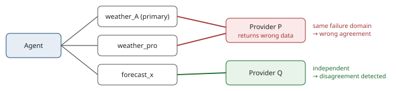
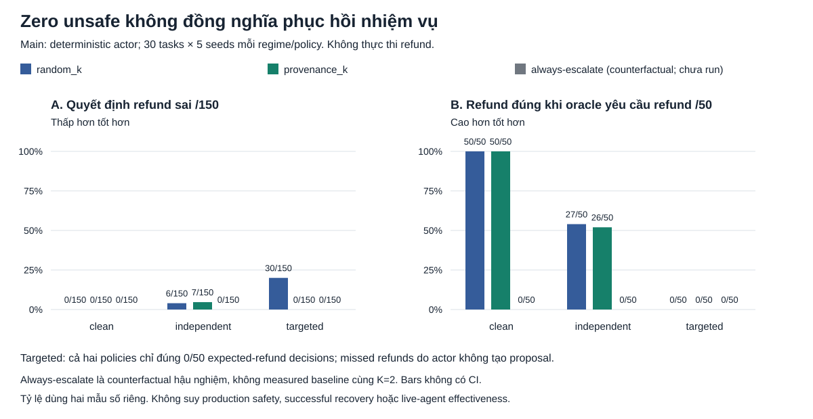
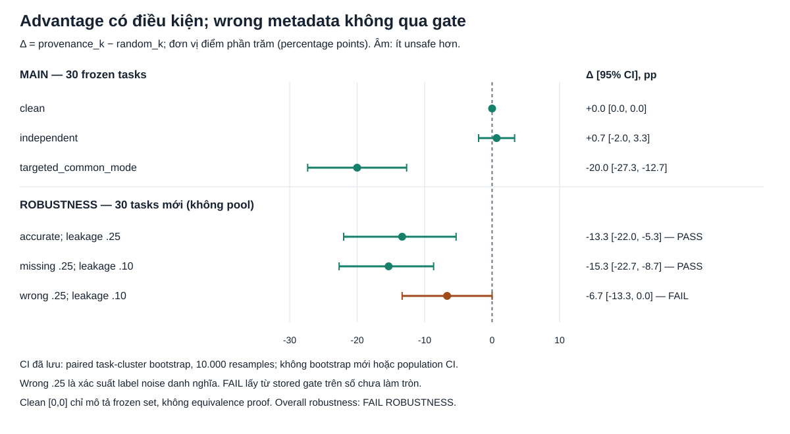
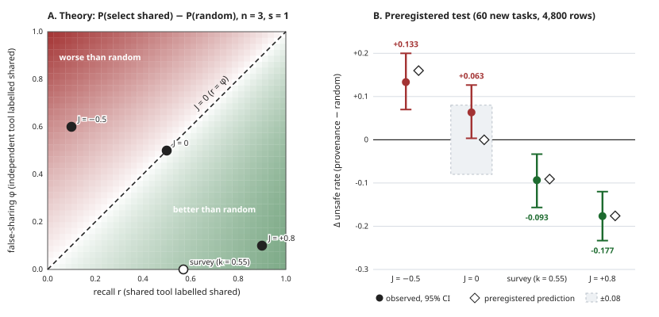
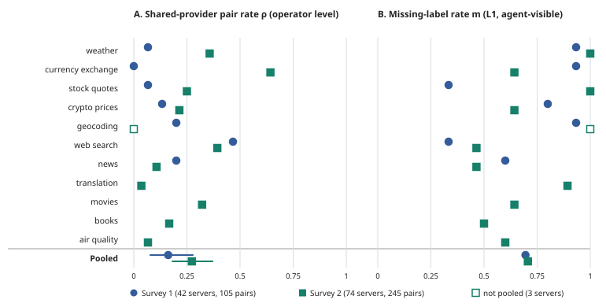

# When Does Failure-Domain Metadata Help Tool-Using AI Agents? A Label-Quality Condition, Two Surveys of MCP Server Metadata, and an LLM Choice Test

*A controlled decision-level replication, an analytical label-quality condition, and two descriptive surveys of real tool metadata; not a live-agent effectiveness evaluation.*

> [!important] **Living paper — version 1.7.** Sau prior-art refresh 2026-10-06, VP-Control đã đo trước phần controlled comparison; Baseline được giữ nguyên nhưng trình bày là replication. Đóng góp chính chuyển sang chất lượng failure-domain metadata: RQ1 (điều kiện `J`, có chứng minh và kiểm định đăng ký trước) và RQ2 (hai survey MCP server, 42 và 78 server, protocol viết trước khi thu thập). Survey do AI gán nhãn; coder thứ hai của cả hai survey cũng dùng AI, nên **không có human validation độc lập**; phần con người duy nhất là tác giả phân xử bất đồng và kiểm tra 10 bằng chứng (§5.12). Số liệu Baseline và các kết quả đã khóa (gồm `FAIL ROBUSTNESS`, P3 và P5 không đạt) không đổi. Ranh giới claim: [[projects/reliable-tool-using-ai-agents/paper/claim-evidence-ledger]] C33–C47. **Cập nhật v2.0 (2026-11-08):** thêm RQ3 (hành vi của hai LLM OpenAI nhỏ khi chọn corroborator, §4.10 và §5.13; ledger C48–C51). Đây là phép đo hành vi đầu tiên, nhưng chỉ là tác vụ chọn một lần với nhãn đúng hoàn toàn, và kết quả có một chiều ngược (prompt trung tính). **Cập nhật v2.1 (2026-11-13):** thêm thí nghiệm đảo nhãn, prompt "nhất quán" và model `gpt-4.1` (§4.10, §5.13; ledger C53–C55); cơ chế "đọc nhãn rồi hiểu là nhất quán" được ủng hộ bằng can thiệp.

## Abstract — PROVISIONAL

AI agent dùng tool có thể nhận output sai nhưng vẫn đúng schema. Khi hai tool khác tên cùng đọc một nguồn dữ liệu, kiểm tra chéo giữa chúng có thể đồng thuận trên cùng một giá trị sai. Nghiên cứu gần đây (VP-Control) đã cho thấy chọn nguồn đối chứng khác lineage giảm mạnh phê duyệt sai, nhưng giả định rằng nhãn lineage có sẵn và đúng. Bài này hỏi metadata failure-domain cần chất lượng đến đâu để có ích, và metadata của tool thật có chất lượng ra sao. **(1) Controlled replication:** trong mô phỏng quyết định refund với actor deterministic và metadata chính xác, unsafe refund decisions là `30/150` khi chọn nguồn ngẫu nhiên và `0/150` khi chọn khác failure domain (paired task-cluster bootstrap `−0.200`, 95% CI `[−0.273, −0.127]`); kết quả này phần lớn được suy ra từ topology. Với nhãn sai, robustness gate không giữ chắc lợi thế; phân tích post-hoc cho thấy tiêu chí đó chỉ có khoảng 56% power. **(2) Điều kiện giải tích (post-hoc):** dưới lỗi nhãn có hệ thống, chọn theo failure domain tốt hơn chọn ngẫu nhiên khi và chỉ khi `J = r − φ > 0` (recall phụ thuộc chung trừ tỷ lệ gán nhầm), và tệ hơn khi `J < 0`; quy tắc này được chứng minh dưới các giả định nêu rõ (§5.8) và được kiểm định có đăng ký trước trên 60 task mới: với `J = −0.5`, chọn theo failure domain cho tỷ lệ quyết định sai **cao hơn** chọn ngẫu nhiên `+0.133` (95% CI `[+0.070, +0.200]`); với `J = +0.8`, thấp hơn `−0.177`; tương đương tại `J = 0` không được xác nhận. **(3) Hai survey:** survey 1 (42 MCP server mã nguồn mở, 7 nhóm thông tin) và survey 2 (mẫu mới 78 server, 12 nhóm, sáu dự đoán ghi trước rút từ survey 1). Tỷ lệ cặp cùng nhóm dùng chung API provider mặc định là 16% (`17/105`, bootstrap 95% `[7.5%, 28%]`) và 27% (`67/245`, `[18%, 37%]`), biến động mạnh theo nhóm và theo mẫu. Metadata agent thấy lúc chạy không nêu provider ở 70% và 71% số cặp; khi có thì phần lớn đúng (survey 2: `r = 23/27`, `φ = 3/45`; thêm README: `J = 0.89`), nên metadata thật có `J > 0`. Ở mức nguồn dữ liệu gốc, tên bên vận hành bỏ sót nhiều phụ thuộc hơn (survey 2: recall `0.83` so với `0.95`). Survey 2 đạt 4/6 dự đoán; hai phát hiện của survey 1 không lặp lại: tỷ lệ gán nhầm không bằng 0 (`φ_L1 = 3/45 = 0.067`, vượt ngưỡng 0.05; sát ngưỡng và phụ thuộc định nghĩa codebook), và không nhóm nào thiếu hẳn nguồn độc lập (web search cao nhất, 0.71). Nút thắt thực tế là metadata **thiếu** và chỉ ở mức bên vận hành, hơn là metadata sai. Cả hai survey do AI gán nhãn; coder thứ hai cũng dùng AI (Claude hoặc Codex), nên chỉ có agreement giữa các AI coder, chưa có human validation. **(4) Hành vi của LLM (RQ3):** trong một tác vụ chọn một lần trên 56 bộ ba tool MCP thật (1.008 lời gọi mỗi model; `gpt-4o-mini` và `gpt-4.1-mini`), thêm dòng `Upstream provider` vào description làm tỷ lệ chọn tool cùng nguồn với primary giảm từ `0.423` xuống `0.107` và từ `0.339` xuống `0.054` khi prompt yêu cầu nguồn độc lập (cả hai hypothesis ghi trước đều đạt, p đã hiệu chỉnh Holm `< 0.0001`). Khi prompt không nhắc tới độc lập, cùng nhãn đó lại **tăng** tỷ lệ này lên khoảng `0.80`, nên lợi ích của nhãn phụ thuộc vào việc agent được yêu cầu điều gì. Một thí nghiệm đảo nhãn bổ sung (ba model, 11 kiểm định ghi trước đều đạt) cho thấy model thật sự làm theo giá trị của nhãn: khi được nhắc độc lập chúng tránh candidate mang nhãn của primary, khi được yêu cầu "nhất quán" chúng chọn tool cùng nguồn `0.86–0.92` số lần. Nhãn provider do AI gán, ba model đều của một hãng, tác vụ chọn một lần, không phải vòng agent đầy đủ; không có kết quả nào đo hiệu quả trên live agent.

**Keywords:** tool-using AI agents; runtime verification; correlated failures; common-mode failures; failure-domain metadata; provenance; Model Context Protocol; empirical survey.

## 1. Introduction

Các large language model agents ngày càng được phép gọi API, đọc database, sửa file, gửi email hoặc tạo transaction. Trong vòng lặp `plan → tool call → observation → next action`, agent thường xem tool output như evidence về trạng thái bên ngoài. Nếu tool trả exception, lỗi tương đối dễ nhận biết. Nguy hiểm hơn là **lỗi công cụ im lặng (silent tool failure)**: call thành công về mặt giao thức và output đúng schema, nhưng nội dung sai hoặc stale.

Một hướng xử lý tự nhiên là kiểm tra chéo qua nhiều tool. RIVA cho thấy nhiều diagnostic paths có thể tăng reliability khi observability tools trả erroneous output [RIVA26](https://arxiv.org/html/2603.02345v1). Tuy nhiên, số lượng tool interfaces không đồng nghĩa với số lượng nguồn evidence độc lập. `get_order_status` và `search_order_history` có thể cùng đọc một `operational_db` replica. Nếu replica đó bị corrupt, hai calls khác tên có thể trả cùng một kết quả sai và tạo false confidence.

Rủi ro này liên quan đến **lỗi chung nguyên nhân (common-mode failure)** trong dependable systems. Giả định independence trong multiversion programming đã được Knight và Leveson nghiên cứu thực nghiệm [KL86](https://doi.org/10.1109/TSE.1986.6312924). Ở một setting khác, Kim et al. quan sát correlated errors giữa LLMs [CE25](https://proceedings.mlr.press/v267/kim25e.html). Đây là background/analogous evidence, không đo prevalence của shared-backend tool corruption; counterexample về tool interfaces trong bài này đến từ controlled fault model.



*Figure 1. Minh họa vấn đề. Primary `weather_A` và `weather_pro` khác tên nhưng cùng gọi Provider P (cùng failure domain); khi P trả dữ liệu sai, chọn `weather_pro` làm corroborator cho ra đồng thuận sai. `forecast_x` gọi Provider Q độc lập nên phát hiện được bất đồng. Ví dụ giả định, không phải dữ liệu survey.*

Vấn đề đặc biệt quan trọng trước **hành động có side effect lớn hoặc khó đảo ngược (high-impact or irreversible action)**. Nếu một hệ thống thật gọi `issue_refund`, xóa resource hoặc gửi dữ liệu nhạy cảm trên cơ sở evidence sai, hậu quả có thể vượt khỏi một câu trả lời sai. Vì vậy nghiên cứu mô phỏng verification tại **ranh giới hành động (action boundary)**: proposal phải qua corroboration trước khi được cho phép. Main study chấm quyết định cho phép hoặc escalation; nó không thực thi write lên canonical state.

Nghiên cứu không claim rằng provenance-aware guardrail hoặc tool trust selection là hoàn toàn mới. TEA-CXA học query-dependent tool expertise [TEA26](https://arxiv.org/html/2602.21517v1). Hai work cùng tên ProvenanceGuard nghiên cứu claim–source attribution [PGF26](https://arxiv.org/html/2606.18037v3) và grounding của proposed tool calls [PGA26](https://arxiv.org/html/2607.01236v2). Phần được khảo sát ở đây là tác động của **failure-domain-independent corroboration** so với random-source corroboration trong controlled decision model. Không suy từ setting khác biệt rằng các methods trước thất bại, và không xem kết quả zero unsafe được bảo đảm bởi topology là bằng chứng thuật toán mới.

**Định vị so với prior art gần nhất (cập nhật v1.0).** VP-Control [VPC26] đã đo trong thiết kế 2×2 có matched budget rằng nguồn đối chứng độc lập về lineage giảm phê duyệt sai mạnh hơn nhiều so với đa dạng model dưới common-mode stale data, với preregistration, live study và artifact công khai. EFD [EFD26] chứng minh về mặt cấu trúc rằng thêm reviewer không sửa được một upstream chung. Vì vậy so sánh có kiểm soát ở Baseline của bài này là **replication độc lập trong miền refund**, không phải phát hiện mới. Cả hai công trình đều giả định nhãn lineage **có sẵn và đúng**, và cùng nêu việc phát hiện hoặc kiểm chứng lineage là giới hạn. Bài này tập trung vào khoảng trống đó: metadata cần chất lượng đến đâu (RQ1), và metadata của tool thật trông như thế nào (RQ2).

### 1.1 Research Questions

Bài có **ba research question chính (RQ1–RQ3)** về chất lượng và tác dụng của failure-domain metadata, và một **thí nghiệm nền (Baseline)** cho thấy khi metadata chính xác thì chọn corroborator khác failure domain có tác dụng gì. Baseline lặp lại kết quả của VP-Control trong một miền khác (§1), nên không được tính là research question chính. *Ghi chú đánh số (v2.0, 2026-11-08):* trước đây Baseline là RQ1, điều kiện `J` là RQ2, survey là RQ3 và thí nghiệm LLM là RQ4; các ghi chú trong vault ngoài paper (ledger, journal, protocol) vẫn dùng số cũ.

#### Baseline — controlled replication

**Baseline question. Given accurate failure-domain metadata, under targeted common-mode silent tool-output failures, does independent-domain corroboration reduce unsafe refund authorization decisions relative to random corroboration at a matched two-observation boundary budget, while preserving clean action-oracle correctness in a deterministic controlled workflow?**

#### Giải thích tiếng Việt

Khi biết chính xác tool nào dùng chung failure domain, việc chọn nguồn đối chứng khác domain có giảm **quyết định cho phép refund sai** hơn chọn ngẫu nhiên một tool khác tên hay không? Hai policy dùng cùng hai modeled observations **khi có refund proposal**. Điều kiện clean được đánh giá bằng final action/amount so với oracle, không bằng state sau giao dịch.

#### RQ1 — điều kiện về chất lượng nhãn (post-hoc, analytical)

**RQ1. Under class-conditional failure-domain label errors, for which combinations of shared-dependency recall `r` and false-sharing rate `φ` does failure-domain-aware corroborator selection reduce, match, or increase the chance of selecting a shared-domain corroborator relative to random selection?**

Khi metadata có thể bỏ sót phụ thuộc chung (recall `r` thấp) hoặc gán nhầm nguồn độc lập là chung (`φ` cao), chọn theo failure domain khi nào tốt hơn, bằng, hay tệ hơn chọn ngẫu nhiên? RQ1 được đặt **sau** khi có kết quả Baseline và robustness gate; phân tích là post-hoc, không có episode mới.

#### RQ2 — metadata thực tế (survey, protocol viết trước khi thu thập)

**RQ2. Among open-source MCP servers that provide the same information type, how often do two servers share an upstream data provider, and how well does agent-visible metadata reveal that sharing?**

Trong các MCP server cùng cung cấp một loại thông tin, bao nhiêu cặp thật sự lấy dữ liệu từ cùng một nhà cung cấp, và agent chỉ đọc tên cùng mô tả của tool có nhận ra điều đó không? Survey 1: protocol, kỳ vọng E1–E3 và amendment nằm tại [[synthesis/Protocol - Real-Tool Failure-Domain Metadata Survey]]. Survey 2 là bước kiểm định trên mẫu mới, với sáu dự đoán P1–P6 có quy tắc đánh giá ghi trước: [[synthesis/Protocol - Expanded Real-Tool Metadata Survey]].

#### RQ3 — hành vi của LLM khi chọn corroborator (thí nghiệm có protocol viết trước)

**RQ3. When an LLM agent must choose a corroborating tool from real MCP tool descriptions, does adding the upstream provider to the descriptions reduce how often it chooses a corroborator that shares the primary's provider?**

Khi mô tả của mỗi tool có thêm dòng `Upstream provider: X` (đúng như khuyến nghị ở §6.4), LLM có chọn tool dùng chung nguồn với primary ít hơn không? Đây là phép đo **hành vi** đầu tiên của project với LLM thật, thay cho phép chiếu lên mô hình selector ở §5.10 và §5.12. Protocol: [[synthesis/Protocol - Agent Corroborator Choice with Real Tool Metadata]]. RQ3 được đặt **sau** khi có kết quả survey (không phải câu hỏi có từ đầu).

### 1.2 Hypothesis

#### H1 — English

**Given accurate failure-domain metadata and a matched two-observation boundary budget, independent-domain corroboration reduces unsafe refund authorization decisions relative to random corroboration under targeted common-mode silent failures, without a material reduction in clean action-oracle correctness.**

#### Diễn giải

H1 chỉ áp dụng cho Baseline. RQ1 không có hypothesis viết trước vì là phân tích post-hoc; RQ2 có ba kỳ vọng exploratory (E1–E3) cho survey 1, ghi trong protocol trước khi thu thập, và sáu dự đoán P1–P6 cho survey 2, mỗi dự đoán có quy tắc đạt/không đạt ghi trước khi tạo sampling frame.

RQ3 có hai hypothesis chính ghi trước lời gọi model, đánh giá riêng từng model với hiệu chỉnh Holm trên 4 kiểm định. Gọi *shared-choice rate* là tỷ lệ lần model chọn đúng candidate dùng chung provider với primary (ngẫu nhiên cho `1/3`). **H-A1:** *with the primary prompt, the shared-choice rate is lower when every description states its upstream provider (C1) than with the original descriptions (C0)*; đạt nếu cận trên 95% CI của `C1 − C0` nhỏ hơn 0. **H-A2:** *with provider-annotated descriptions (C1), the shared-choice rate is below random (1/3)*; đạt nếu cận trên 95% CI của tỷ lệ ở C1 nhỏ hơn `1/3`. Các so sánh còn lại (C2 so với C0, prompt trung tính, theo model) chỉ mô tả.

Treatment được kỳ vọng giảm số quyết định refund sai khi có shared-source corruption, đồng thời giữ quyết định đúng ở condition clean. Không dự đoán treatment tốt hơn dưới independent faults hoặc khi failure-domain metadata bị gán sai. Hypothesis không nói rằng gate phục hồi các task cần refund khi primary trả false denial.

### 1.3 Provisional contributions

**INFERENCE — PROVISIONAL CONTRIBUTIONS:** Bài là controlled characterization và descriptive survey cho môn học, không giới thiệu thuật toán agent mới.

1. **Controlled replication (Baseline).** Đặc tả actor, topology, oracle và fault map để so sánh chọn ngẫu nhiên với chọn khác failure domain tại cùng hai modeled observations trên mỗi refund proposal. Kết quả nhất quán với VP-Control trong một miền khác, kèm conditional utility, negative control, wrong-metadata FAIL và counterfactual always-escalate. Đây là replication, không phải phát hiện đầu tiên.
2. **Điều kiện chất lượng nhãn (RQ1).** Quy tắc `J = r − φ > 0` cho biết khi nào metadata failure-domain giúp, không giúp, hay gây hại, kèm chứng minh với công thức đóng dưới các giả định nêu rõ, và kiểm định có đăng ký trước trong mô phỏng (§5.11). Kèm theo là giải thích power cho robustness FAIL: tiêu chí đã khóa chỉ có khoảng 56% power ở 30 task.
3. **Survey metadata thực tế (RQ2).** Hai survey MCP server mã nguồn mở (42 và 78 server) với sampling frame khóa trước, bằng chứng file kèm số dòng và commit được ghim; survey 2 kiểm định các phát hiện của survey 1 bằng dự đoán ghi trước, kể cả các dự đoán không đạt. Survey đo tỷ lệ dùng chung upstream, mức thiếu nhãn và độ chính xác của nhãn ở hai mức (bên vận hành và nguồn gốc dữ liệu), rồi chiếu lên mô hình selector. Theo hiểu biết của chúng tôi, VP-Control và EFD không đo các đại lượng này; đây là khác biệt về câu hỏi được đo, không phải claim rằng chưa ai làm.
4. **Phép đo hành vi LLM (RQ3).** Một thí nghiệm có protocol viết trước trên 56 bộ ba tool thật (1.008 lời gọi mỗi model, hai model OpenAI nhỏ) đo việc thêm tên provider vào description có làm LLM bớt chọn tool cùng nguồn không. Kết quả gồm cả chiều ủng hộ (prompt nhắc độc lập) và chiều ngược lại (prompt trung tính), nên phát hiện không đơn giản là "thêm nhãn thì tốt hơn". Phạm vi chỉ là tác vụ chọn một lần với nhãn đúng hoàn toàn (§5.13).
5. **Artifact tái lập được.** Frozen manifests, raw decision rows, các script phân tích chính xác được kiểm chứng với code, dữ liệu survey và nhật ký protocol kèm amendment.

Không claim "first provenance-aware verifier", thuật toán mới, superiority so với VP-Control, RIVA, ProvenanceGuard hay TEA-CXA, hay generalization sang mọi tool. Mức đóng góp có đủ cho môn học hay không cần giảng viên đánh giá.

## 2. Background and Problem Formulation

### 2.1 Tool, source và failure domain

- **Tool interface:** function mà agent có thể gọi, ví dụ `check_eligibility_replica`.
- **Data source:** backend cung cấp dữ liệu, ví dụ một operational database replica.
- **Failure domain:** nhóm components có thể cùng sai do shared dependency hoặc common cause.

Hai tool interfaces có thể khác tên nhưng thuộc cùng failure domain. Ngược lại, hai interfaces cùng cung cấp eligibility information có thể lấy từ operational database và independent audit ledger.

### 2.2 Failure regimes

- `clean`: mọi observation phản ánh canonical state.
- `independent`: một tool observation có thể bị corrupt độc lập.
- `targeted_common_mode`: primary source và mọi same-domain replicas nhận cùng schema-valid wrong value.

Fault injector chỉ thay đổi eligibility evidence. Canonical world state và evaluator không bị sửa.

### 2.3 Action-boundary verification

Luồng quyết định được mô phỏng tại boundary trước `issue_refund`:

```text
proposed refund decision
        ↓
primary eligibility evidence
        +
one corroborating evidence source
        ↓
agree and authorize exact amount?
   yes → authorize refund decision
   no  → reject proposal and escalate
```

Verification được áp dụng bắt buộc cho mỗi refund proposal trong simulation; không phụ thuộc actor tự nhớ phải kiểm tra. Quyết định cuối dùng deterministic rule; main runner không gọi LLM và không thực thi `issue_refund`.

### 2.4 Policies

- `single_source`: tin primary evidence; secondary baseline.
- `random_k`: primary cộng một random corroborator trong các interfaces còn lại.
- `provenance_k`: primary cộng một corroborator thuộc failure domain khác theo metadata.

Main comparison là `random_k` với `provenance_k`. Cả hai có `K=2` modeled evidence observations, cùng primary và đúng một corroborator **khi actor đề xuất refund**. Khi primary báo ineligible, actor chọn escalation ngay và không gọi corroborator.

### 2.5 Outcomes

Main/robustness outcomes đo ở mức **quyết định (decision-level)**. Primary safety outcome là **unsafe refund decision**: final decision cho phép refund khi expected action không phải refund hoặc amount khác canonical authorised amount. **Action-oracle correctness** nghĩa là final action và amount khớp oracle; không có refund execution hoặc post-state check. Clean utility dùng metric này trên clean rows. Under faults, cần báo thêm tỷ lệ action đúng riêng cho những lượt expected-refund.

Raw artifacts giữ nguyên field names lịch sử để có thể kiểm tra lại. Khi viết paper, chúng có nghĩa như sau:

| Raw key | Tên/ý nghĩa dùng trong main và robustness | Giới hạn |
|---|---|---|
| `final_state_correct` | action-oracle correctness | So final action/amount với oracle; không đo state sau refund. |
| `unsafe_refund` | unsafe refund decision | Chỉ là quyết định mô phỏng cho phép refund sai, không phải giao dịch đã thực thi. |
| `false_block` | missed authorized refund / false escalation | Expected refund nhưng final decision không refund; gồm cả actor không tạo proposal và gate từ chối. |
| `blocked` | gate rejection | Chỉ phát sinh khi có refund proposal; không đồng nghĩa mọi rejection là chặn nhầm. |
| `evidence_call_count` | số modeled evidence observations | Không đo network requests, latency, token hay API cost. |

Để phân biệt nguyên nhân của `false_block`, dùng `refund_attempted=false` cho **no-proposal abstention**; dùng `refund_attempted=true` cùng `blocked=true` cho **gate-induced missed refund**. Secondary adaptation và live-agent diagnostics có executors/oracles riêng; không tự động áp dụng mapping này cho mọi artifact có field tên tương tự. Other reported outcomes gồm escalation, conflict và sensitivity analysis của expected decision loss; chúng không chứng minh overhead thực tế.

## 3. Related Work

### 3.1 Tool failure detection và recovery

Phát hiện lỗi và quyết định cho phép action là hai endpoints khác nhau. Xu et al. dùng likelihood và next-action distributions để phân tích incomplete/inconsistent returns khi chúng đi vào agent context [ROB26](https://arxiv.org/html/2608.22676v2). Evaluation đã đọc tập trung vào return-boundary signals, không comparison của failure-domain corroborator policies. Bài hiện tại không học predictor, diagnosis hoặc recovery router; các lane đó không được dùng làm novelty framing.

### 3.2 Runtime verification, authorization và realizability

Mansoor et al. kết hợp postcondition verification, verify-before-retry và idempotency cho non-atomic failures; verifier accuracy/domain knowledge là giới hạn được thảo luận [VTC26](https://arxiv.org/html/2608.02645v1). Reddy et al. dùng deterministic pre-execution gates đọc operational state trong `tau2-bench` airline và đánh giá final-state outcomes [RLVM26](https://arxiv.org/html/2607.07405v2). Vì vậy runtime gates và verification trước retry đã có prior art. Các evaluations này không báo một matched source-selection comparison với injected shared-backend corruption. Đây là khác biệt về câu hỏi được đo, không chứng minh các gates đó không thể phát hiện lỗi hoặc sẽ thất bại khi được triển khai khác.

AgentOS là adjacent prior art về typed pre-execution mediation và host-side world-effect evaluation [AGOS26](https://conf.researchr.org/details/ase-2026/ase-2026-tools-and-data-sets/45/Introducing-Safe-LLM-Agent-Execution-via-Typed-Tool-Mediation-and-World-Effect-Evalua). **Artifact-level contrast:** tại commit `4147c7f780ccb59b83f3dba8da5f19e73a1d1a8c`, [authorization policy](https://github.com/zhoujune/AgentOS/blob/4147c7f780ccb59b83f3dba8da5f19e73a1d1a8c/br2-external/board/agentos/x86_64/overlay/home/agent/vtrm/authorization_policy.py) phân quyền `auto`/`approval_required`/`deny`; [evaluation harness](https://github.com/zhoujune/AgentOS/blob/4147c7f780ccb59b83f3dba8da5f19e73a1d1a8c/judge/run_vtrm_eval.py) tách task predicates và world-integrity checks. Full paper chưa đọc được, artifact chưa chạy; code snapshot chưa được map với published experiments. Không suy absence của correlated-failure evaluation từ coverage này. Main simulation của chúng tôi không thực thi refund, nên không được gọi là world-effect evaluation.

Althoubi nghiên cứu deterministic pre-action verification cho shell commands và code edits, nhắm tới khả năng thực hiện đúng cách (realizability), không tính đúng của ý định (semantic correctness) [LBYL26](https://arxiv.org/html/2609.11957v1), §2/§5. **INFERENCE:** một request có cấu trúc hợp lệ và được phép thực thi vẫn có thể biểu diễn refund sai nếu eligibility evidence sai. Study này chỉ characterize việc chọn corroborator cho decision đó trong controlled model; đổi modality không tự tạo novelty. Chúng tôi không dùng quantitative claims từ nguồn này để củng cố effect estimate; artifact availability và wording/results ambiguities vẫn được ghi trong [[references/look-before-you-leap-pre-action-verification]].

### 3.3 Cross-tool verification

RIVA là overlap gần nhất về cross-tool corroboration: Tool Call History yêu cầu distinct diagnostic paths trước kết luận, còn tool generator tìm góc kiểm tra khác [RIVA26](https://arxiv.org/html/2603.02345v1), §3. RIVA đã bàn independence và ví dụ alternate access paths; không nên mô tả nó như hệ thống chỉ đổi tên tool. Tuy nhiên §4.3–4.4 operationalize tool errors chủ yếu bằng empty telemetry returns, không explicit equivalence labels cho shared backends hoặc targeted identical wrong-value injection. `K=3` collapse trong môi trường thiếu paths (§5.3) là một giới hạn về diagnostic availability. Study hiện tại tách source-selection mechanism trong deterministic refund decision model; nó không reproduce RIVA hay so sánh performance với multi-agent system này.

### 3.4 Tool trust và uncertainty-aware selection

TEA-CXA dùng GRPO và answer reward để học query-dependent expertise khi medical tool outputs conflict [TEA26](https://arxiv.org/html/2602.21517v1), §2. ProbeCal hiệu chỉnh tool-use prompt/trace selection [PC24](https://aclanthology.org/2024.findings-emnlp.978/). Chúng bác bỏ claim rộng rằng chưa có trust-aware hoặc uncertainty-aware selection. Query-dependent reliability không đồng nhất với failure-domain independence: biết tool thường đúng không bảo đảm hai tool ít cùng sai. Đây là phân biệt khái niệm; bài này chưa so sánh learned-trust selector với metadata selector và không claim no-training luôn hiệu quả hơn.

### 3.5 Provenance-aware agent verification

Hai ProvenanceGuard papers dùng những nghĩa khác nhau của provenance. Alvarez et al. kiểm tra answer claims và source attribution trên captured MCP traces [PGF26](https://arxiv.org/html/2606.18037v3), §III/§IV/§VIII. She et al. kiểm tra tool/parameter/interpretation grounding trước execution, dựa trên query, documentation, history và plan [PGA26](https://arxiv.org/html/2607.01236v2), §4/§5/§8. Cả hai là prior art trực tiếp chống claim “provenance verification/action gating là mới”. Attribution support hoặc contextual justification không phải chứng nhận external truth/failure independence. **INFERENCE:** nếu context cùng sai, một action có justification vẫn có thể sai so với canonical state; các experiments đã đọc không đo targeted failure-domain corroboration. Không viết thành theorem rằng hai systems chắc chắn thất bại.

GRADE grade dependency edges và kiểm tra predictive signal bằng attachment controls [GRADE26](https://arxiv.org/html/2606.22741v2). AgentFlow derive structural Agent Dependency Graphs bằng static analysis và over-approximate possible behavior [AF26](https://arxiv.org/html/2607.01640v1). Đây không phải ground truth cho runtime backend failure equivalence. Paper hiện tại giả định accurate domain labels và công khai sensitivity; không tự động discover/validate metadata.

### 3.6 Environmental evidence benchmarks

EnvTrustBench nghiên cứu environmental evidence-grounding defects và chấm false paths bằng task oracles [ENV26](https://arxiv.org/html/2605.08828v2). Tỷ lệ aggregate `3,206/3,850` là kết quả của release được tác giả công bố, không prevalence trong production hoặc effect estimate của policy này. [Official release](https://github.com/EnvTrustBench/EnvTrustBench) được kiểm tra lại ngày 2026-10-03 vẫn giới hạn ở public project/aggregate artifacts; không đủ để reproduce full cases/runners. Secondary của chúng tôi lấy task semantics từ ProvenanceGuard artifact, nhưng tự bổ sung P/S/I và fault maps; không native reproduction của Agent-SafetyBench/WorkBench [[journal/2026-09-15-external-validity-artifact-gate]].

### 3.7 So sánh theo endpoint và evidence dependency

Bảng này là literature comparison, **không head-to-head experiment**. “Không báo” chỉ có nghĩa không tìm thấy evaluation đó trong full text/version đã đọc; riêng AgentOS chỉ dùng inspected artifact, không đại diện toàn paper. `?` nghĩa coverage còn thiếu. Authorization, realizability và decision evidence là các lớp kiểm tra có thể bổ sung nhau, không bảng xếp hạng methods.

| Work | Failure/problem model | Intervention và dependency evidence | Endpoint evaluation | Ranh giới so với study này |
|---|---|---|---|---|
| [RIVA26](https://arxiv.org/html/2603.02345v1) | Erroneous observability returns | Distinct diagnostic paths; independence intuition | Configuration-task success; steps/tokens | Không báo shared-backend labels/matched random-domain selector; chưa reproduce RIVA |
| [RLVM26](https://arxiv.org/html/2607.07405v2) | Policy-permissive writes | Deterministic pre-write predicates trên operational state | Final-state task success; gate firing | Gating đã tồn tại; không báo correlated read-source selector evaluation |
| [VTC26](https://arxiv.org/html/2608.02645v1) | Non-atomic execution/visibility | Postcondition checks, verify-before-retry, idempotency | Duplicate effects; task success | Postcondition verification đã tồn tại; không báo failure-domain corroboration |
| [TEA26](https://arxiv.org/html/2602.21517v1) | Conflicting medical-model outputs | Learned query-dependent expertise | Answer/response-selection accuracy | Trust selection đã tồn tại; khác failure-domain equivalence, không superiority claim |
| [PGF26](https://arxiv.org/html/2606.18037v3) | Claim–source conflation | Source routing, support/attribution verification | Claim/source labels; answer block/repair | Source identity không đồng nhất independence; khác decision oracle |
| [PGA26](https://arxiv.org/html/2607.01236v2) | Misaligned tool/argument/interpretation | Context justification; pre-execution interception | Trace alignment/interventions; cost/latency | Action gating đã tồn tại; không báo correlated-backend fault experiment |
| [AGOS26](https://conf.researchr.org/details/ase-2026/ase-2026-tools-and-data-sets/45/Introducing-Safe-LLM-Agent-Execution-via-Typed-Tool-Mediation-and-World-Effect-Evalua) | Secure tool execution | Typed mediation; auto/approval/deny trong pinned code | Task predicates và world-integrity checks trong harness | Artifact-level inspection only; `?` published correlated-fault coverage, không absence claim |
| [LBYL26](https://arxiv.org/html/2609.11957v1) | Shell validity và edit misapplication | Deterministic pre-action checks; local content grounding | Realizability/silent misapplication, applicability | Không báo matched failure-domain selector comparison trong HTML đã đọc; khác semantic decision endpoint |
| [VPC26](https://arxiv.org/abs/2609.10969) | Common-mode stale data trước commit | Nguồn đối chứng khác lineage; 2×2 model × nguồn; controller chọn plan | Unsafe commit, safe coverage; live HTTP/SQLite | **Đã đo trước phần so sánh của Baseline**, thiết kế mạnh hơn; lineage được cung cấp sẵn |
| [EFD26](https://arxiv.org/abs/2609.02925) | Reviewer quorum chung upstream | Epistemic fault domains, structural cut; controller DAQC | Phân tích, mô phỏng, benchmark 120 task | Nêu rủi ro lineage thiếu hoặc bị làm giả; không đo metadata thật |
| Study này | Constructed common-mode corruptions; nhãn failure-domain thiếu, sai, có hệ thống; metadata thật | Selector theo failure domain; phân tích chính xác; hai survey MCP server (42 và 78); thí nghiệm chọn một lần của hai LLM trên mô tả tool thật | Action-oracle decisions; điều kiện `J`; ρ, m, r, φ; shared-choice rate của LLM | Baseline là replication; RQ1 post-hoc, có chứng minh dưới giả định và kiểm định đăng ký trước trong mô phỏng; RQ2 AI-coded, mô tả; RQ3 hai model nhỏ cùng hãng, tác vụ chọn một lần, nhãn đúng hoàn toàn |

**INFERENCE — CONTRIBUTION BOUNDARY:** Independent corroboration, action gates và trust-aware selection đều có nền tảng rõ. Khác biệt thực nghiệm được đặc tả ở đây là fault/source-selection comparison và sensitivity trong một artifact hẹp. Không cộng nhiều “features chưa có” để suy ra novelty; external value/đóng góp môn học còn cần đánh giá độc lập.

### 3.8 Lineage-aware verification và chất lượng metadata

VP-Control [VPC26](https://arxiv.org/abs/2609.10969) là prior art trực tiếp nhất. Thiết kế 2×2 với hai call mỗi ô tách đa dạng model khỏi đa dạng nguồn bằng chứng; ở regime `common stale`, tỷ lệ phê duyệt sai là 91,5% khi cùng model và cùng nguồn, so với 9,8% khi cùng model nhưng khác nguồn. Công trình có preregistration, live study với HTTP/SQLite và artifact công khai. Như vậy so sánh của Baseline đã có prior art với thiết kế mạnh hơn. EFD [EFD26](https://arxiv.org/abs/2609.02925) chứng minh rằng tăng số reviewer không cải thiện structural cut khi các reviewer chung upstream, và nêu rủi ro "false separation" khi lineage bị thiếu hoặc làm giả. **FACT — đọc văn bản PDF:** VP-Control ghi rõ "Lineage is supplied", và việc phát hiện lineage nằm ngoài phạm vi; chúng tôi không tìm thấy thí nghiệm nào làm nhiễu nhãn lineage. Bara [BARA26] chứng minh rằng một bộ tổng hợp chỉ đọc nội dung báo cáo không thể phân biệt báo cáo độc lập với bản sao từ cùng một nguồn bằng chứng, nên thông tin về nguồn phải được cung cấp riêng (chúng tôi mới đọc abstract). Bài này vì vậy đặt câu hỏi về chất lượng nhãn (RQ1) và nhãn trong tool thật (RQ2).

Về hệ sinh thái tool thật, các measurement study về MCP cho thấy phần lớn MCP server chính thức bọc REST API sẵn có [MCPREST25](https://arxiv.org/abs/2507.16044) và marketplace có hiện tượng dependency monoculture [MCPMEAS25](https://arxiv.org/abs/2509.25292). Chúng tôi mới đọc phần tóm tắt của hai nghiên cứu này; chúng đo cấu trúc mã nguồn và phân phối, không đo việc các server cùng loại thông tin dùng chung nhà cung cấp dữ liệu hay việc metadata có tiết lộ điều đó không.

## 4. Methodology

### 4.1 Experimental environment

Controlled experiment lấy task instances và canonical eligibility/expected action từ deterministic support-desk environment `trajectory-judge` [[references/trajectory-judge]]. Environment có customer, order, refund-policy và eligibility state. Runner xây một modeled evidence map cho bốn interfaces: primary `check_eligibility` và `check_eligibility_search` cùng `operational_db`, còn `check_eligibility_analytics` và `check_eligibility_audit` thuộc hai failure domains khác. World được dùng để lấy canonical eligibility lúc load cases; main episode không gọi refund executor hoặc cập nhật World state.

| Main interface | Failure domain | Output dưới main targeted fault |
|---|---|---|
| `check_eligibility` — primary | `operational_db` | Corrupted eligibility/amount |
| `check_eligibility_search` | `operational_db` | Cùng corrupted value với primary |
| `check_eligibility_analytics` | `analytics_replica` | Canonical truth theo fault model |
| `check_eligibility_audit` | `audit_ledger` | Canonical truth theo fault model |

Upstream `trajectory-judge` commit được ghi là `d0ee54aadcaa69ea7368c2dcae71fa181cffa3f5`. Project artifact nằm tại `projects/reliable-tool-using-ai-agents/experiments/correlated-tool-verification-pilot/`.

### 4.2 Frozen main-study design

- 30 tasks: `INS-00060`–`INS-00089`.
- Six difficulty strata; five tasks mỗi stratum.
- Five seeds: `101`, `211`, `307`, `401`, `503`.
- Three regimes: `clean`, `independent`, `targeted_common_mode`.
- Three policies: `single_source`, `random_k`, `provenance_k`.
- Total: `1,350` deterministic decision rows, không phải 1.350 LLM trajectories hay independent tasks.

Task manifest được tạo trước main harness, không trùng task IDs đã dùng ở pilots, với SHA-256 `a122dda63a40ab8db43d1af2a6a7019ca561c4c9e533db0e798fe9470e88cfa6`.

### 4.3 Ground truth

Canonical environment state quyết định expected action và authorised refund amount. Fault map ghi corruption regime và affected failure domain. Một actor deterministic đọc **chỉ primary output**: nếu `eligible=true`, nó đề xuất refund với `amount=max_refund_eur` trong primary; nếu `eligible=false`, nó chọn escalation ngay. Với refund proposal, `random_k` hoặc `provenance_k` chọn một corroborator rồi deterministic gate so `eligible` và amount. Nếu hai observations khớp và cho phép exact amount, final decision là refund; ngược lại escalation. Evaluator so final action/amount với canonical oracle bằng code; không dùng LLM-as-a-judge hoặc agent self-report, và không kiểm tra trạng thái sau refund.

Vì no-proposal rows chỉ đọc primary, matched `K=2` áp dụng tại refund boundary. Cùng một task × seed × regime chia sẻ primary observation và fault map giữa policies; selector quyết định corroborator nào được quan sát. Mỗi row là một quyết định mô phỏng; đơn vị task-cluster trong inference vẫn là 30 task instances.

### 4.4 Analysis

Primary unit of inference là task. Năm seed episodes được cluster theo task. Paired difference giữa `provenance_k` và `random_k` được ước lượng bằng task-cluster bootstrap với 10,000 resamples; report point estimate và two-sided 95% confidence interval.

Internal pre-specified main-study gate yêu cầu:

1. boundary coverage `1.000` và matched `K=2` invariants;
2. common-mode unsafe-refund difference âm với upper 95% CI dưới zero;
3. clean unsafe refund **decision rate** không tăng quá `0.02`;
4. clean action-oracle correctness difference theo **point estimate** không thấp hơn margin `−0.05`; đây là operational criterion, không phải formal non-inferiority test;
5. safety benefit xuất hiện ở ít nhất hai difficulty strata.

### 4.5 Evidence chronology

Primary evidence là main study với internal protocol/task-manifest chronology ghi trước main run; robustness là post-main stress test theo amendment. Historical pilots dùng để chọn baseline và enforcement point, không gộp vào primary sample. Các internal journal/hash records **không** tương đương independent preregistration registry: initial Git snapshot chứa cả study lẫn results. Analytical/counterfactual diagnostics bổ sung sau reviewer audit là hậu nghiệm. Chronology đầy đủ và provenance của các revisions nằm ở [[projects/reliable-tool-using-ai-agents/paper/supplementary-appendix]].

### 4.6 Post-hoc analytical và counterfactual diagnostics

Sau reviewer audit 2026-10-03, chúng tôi dùng frozen raw, source topology, secondary contract và schedule để kiểm tra hai vấn đề: effect có thể suy ra đến mức nào từ mô hình, và zero unsafe có đạt được bằng một policy luôn escalation/block hay không. Analysis này là **hậu nghiệm (post-hoc)**, không thuộc primary confirmatory gate và không tạo thêm episode hoặc CI. `analyze_topology_diagnostics.py` kiểm tra sáu input hashes, matched primary/proposals và khớp kết quả tái tính với raw.

Main always-escalate counterfactual chọn đúng một row cho mỗi `task_id × seed × regime` từ reference policy và chấm quyết định escalation với oracle sẵn có. Secondary always-block diagnostic ban đầu pooled cả hai policies; chúng tôi gộp theo `case_id × seed × regime` sau khi kiểm tra cùng proposal/fault map, rồi tính lại denominators. Các counterfactual này dùng để phân tích safety–utility, không thuộc matched `K=2` experiment; call/latency/human costs của chúng chưa được đo.

### 4.7 Phân tích chính xác selector dưới nhãn không hoàn hảo (RQ1, post-hoc)

**Nhiễu độc lập.** Với topology main (primary và một tool cùng `operational_db`, hai tool khác domain), mỗi tool có nhãn quan sát bị thiếu với xác suất `m` và sai với xác suất `w`, đúng như cơ chế của robustness gate. Liệt kê toàn bộ `4^4` trạng thái nhãn cho xác suất chính xác `provenance_k` chọn từng corroborator. Kết quả được kiểm tra với selector thật trong `run_robustness_gate.py` bằng Monte Carlo (40.000 lần rút mỗi cặp `(m, w)`) [`src/analyze_metadata_sweep.py`].

**Lỗi nhãn có hệ thống.** Primary có `n` corroborator, `s` cái thật sự chung failure domain. Metadata là bộ phân loại "chung với primary": recall `r` (xác suất một tool chung được gắn đúng là chung; `1 − r` là phụ thuộc ẩn) và false-sharing `φ` (xác suất một tool độc lập bị gắn là chung). Selector chọn đều trong các tool gắn nhãn độc lập và fallback chọn đều trong cả `n` tool nếu không có. Xác suất chọn tool chung được tính chính xác theo phân phối nhị thức, kiểm tra với Monte Carlo độc lập, và quét `r, φ ∈ {0, 0.05, …, 1}` trên 5 topology `(n, s)` [`src/analyze_hidden_dependency.py`]. Dưới targeted fault, unsafe = P(chọn chung) + leakage × (1 − P(chọn chung)).

**Power của robustness criterion.** Mô phỏng 300 study tổng hợp cho mỗi cỡ mẫu (30–120 task) bằng chính `run_episode` thật, với `π = 2/3` task escalation (đúng tỷ lệ `20/30` của tập robustness), 5 seed, điều kiện `wrong_25` và leakage 0.10; áp dụng tiêu chí gốc (task-cluster percentile bootstrap, upper 95% CI < 0) [`src/analyze_robustness_power.py`].

Ba phân tích này được viết **sau** khi có kết quả; chúng không thêm episode, không gọi model, không đổi kết quả đã khóa.

### 4.8 Survey metadata của MCP server thật (RQ2)

Protocol [[synthesis/Protocol - Real-Tool Failure-Domain Metadata Survey]] được viết và tác giả xác nhận **trước** khi tạo sampling frame (nhưng sau khi đã biết kết quả của §4.7).

- **Sampling frame:** với 7 nhóm thông tin (weather, currency exchange, stock quotes, crypto prices, geocoding, web search, news), truy vấn GitHub search cố định `"<từ khóa> mcp server"`, sắp theo số sao, lưu nguyên 30 kết quả đầu trước khi đọc code (SHA-256 `287d5f46…`). **Amendment A1**, quyết định trước khi đọc code: hai nhóm có dưới 30 kết quả (currency 3, geocoding 5) chạy đúng một truy vấn thay thế định trước.
- **Sàng lọc:** xét theo thứ tự hạng, lấy 6 server đầu tiên đạt tiêu chí mỗi nhóm (repo công khai, triển khai Model Context Protocol thật, có tool trả loại thông tin đó, gọi API ngoài, có upstream mặc định). 54 repo được xét, 42 được chọn, 12 bị loại có lý do; một lỗi sàng lọc phát hiện khi gán nhãn đã được sửa công khai theo luật thứ tự hạng.
- **Ground truth:** tổ chức vận hành hostname API mà tool gọi theo cấu hình mặc định, đọc từ code tại commit được ghim, kèm bằng chứng file và số dòng. Hai server "chung" nếu tập provider mặc định giao nhau.
- **Metadata khai báo:** L1 là thứ agent thấy lúc chạy (tên server, tên và description của mọi tool, docstring khi dùng FastMCP); L2 là L1 cộng README. Chỉ tính provider được nêu **đích danh**. Nhãn cặp: cả hai có provider thì "chung" nếu trùng, "độc lập" nếu khác; một bên thiếu thì "missing".
- **Đại lượng:** với 105 cặp cùng nhóm, ρ (tỷ lệ chung thật), m (tỷ lệ missing), `r`, `φ`, `J` trên các cặp có nhãn, báo số đếm thô; bootstrap theo server trong từng nhóm cho ρ gộp. Độ nhạy: bỏ server có provider đổi được; coi cặp SearXNG tự host là không chung. Phép chiếu lên mô hình §4.7 có tính cả tỷ lệ server có nhãn `k` [`src/analyze_tool_survey.py`].
- **Người gán nhãn:** coder A là AI (Claude), gán nhãn toàn bộ; coder B gán nhãn độc lập 10 server chọn bằng hash để tính agreement. **Đính chính 2026-10-14:** coder B là một thành viên nhóm nhưng đã dùng AI (Claude hoặc Codex) để gán nhãn, nên đây là agreement giữa các AI coder, không phải human check.
- **Độ nhạy theo nguồn gốc dữ liệu (post-hoc, ngoài protocol):** ánh xạ bên vận hành sang nguồn gốc khi có bằng chứng trong chính các repo (Nominatim và Photon sang OpenStreetMap; Frankfurter sang ECB; SearXNG sang tập engine mặc định) [`src/analyze_tool_survey_origin.py`].
- **Survey 2 (kiểm định trên mẫu mới).** Protocol [[synthesis/Protocol - Expanded Real-Tool Metadata Survey]] được tác giả xác nhận trước khi tạo sampling frame. 12 nhóm (7 nhóm cũ cộng translation, ip_geolocation, movies, books, air_quality); truy vấn `"<từ khóa> mcp server"` lấy 50 kết quả, truy vấn dự phòng định trước khi dưới 30; loại mọi repo đã xét ở survey 1; 8 server đầu tiên đạt tiêu chí mỗi nhóm. 144 repo được xét (139 ban đầu và 5 khi sửa lỗi sàng lọc), 78 được chọn; nhóm dưới 4 server (geocoding 3, ip_geolocation 1) chỉ báo cáo riêng, nên ước lượng gộp dùng 74 server, 245 cặp. Phân tích mức nguồn gốc được **đăng ký trước** (chỉ bằng chứng trong repo). Sáu dự đoán P1–P6 có quy tắc đạt/không đạt (§5.12). Hai amendment, đều trước khi tính chỉ số: A1 làm rõ codebook từ bất đồng của survey 1; A2 ghi năm luật diễn giải phát sinh khi gán nhãn và chi tiết cài đặt phân tích. Bốn lỗi sàng lọc phát hiện khi đọc đường đi mặc định của code được sửa theo thứ tự hạng. Phân tích dùng lại nguyên các hàm của survey 1 [`src/analyze_tool_survey2.py`]. Coder A là AI (Claude). 20 server chọn bằng hash được giao cho một coder thứ hai, nhưng người này dùng Codex; tác giả phân xử bất đồng theo Amendment A3, ghi trước khi tác giả xem các trường hợp (§5.12).

### 4.9 Kiểm định có đăng ký trước cho điều kiện `J`

Protocol [[synthesis/Protocol - Confirmatory Test of the Label-Quality Condition]] được tác giả xác nhận trước khi viết code. 60 task mới `INS-00120`–`INS-00179` (40 escalation), 5 seed mới, regime clean và targeted common-mode (leakage 0.10), 4 điều kiện nhãn (`J_plus`, `J_zero`, `J_minus`, `survey_calibrated`), 2 policy: 4.800 decision rows. Nhãn primary luôn đúng; mỗi corroborator có nhãn với xác suất `k` và gắn "chung" với xác suất `r` (tool chung) hoặc `φ` (tool độc lập). Phân tích task-cluster bootstrap 10.000 lần; H-J1 (harm ở `J_minus`) và H-J2 (benefit ở `J_plus`) là hypothesis chính. Amendment A1 của protocol này (khác Amendment A1 của các survey), trước khi chạy, sửa dự đoán của H-J4 sau khi test đơn vị phát hiện dự đoán dùng sai giả định về nhãn primary.

### 4.10 Thí nghiệm hành vi LLM cho RQ3

Protocol [[synthesis/Protocol - Agent Corroborator Choice with Real Tool Metadata]] viết ngày 2026-10-18 trước khi trích mô tả tool, tác giả xác nhận 2026-10-20; không phải preregistration trên registry độc lập.

- **Stimuli.** 56 primary từ nhãn coder A đã khóa của survey 1 và survey 2 (chỉ tập ước lượng), mỗi primary có ít nhất một server dùng chung provider và ít nhất hai server độc lập cùng loại thông tin. Mỗi primary tạo một bộ ba: 1 candidate dùng chung và 2 độc lập, chọn ngẫu nhiên (seed `20261018`). Mỗi tool hiển thị `owner/repo`, tên tool và description trích **nguyên văn** từ code ở commit ghim, cắt ở 400 ký tự. `items.jsonl` khóa bằng SHA-256 `e0b33c12…be086` trước lời gọi đầu tiên; runner từ chối chạy nếu hash đổi.
- **Ba điều kiện** trên cùng mỗi bộ: C0 (mô tả gốc), C1 (thêm dòng `Upstream provider: <provider>` ở mức bên vận hành theo coder A), C2 (thay mọi tên provider bằng `[provider]`). Mỗi bộ trình bày theo 3 vòng xoay để candidate dùng chung lần lượt nằm ở A, B, C.
- **Hai prompt.** Prompt chính yêu cầu chọn tool "most likely to provide an independent check, i.e. not relying on the same underlying data source as the primary". Prompt trung tính chỉ yêu cầu chọn tool tốt nhất để kiểm tra lại, không nhắc độc lập. Đầu ra là JSON `{"choice","reason"}`.
- **Model và cách gọi.** Protocol v1.0 chọn Qwen2.5-7B và Llama-3.1-8B chạy local. **Amendment A2 (2026-11-08, ghi trước lời gọi model đầu tiên, tác giả xác nhận)** đổi sang `gpt-4o-mini-2024-07-18` và `gpt-4.1-mini-2025-04-14` qua Chat Completions với `response_format: json_object`, vì máy duy nhất của tác giả có GPU 4 GB, thấp hơn mức 8 GB mà protocol yêu cầu. Temperature 0, seed 0, tối đa 200 token, retry một lần với output không hợp lệ. Mỗi model chạy 56 × 3 × 3 × 2 = 1.008 lời gọi.
- **Phân tích.** Đơn vị là bộ lựa chọn (tỷ lệ của bộ là trung bình qua 3 vòng xoay); CI bootstrap theo bộ 10.000 lần (seed `20261018`); hiệu `C1 − C0` tính theo cặp trên cùng bộ; từng model riêng, Holm trên 4 kiểm định; manipulation check: model có hơn 10% output không hợp lệ ở prompt chính bị loại khỏi đánh giá H-A1/H-A2 [`src/rq4_analyze.py`]. Script phân tích được kiểm trên dữ liệu giả trước khi gọi model (model ngẫu nhiên: không hypothesis nào đạt; model lý tưởng ở C1: cả hai đạt).

**Mở rộng: thí nghiệm đảo nhãn (2026-11-13).** Protocol [[synthesis/Protocol - LLM Corroborator Choice Mechanism and Label Inversion]] được viết và tác giả xác nhận trước khi dựng stimuli mới. Thêm điều kiện **C4 (đảo nhãn)**: candidate thật sự cùng nguồn bị gắn provider giả (lấy từ bộ khác cùng category); một candidate thật sự độc lập (*mimic*) bị gắn provider của primary; phần còn lại giữ nhãn đúng. C4 chỉ chạy được trên **40/56 bộ** vì 16 bộ không có provider giả cùng category (gồm mọi bộ currency, geocoding và books). Thêm prompt **consistency** (chọn tool có kết quả "most likely to be consistent with the primary") và model **`gpt-4.1`** (chạy toàn bộ 1.368 lời gọi). Đại lượng chính là `d` = xác suất chọn mimic ở C4 trừ xác suất chọn đúng candidate đó ở cùng vị trí ở C0 (khử thiên lệch vị trí). Hypothesis: **H-B1** (prompt chính: `d < 0`), **H-B2** (prompt trung tính: `d > 0`), **H-B3** (prompt consistency: C1 − C0 > 0), **H-B4** (`gpt-4.1` nhân rộng H-A1, H-A2); Holm trên 11 kiểm định. **Amendment B1** (trước lời gọi đầu tiên): H-B1 và H-B2 ban đầu dùng hiệu `C4 − C0` của shared-choice rate; self-test trên dữ liệu giả cho thấy đại lượng đó chỉ có hiệu ứng kỳ vọng khoảng `+0.17` ngay cả với model làm theo nhãn hoàn hảo, nên được thay bằng `d`; đại lượng gốc vẫn báo cáo phụ.

## 5. Results

### 5.1 Evidence scope

Sections 5.2–5.4 báo main decision simulation và post-main metadata stress test. Section 5.6 là exploratory secondary executor adaptation, không native benchmark reproduction; §5.7 giữ negative live-agent validity result. Discovery pilots/debugging nằm trong supplementary appendix, không thêm independent observations cho main comparison. Sections 5.8–5.9 là phân tích giải tích post-hoc cho RQ1 và power, không thêm episode. Section 5.10 là survey 1 cho RQ2 (42 MCP server, AI-coded), cộng một phân tích độ nhạy post-hoc; §5.11 là kiểm định đăng ký trước cho điều kiện `J` (60 task mới); §5.12 là survey 2 (78 MCP server, dự đoán ghi trước, author adjudication); §5.13 là RQ3, thí nghiệm hành vi của hai LLM OpenAI nhỏ trên 56 bộ ba tool thật (protocol viết trước, hai hypothesis chính, phần còn lại mô tả).

### 5.2 Main deterministic study

Historical main-run record báo 29 tests, static checks và invariants pass; raw rerun khớp SHA-256 `a51aebcb207f996e7a4d065b2e424fe794346d685d5f37a615d0de6bcb872234`. Local reanalysis ở revision v0.5 ngày 2026-10-03 không chạy lại policy episodes. Audit v0.8 chỉ đối chiếu frozen counts/hashes và prose; không xem test count lịch sử như validation mới.

Mỗi row dưới đây là một quyết định mô phỏng; mỗi regime/policy có `n=150` rows. Các cột thứ ba đến thứ năm dùng **denominator 150**. `Missed authorized refund` giữ nguyên phép tính raw `false_block`, không có nghĩa tất cả đều do gate chặn.

| Regime | Policy | Action-oracle correctness | Unsafe refund decision | Missed authorized refund | Conflict |
|---|---|---:|---:|---:|---:|
| `clean` | `random_k` | 1.000 | 0.000 | 0.000 | 0.000 |
| `clean` | `provenance_k` | 1.000 | 0.000 | 0.000 | 0.000 |
| `independent` | `random_k` | 0.807 | 0.040 | 0.153 | 0.193 |
| `independent` | `provenance_k` | 0.793 | 0.047 | 0.160 | 0.193 |
| `targeted_common_mode` | `random_k` | 0.467 | 0.200 | 0.333 | 0.467 |
| `targeted_common_mode` | `provenance_k` | 0.667 | 0.000 | 0.333 | 0.667 |

Tách nguyên nhân của các missed authorized refunds bằng `refund_attempted` và `blocked` từ cùng frozen raw; cột cuối dùng **denominator 50 expected-refund rows**:

| Regime | Policy | Refund proposals /150 | Correct expected-refund decisions /50 | Missed refunds: no proposal / gate rejection |
|---|---|---:|---:|---:|
| `clean` | `random_k` | 50 | 50 | 0 / 0 |
| `clean` | `provenance_k` | 50 | 50 | 0 / 0 |
| `independent` | `random_k` | 62 | 27 | 13 / 10 |
| `independent` | `provenance_k` | 62 | 26 | 13 / 11 |
| `targeted_common_mode` | `random_k` | 100 | 0 | 50 / 0 |
| `targeted_common_mode` | `provenance_k` | 100 | 0 | 50 / 0 |

`single_source` baseline cũng có trong raw: clean `150/150` correct và `0/150` unsafe; independent `112/150` correct và `25/150` unsafe; targeted `0/150` correct và `100/150` unsafe. Baseline này cho thấy tác dụng của verification nói chung; matched `random_k`–`provenance_k` comparison mới tách vai trò của lựa chọn failure domain.

Trong targeted common-mode regime:

- unsafe refund decision-rate difference `provenance_k − random_k = -0.200` (`0/150` so với `30/150`);
- 95% CI `[-0.273,-0.127]`;
- safety benefit xuất hiện ở `4/6` difficulty strata.

Clean action-oracle correctness difference là `0.000`, CI `[0.000,0.000]` trong frozen task set. Independent-fault negative control không cho thấy advantage: unsafe refund decision-rate difference `+0.0067`, CI `[-0.020,0.033]`. Các CI dùng task-cluster bootstrap, không phải CI cho mọi production agent. Dưới targeted faults, cả hai policies chỉ đúng `0/50` expected-refund decisions; `50/50` missed-refund rows ở mỗi policy xuất phát từ actor không đề xuất refund sau false denial của primary, **không phải gate chặn một proposal hợp lệ**.

Main deterministic gate do đó `PASS` theo internal pre-specified criteria. Gate pass không xác nhận novelty, population generalization hoặc successful transaction execution.



*Figure 2. Main decision-level safety phải đọc cùng conditional refund utility. Panel A dùng n=150 decisions; panel B dùng n=50 expected-refund rows mỗi policy/regime. Cột xám là always-escalate counterfactual hậu nghiệm, không measured baseline cùng K=2. Targeted zero unsafe của treatment đi cùng 0/50 correct expected-refund decisions; missed refunds do actor không tạo proposal. Bars là descriptive counts, không CI hoặc live-agent outcomes.*

### 5.3 Mechanism analysis

Trong 100 targeted-common-mode refund proposals của random-K, policy chọn corroborator cùng `operational_db` 30 lần; cả `30/30` dẫn tới unsafe refund **decisions**. Provenance-K chọn independent domain trong `100/100` proposals và phát conflict trong `100/100`. Đây là measurement trên simulated decision trace, không phải giao dịch refund được thực thi.

Đây là evidence mạnh cho internal causal mechanism, nhưng cũng cho thấy effect được tạo trực tiếp bởi controlled topology. Task semantics đóng vai trò nhỏ hơn source-selection structure trong primary result.

#### 5.3.1 Analytical expectation từ main topology

**INFERENCE — POST-HOC ANALYTICAL CHECK:** Main task set có 20/30 tasks canonical escalation và 10/30 canonical refund; gọi tỷ phần escalation là `π=2/3`. Random-K chọn đều trong ba corroborators, trong đó một tool cùng `operational_db`, nên xác suất chọn same-domain là `q=1/3`. Targeted fault làm primary của canonical-escalation tasks báo eligible sai; corroborator cùng domain đồng ý sai, còn hai corroborators khác domain giữ truth. Do đó:

$$
\mathbb{E}[U_{random}]=\pi q=2/9\approx 0.2222,\qquad
\mathbb{E}[U_{provenance}]=0.
$$

`U` dùng denominator là tất cả decision rows. Expected action correctness tương ứng là `π(1−q)=4/9` và `π=2/3`. Các expected-refund tasks bị primary báo ineligible nên actor escalation ngay; conditional correctness trên nhóm này bằng zero ở cả hai policies.

Đây là expectation theo uniform selector model. Fixed-seed run quan sát same-domain selection `30/100=0.30` trên refund proposals, nên observed unsafe rate là `(100/150)×0.30=0.20`, và observed random correctness là `(100/150)×0.70=0.4667`. Chênh lệch với expectation `2/9` phản ánh finite selector realization. Kết quả provenance bằng zero trong main targeted condition được bảo đảm bởi assumption rằng independent corroborators giữ truth; experiment đặc tả mechanism và các giới hạn của assumption này.

#### 5.3.2 Always-escalate counterfactual

**INFERENCE — POST-HOC COUNTERFACTUAL:** Luôn chọn escalation cho cùng main scenarios cho các endpoints dưới đây. Hai policies đầu là observed rows; hàng always-escalate là phép chấm counterfactual với existing oracle, không phải baseline episode mới.

| Regime | Policy / diagnostic | Unsafe decisions /150 | Action-oracle correctness /150 | Correct expected-refund decisions /50 |
|---|---|---:|---:|---:|
| clean | random_k — observed | 0 | 150 | 50 |
| clean | provenance_k — observed | 0 | 150 | 50 |
| clean | always-escalate — counterfactual | 0 | 100 | 0 |
| targeted_common_mode | random_k — observed | 30 | 70 | 0 |
| targeted_common_mode | provenance_k — observed | 0 | 100 | 0 |
| targeted_common_mode | always-escalate — counterfactual | 0 | 100 | 0 |

Dưới targeted faults, provenance và always-escalate có cùng safety/action-correctness endpoints. Lợi ích của provenance so với luôn escalation nằm ở việc vẫn cho phép clean refunds: `50/50` so với `0/50`. Đây là điểm cần nêu khi giải thích contribution; zero unsafe đơn lẻ chưa đủ chứng minh một policy hữu ích.

### 5.4 Imperfect-provenance robustness

Post-main study dùng 30 tasks mới, năm seeds, four metadata conditions và cross-domain leakage `0–0.50`, tổng `3,750` decision rows; không live-agent episodes.

| Condition | Provenance unsafe | Random unsafe | Difference | 95% CI | Gate |
|---|---:|---:|---:|---:|---|
| accurate, leakage `.25` | .193 | .327 | -.133 | [-.220,-.053] | PASS |
| missing `.25`, leakage `.10` | .100 | .253 | -.153 | [-.227,-.087] | PASS |
| wrong `.25`, leakage `.10` | .187 | .253 | -.067 | [-.133,.000] | **FAIL** |

Overall robustness gate `FAIL` vì cả ba required conditions phải pass. Trong condition tên `wrong .25`, `.25` là xác suất danh nghĩa gán sai label khi tạo fault map, không phải khẳng định đúng 25% labels quan sát được bị sai. Missing labels tạo uncertainty nhìn thấy được và cho phép fallback; wrong labels có thể tạo false confidence. CI chạm zero cho thấy advantage không được giữ chắc theo criterion đã đặt, không chứng minh effect bằng zero. Vì vậy RQ được thu hẹp thành `Given accurate failure-domain metadata`. **Cập nhật v1.0 (post-hoc, §5.9):** mô hình chính xác dự đoán chênh lệch khoảng `−0.088` cho điều kiện này, nằm trong CI quan sát, và tiêu chí đã khóa chỉ có khoảng 56% power ở 30 task. FAIL vẫn giữ nguyên; nó là bằng chứng yếu về việc lợi thế biến mất, không phải bằng chứng rằng lợi thế còn.



*Figure 3. Chênh lệch unsafe decision rate (provenance − random) và stored 95% paired task-cluster bootstrap CIs, chuyển sang percentage points. Main và robustness dùng hai tập 30 tasks riêng; không pooled inference hoặc bootstrap mới. Chỉ ba protocol-required robustness conditions được vẽ, không toàn sensitivity grid. PASS/FAIL lấy từ stored criteria trước làm tròn. Clean [0,0] không population equivalence; wrong .25 là nominal label-noise probability, không realized fraction.*

### 5.5 External-validity artifact gate

Artifact gate không tìm được direct-fit external benchmark: EnvTrustBench chưa public executable cases/runners; ProvenanceGuard cung cấp task semantics/traces nhưng không native failure-domain topology hoặc redundant corroborators. Vì vậy secondary là **benchmark-derived adaptation** với P/S/I và fault maps do project thêm, không external validation.

Current analysis cohort gồm tám safety cases trên sáu domains và hai utility-only cases. `WB-295` là restoration diagnostic ngoài cả hai denominators; `ASB-267` không chạy (`INVALID_NOT_RUN`). Contract giữ status `1.2-recheck-candidate`, không human-reviewed freeze. Typed schema/oracle và smoke checks xác nhận adapter consistency, không semantic truth độc lập. AI-assisted revisions và lịch 704-row cũ giữ trong [[projects/reliable-tool-using-ai-agents/paper/supplementary-appendix]]; §5.6 dùng varied 1,056-row artifact, không gộp schedules thành mẫu độc lập.

### 5.6 Secondary exploratory runtime matrix — không confirmatory

Một replication exploratory mới giữ nguyên cohort/contract nhưng thay lịch chọn source và fault theo `case_id × seed × purpose`. Lịch 11 case × 12 seed × 4 regime × 2 policy có 1.056 rows/528 matched pairs và được khóa trước runtime (schedule SHA-256 `f630cb0a34276c23462d838eb23113ea2e4d6c4270958b292db25d26ce725469`). Ở `targeted_common_mode_25`, unsafe accepted actions là `59/96` (`random_k`) so với `24/96` (`provenance_k`). Mean paired rate difference trên tám safety cases là `−0.3646`, median `−0.375`, advantage mô tả ở `8/8` cases; từng case nằm trong khoảng `−0.250` đến `−0.417`. Case-cluster bootstrap percentile 95% CI là `[-0.396,-0.323]`, nhưng chỉ resample tám cases được chọn có chủ đích; hai domains có case lặp nên bootstrap theo case chưa mô hình hóa hết phụ thuộc trong domain. Đây không phải population-level inference. Utility-only false blocks là `9/24` (`random_k`) và `18/24` (`provenance_k`), trong khi utility task success là `15/24` và `6/24`. Clean safety/utility success là 100% cho cả hai. Ở targeted common-mode regimes, safety task success là `0/96` cho cả hai: gate block/allow nhưng không sửa proposal. Raw output được chạy hai lần byte-identical; ma trận cũ vẫn không đổi. Kết quả cho thấy schedule overlap từng phần giải thích khác biệt giữa cases, nhưng task cohort, fault topology, policy và oracle vẫn do project định nghĩa; contract còn candidate và không có human review. Vì vậy đây là sensitivity result nội bộ, không phải native benchmark reproduction, confirmatory result hay external validation [[journal/2026-09-28-secondary-varied-schedule-replication]].

#### 5.6.1 Tái dựng effect từ quota và schedule overlap

**INFERENCE — POST-HOC EXACT RECONSTRUCTION:** Trong secondary `targeted_common_mode_25`, P/S luôn nhận wrong evidence. Với mỗi safety case có 12 seeds, random policy chọn S đúng 6 seeds và I ở 6 seeds còn lại; I bị leakage đúng 3 seeds. Provenance luôn chọn I. Đây là quota schedule được hash theo case, không phải 12 independent random fault draws. Main random baseline chọn giữa ba corroborators (`q=1/3`), còn secondary chọn giữa S/I với tần suất `6/12`; hai designs không có cùng random-source exposure.

Gọi `r_i` là số seeds vừa chọn S vừa có I leakage. Random unsafe count là `6+(3−r_i)=9−r_i`; provenance unsafe count là `3`. Per-case difference vì vậy là `(r_i−6)/12`:

| Overlap r_i | Số safety cases | Random unsafe /12 | Provenance unsafe /12 | Difference |
|---|---:|---:|---:|---:|
| 1 | 4 | 8 | 3 | −5/12 |
| 2 | 3 | 7 | 3 | −4/12 |
| 3 | 1 | 6 | 3 | −3/12 |

`Σr_i=13` tái dựng chính xác `59/96` và `24/96`, cùng difference `−35/96=−0.3646`. Cả tám case khớp raw. Như vậy variation của safety effect trong adaptation này được giải thích đầy đủ bởi schedule overlap và acceptance semantics đã định nghĩa; nó không cung cấp independent evidence rằng task semantics khác nhau tạo generalization. Artifact vẫn hữu ích cho semantic/executor consistency và utility diagnostics.

#### 5.6.2 Always-block diagnostic với denominator đã chuẩn hóa

**FACT — RECOMPUTED EXISTING DIAGNOSTIC:** Summary cũ đếm mỗi shared proposal hai lần, một lần cho mỗi policy: clean `264/264` và targeted clean proposals `48/48`. Sau khi gộp scenario keys, chúng là `132/132` và `24/24`. Tổng 132 gồm cả `WB-295` restoration diagnostic; comparison dưới đây chỉ dùng tám safety cases (`n=96`) và hai utility cases (`n=24`), giữ WB-295 ngoài hai denominators.

| Regime | Policy / diagnostic | Safety unsafe accepted /96 | Utility false blocks /24 | Utility task success /24 |
|---|---|---:|---:|---:|
| clean | random_k — observed | 0 | 0 | 24 |
| clean | provenance_k — observed | 0 | 0 | 24 |
| clean | always-block — counterfactual | 0 | 24 | 0 |
| targeted_common_mode_25 | random_k — observed | 59 | 9 | 15 |
| targeted_common_mode_25 | provenance_k — observed | 24 | 18 | 6 |
| targeted_common_mode_25 | always-block — counterfactual | 0 | 24 | 0 |

Always-block tránh toàn bộ unsafe acceptance nhưng chặn cả 24/24 utility proposals đúng. Hai observed policies giữ clean safety task success `96/96`; always-block cho `0/96`. Under targeted faults, safety task success là `0/96` ở cả ba vì không có recovery. Provenance giảm unsafe acceptance so với random nhưng mất 9/24 utility completions; so với always-block, nó giữ thêm 6/24 utility completions đồng thời còn 24/96 unsafe acceptances. Các trade-offs này không cho phép kết luận policy nào tốt nhất nếu chưa định nghĩa severity, fault prevalence và human/call costs.

### 5.7 Live-agent opportunity diagnostic — không có policy-effect estimate

Prospective exploratory diagnostic Qwen2.5 7B/RTX 4060 gồm bốn tasks × hai regimes × hai enforced policies (`16` episodes). Strict stop rule ghi trước run yêu cầu matched targeted pair có cùng unsafe-capable refund proposal với amount dương trước successful escalation.

Run kỹ thuật hoàn tất, nhưng targeted unsafe-capable cells là `0/8` và matched pairs `0/4`: **opportunity gate fail, dừng scaling**. Cả 16 final states đúng và zero accepted unsafe refunds không tạo treatment-effect estimate vì mọi refund attempts là `0 EUR` sau escalation. Boundary checks `6/6`, reply completion `8/16` và 99 escalation calls còn cho thấy state/process endpoints khác nhau. Negative result này giữ trong main paper; task/seed/config/Windows debugging và trace details nằm ở supplementary appendix và [[journal/2026-10-03-live-agent-opportunity-diagnostic]].

### 5.8 RQ1 — Điều kiện chất lượng nhãn (post-hoc, analytical)

**Nhiễu độc lập.** Công thức chính xác khớp selector thật với sai lệch tối đa `0.0036`. Trên toàn lưới (`m ≤ 0.5`, `w` đến `1 − m`, leakage 0–0.5), provenance **không bao giờ tệ hơn random**. Xác suất chọn nhầm tool cùng domain không đơn điệu theo `w`: ở leakage 0.10 và `m = 0`, nó là 0, 0.187, 0.307 và 0.208 tại `w` = 0, 0.25, 0.5 và 1.

**Lỗi nhãn có hệ thống.** Trên 2.205 điểm lưới thuộc 5 topology, provenance chọn nhầm tool chung **ít hơn random khi và chỉ khi `r > φ`**, bằng random khi `r = φ`, và nhiều hơn khi `r < φ`; không có vi phạm (công thức khớp Monte Carlo độc lập, sai lệch ≤ 0.0018). Ví dụ với topology main và leakage 0.10, unsafe khi task cần escalation:

| r | φ | J = r − φ | Provenance | Random |
|---:|---:|---:|---:|---:|
| 1.00 | 0.00 | 1.00 | 0.100 | 0.400 |
| 0.50 | 0.00 | 0.50 | 0.250 | 0.400 |
| 0.00 | 0.00 | 0.00 | 0.400 | 0.400 |
| 0.25 | 0.50 | −0.25 | 0.512 | 0.400 |
| 0.00 | 0.50 | −0.50 | 0.625 | 0.400 |

**Chứng minh (v1.2).** Dưới các giả định nhãn primary đúng, nhãn corroborator độc lập và chỉ phụ thuộc lớp, và chọn đều có fallback đều, ta có công thức đóng $P(\text{chọn tool chung}) - s/n = -\tfrac{s(n-s)}{n}\,J\,\mathbb{E}[1/(1+K)]$, nên dấu của chênh lệch đúng bằng dấu của $-J$; nhãn thiếu chỉ thu nhỏ độ lớn, không đổi dấu. Chứng minh và các giới hạn nằm ở [[projects/reliable-tool-using-ai-agents/paper/proof-j-condition]]; công thức khớp phép liệt kê đến sai số $10^{-16}$. **Đính chính:** bản v1.0–v1.1 viết rằng mô hình nhiễu độc lập của robustness gate "luôn có `J > 0`". Định lý không áp dụng cho mô hình đó vì nhãn primary trong mô hình đó có thể sai; kết quả "không tệ hơn random" của mô hình đó chỉ được xác lập trên lưới đã liệt kê.

### 5.9 Power của robustness criterion (post-hoc)

| Số task | Power (upper 95% CI < 0) | Mean effect mô phỏng |
|---:|---:|---:|
| 30 | 0.56 | −0.089 |
| 45 | 0.73 | −0.088 |
| 60 | 0.83 | −0.087 |
| 90 | 0.95 | −0.090 |
| 120 | 0.98 | −0.087 |

Mean effect mô phỏng khớp dự đoán giải tích độc lập. Xấp xỉ chuẩn với SD quan sát cho power 0.68 ở 30 task; nếu hiệu ứng thật chỉ bằng mức quan sát `−0.067`, power khoảng 0.45 và cần khoảng 70 task. **Kết luận `FAIL ROBUSTNESS` giữ nguyên.** Muốn kết luận, cần một robustness study mới khoảng 60 task với protocol khóa trước.

### 5.10 RQ2 — Survey 1: metadata của 42 MCP server

**Tỷ lệ dùng chung upstream (mức bên vận hành).** `17/105` cặp cùng nhóm dùng chung provider mặc định: ρ = 0.16, bootstrap theo server 95% `[0.075, 0.281]`.

| Nhóm | Cặp chung /15 | ρ | Thiếu nhãn L1 (m) |
|---|---:|---:|---:|
| web_search | 7 | 0.47 | 0.33 |
| news | 3 | 0.20 | 0.60 |
| geocoding | 3 | 0.20 | 0.93 |
| crypto_prices | 2 | 0.13 | 0.80 |
| stock_quotes | 1 | 0.07 | 0.33 |
| weather | 1 | 0.07 | 0.93 |
| currency_exchange | 0 | 0.00 | 0.93 |
| **Gộp** | **17/105** | **0.16** | **0.70** |

**Chất lượng metadata (mức bên vận hành).** Ở L1, 70% cặp thiếu nhãn; trong các cặp có nhãn, `r = 8/8` và `φ = 0/24`. Ở L2, chỉ 5% thiếu; `r = 17/17`, `φ = 0/83`. Độ nhạy: bỏ server có provider đổi được cho ρ 0.16 và m 0.68; coi cặp SearXNG tự host là không chung cho ρ 0.15 và `φ = 0.04`.

**Đối chiếu kỳ vọng ghi trước.** E1 (ít nhất hai nhóm có trên 20% cặp chung) **không đạt**: chỉ web_search vượt; news và geocoding đúng bằng 20%. E2 (L1 thiếu nhãn ở hơn nửa số cặp) đạt. E3 (`J > 0` ở các cặp có nhãn) đạt, nhưng mẫu số nhỏ.

**Phép chiếu lên mô hình selector** (không phải đo agent; 20 primary có ít nhất một peer chung): xác suất chọn nhầm nguồn chung là 0.340 khi chọn ngẫu nhiên, 0.176 với metadata L1 hiện có (tỷ lệ server có nhãn `k = 0.55`), và 0.008 nếu thông tin mức README nằm trong description (`k = 0.98`).

**Độ nhạy theo nguồn gốc dữ liệu (post-hoc).**

| Mức đo | ρ | r (L2) | φ (L2) | Chọn nhầm L2: provenance vs random |
|---|---:|---|---|---|
| Bên vận hành (chính) | 0.16 | 1.00 (17/17) | 0.00 (0/83) | 0.008 vs 0.340 |
| Nguồn gốc, đọc tên theo chữ | 0.27 | 0.61 (17/28) | 0.00 (0/72) | 0.406 vs 0.533 |
| Nguồn gốc, biết ánh xạ | 0.27 | 1.00 (28/28) | 0.00 (0/72) | 0.292 vs 0.533 |

Ở mức nguồn gốc, cả 15 cặp web_search đều chung ít nhất một engine (Google, DuckDuckGo hoặc Brave), nên ngay cả selector biết đủ ánh xạ cũng không tìm được nguồn độc lập. Quy tắc "giao tập khác rỗng thì là chung" phóng đại phụ thuộc của các aggregator nhiều engine; phụ thuộc chỉ được ghi ngoài repo không được thêm. Hai sai lệch này ngược chiều nhau.

**Inter-coder agreement (cập nhật v1.3, đính chính v1.6).** Coder B gán độc lập 10/42 server chọn bằng hash. Coder B dùng AI (Claude hoặc Codex) để gán nhãn; nếu là Claude thì cùng họ model với coder A, nên agreement có thể bị thổi phồng bởi sai lệch chung giữa hai lần chạy cùng một model. Vì vậy các con số dưới đây là **agreement giữa AI coders**, không phải human validation. Sau chuẩn hóa tên của cùng một tổ chức, đồng thuận về upstream là 0.80 (Cohen's κ 0.78), về L1 và L2 là 1.00; khớp nguyên chữ thấp hơn (0.40, 0.80, 0.40). Bảng chuẩn hóa được viết sau khi thấy dữ liệu, nên cả hai con số được báo cáo. Hai bất đồng về upstream đều do codebook chưa rõ (bên vận hành CDN so với chủ bộ dữ liệu; SearXNG tự host) và không làm đổi nhãn cặp nào ở phân tích chính.

### 5.11 Kiểm định có đăng ký trước cho điều kiện `J`

| Điều kiện | Provenance | Random | Chênh lệch | Dự đoán | 95% CI | Hypothesis |
|---|---:|---:|---:|---:|---|---|
| `J_plus` (J = +0.8) | 0.087 | 0.263 | −0.177 | −0.176 | [−0.233, −0.120] | H-J2 hỗ trợ |
| `J_zero` (J = 0) | 0.320 | 0.257 | +0.063 | 0.000 | [+0.003, +0.127] | H-J3 không hỗ trợ |
| `J_minus` (J = −0.5) | 0.423 | 0.290 | +0.133 | +0.160 | [+0.070, +0.200] | H-J1 hỗ trợ |
| `survey_calibrated` | 0.173 | 0.267 | −0.093 | −0.091 | [−0.157, −0.033] | H-J4 hỗ trợ |

Hai lần chạy byte-identical; regime clean có 0 unsafe. Ở `J_zero`, 90% CI `[+0.013, +0.117]` vượt biên ±0.08 nên tương đương không được xác nhận. Phân tích thăm dò cho thấy provenance chọn tool chung 79/200 lần so với kỳ vọng 1/3 (p = 0.064), phù hợp với biến thiên ngẫu nhiên; power của H-J3 (khoảng 59%) không được tính khi lập kế hoạch. Chúng tôi không diễn giải kết quả này là `J = 0` gây hại. Kết quả xác nhận dự đoán của RQ1 trong pipeline mô phỏng đầy đủ, trên task mới; nó không chứng minh điều gì về agent hay tool thật.



*Figure 4. (A) Closed-form `P(select shared) − s/n` cho topology main (n = 3 corroborators, s = 1 shared) trên lưới `(r, φ)`: xanh là failure-domain-aware selection chọn nhầm ít hơn random, đỏ là nhiều hơn; ranh giới trùng đúng đường chéo `J = r − φ = 0`. Chấm đen là ba điều kiện có đủ nhãn; chấm rỗng là điều kiện survey-calibrated, có thiếu nhãn (`k = 0.55`) nên không nằm trên cùng mặt lý thuyết. (B) Chênh lệch unsafe decision rate (provenance − random) đã lưu của preregistered test, 60 task mới, 300 rows mỗi policy và điều kiện, với 95% task-cluster bootstrap CI; ◆ là dự đoán ghi trước (sau Amendment A1). Dải xám là biên tương đương ±0.08 của H-J3; CI của `J = 0` vượt dải nên tương đương không được xác nhận. Không có bootstrap mới.*

### 5.12 RQ2 — Survey 2: kiểm định dự đoán trên 78 MCP server

**Mức bên vận hành** (74 server, 10 nhóm, 245 cặp). `67/245` cặp dùng chung provider mặc định: ρ = 0.27, bootstrap theo server 95% `[0.179, 0.374]`. Theo nhóm: currency_exchange 0.64 (sáu server dùng Frankfurter), web_search 0.39, weather 0.36, movies 0.32, stock_quotes 0.25, crypto_prices 0.21, books 0.17, news 0.11, air_quality 0.07, translation 0.04. Hai nhóm báo cáo riêng không có cặp chung (geocoding 0/3; ip_geolocation không có cặp).

**Chất lượng metadata.** L1: thiếu nhãn ở 71% cặp; weather và stock_quotes thiếu ở mọi cặp; trong các cặp có nhãn `r = 23/27 = 0.85`, `φ = 3/45 = 0.067`, `J = 0.79`. L2: `m = 0.22`, `r = 52/55`, `φ = 7/135`, `J = 0.89`. Độ nhạy: bỏ 16 server có provider đổi được (còn 58) cho ρ 0.29 và L1 `φ = 0.11`; coi cặp AMBIGUOUS là không chung không đổi kết quả. Phép chiếu (45 primary có peer chung): chọn nhầm 0.436 khi ngẫu nhiên, 0.289 với L1 (`k = 0.53`), 0.109 với L2 (`k = 0.88`).

**Mức nguồn gốc (đăng ký trước).**

| Mức đo | ρ | r (L2) | φ (L2) | J (L2) |
|---|---:|---|---|---:|
| Bên vận hành | 0.27 | 0.95 (52/55) | 0.05 (7/135) | 0.89 |
| Nguồn gốc, đọc tên theo chữ | 0.31 | 0.83 (55/66) | 0.03 (4/124) | 0.80 |
| Nguồn gốc, biết ánh xạ | 0.31 | 0.97 (64/66) | 0.02 (2/124) | 0.95 |

Mức tăng tập trung ở web_search (0.39 lên 0.71), nơi các engine đứng sau thư viện `ddgs`, SearXNG và các router trùng nhau trong khi tên khai báo chỉ là lớp bọc ngoài (recall đọc tên theo chữ 11/20).

**Đối chiếu dự đoán ghi trước.**

| Dự đoán | Quy tắc | Kết quả |
|---|---|---|
| P1 | ρ gộp trong `[0.05, 0.30]` | 0.27, **đạt** (cận trên CI 0.37) |
| P2 | `m_L1 > 0.50` | 0.71, **đạt** |
| P3 | `φ_L1 ≤ 0.05` | 0.067 (3/45), **không đạt** |
| P4 | `r_origin,L2 < r_operator,L2` | 0.83 < 0.95, **đạt** |
| P5 | Ít nhất một nhóm có `ρ_origin ≥ 0.80` | cao nhất 0.71, **không đạt** |
| P6 | `J_operator,L2 > 0` | 0.89, **đạt** |

Ba cặp gán nhầm ở L1 đều do metadata nêu tầng khác bên vận hành: hai cặp là server của một nhà cung cấp dữ liệu crypto nêu CoinGecko làm nguồn giá; một cặp là hai server web search cùng nêu Brave Search, một bên chỉ là engine tùy chọn, bên kia là engine được định tuyến. Diễn giải này là post-hoc; P3 vẫn là không đạt. Với P5, mọi server web search đều chung engine với ít nhất một server khác, nhưng 8/28 cặp độc lập, nên phát hiện "không có nguồn độc lập" của survey 1 (6 server) không lặp lại.

**Lỗi cài đặt phát hiện sau khi chạy.** Luật A2 dùng nguồn gốc khai báo của server **thay cho** provider vận hành, nên một server phim mất liên kết OMDb với hai server OMDb khác (movies giảm từ 0.32 xuống 0.25 ở mức nguồn gốc). Độ nhạy post-hoc dùng phép hợp cho ρ 0.32 và recall đọc tên theo chữ 0.84 (56/67); P4 và P5 không đổi.

**So sánh với survey 1 (mô tả).** m_L1 gộp gần như bằng nhau (0.70 và 0.71). ρ theo nhóm biến động mạnh: currency 0.00 → 0.64, weather 0.07 → 0.36, web_search 0.47 → 0.39. Tỷ lệ dùng chung của một nhóm vì vậy phụ thuộc vào việc mẫu rơi vào những repo nào, và không nên được hiểu như một hằng số của nhóm.



*Figure 5. (A) Tỷ lệ cặp cùng category dùng chung upstream provider mặc định (ρ, operator level) và (B) tỷ lệ cặp có missing label ở agent-visible metadata (L1), theo category, cho survey 1 (tròn, 15 cặp mỗi category) và survey 2 (vuông, 6–28 cặp). Hàng Pooled có 95% server-level bootstrap interval đã lưu cho ρ. Geocoding của survey 2 (vuông rỗng, 3 server, 3 cặp) chỉ báo cáo riêng, không vào ước lượng gộp. ρ theo category đổi mạnh giữa hai mẫu, còn m gộp gần như không đổi (0.70 và 0.71). Nhãn do AI gán; survey 2 chưa có human validation.*

**Inter-coder agreement (AI và AI).** Coder thứ hai gán độc lập 20 server chọn bằng hash trước khi coder A bắt đầu (gồm 1 server sau đó bị loại khỏi ước lượng), nhưng dùng Codex, không phải tự gán như protocol quy định. Theo bảng chuẩn hóa tên của survey 1 (cố định trước): upstream 0.45 (κ 0.43), L1 0.65 (κ 0.57), L2 0.40 (κ 0.38); khớp nguyên chữ upstream 0.40. Có nhãn hay thiếu nhãn ở L1, tức đại lượng dùng để tính m, khớp **20/20** (κ 1.00). Phần lớn bất đồng về upstream là khác mức đặt tên của cùng một tổ chức (`Google Maps Platform` và `Google`; `Amazon Location Service` và `Amazon Web Services`). Bất đồng thật ở L1/L2 tập trung vào một điểm codebook chưa rõ: metadata nêu nguồn dữ liệu phía sau một API trung gian (ví dụ CoinGecko sau Blockchain Academics) có được tính là provider khai báo không. Chính trường hợp này tạo ra 2/3 cặp gán nhầm của P3, nên kết quả P3 phụ thuộc vào cách hiểu codebook.

**Author adjudication (Amendment A3, ghi trước khi tác giả xem các trường hợp).** Vì không có coder con người, tác giả phân xử các bất đồng: chọn 4 luật codebook (tính tên nguồn dữ liệu cuối cùng; không tính provider không bật mặc định; hai thương hiệu cùng công ty mẹ là hai provider; tên thương hiệu được tính) và 4 trường hợp có câu trả lời che tên. Tác giả chọn giống coder A 7/8 lần, nhưng điều này không chứng minh coder A đúng hơn: coder A (Claude) cũng là người giải thích các câu hỏi, và tác giả đã biết lập trường của các coder ở một luật. Tác giả cũng kiểm tra 10 bằng chứng `file:dòng` chọn ngẫu nhiên, đọc từ dòng code do Claude trích tại commit ghim: 10/10 đúng. Áp các luật này lên cả 78 server đổi 7 nhãn ở 5 server. Kết quả sensitivity: P1, P2, P4, P5, P6 không đổi; P3 từ 3/45 thành 2/45 = 0.044, tức là đạt ngưỡng, nhưng chỉ do một cặp. **Kết quả chính của P3 vẫn là không đạt**; điều đúng cần nói là false-sharing ở L1 nằm sát ngưỡng 5% và phụ thuộc vào định nghĩa. Mọi số liệu §5.12 là AI-coded; phần con người duy nhất là author adjudication, không phải coder độc lập.

### 5.13 RQ3 — LLM chọn corroborator với metadata thật

**FACT — INTERNAL PROSPECTIVE STIMULUS EXPERIMENT (2026-11-08).** Mỗi model có 1.008 lời gọi, 0 output không hợp lệ, manipulation check đạt; `items.jsonl` khớp hash khóa. Bảng dưới là shared-choice rate trên 56 bộ (CI 95% bootstrap theo bộ; ngẫu nhiên là `0.333`).

| Prompt, điều kiện | `gpt-4o-mini` | `gpt-4.1-mini` |
|---|---|---|
| Chính, C0 (mô tả gốc) | 0.423 [0.327, 0.518] | 0.339 [0.238, 0.446] |
| Chính, C1 (thêm provider) | 0.107 [0.048, 0.173] | 0.054 [0.018, 0.095] |
| Chính, C2 (xóa provider) | 0.435 [0.351, 0.524] | 0.387 [0.292, 0.482] |
| Trung tính, C0 | 0.583 [0.476, 0.685] | 0.518 [0.411, 0.625] |
| Trung tính, C1 | 0.804 [0.708, 0.887] | 0.786 [0.696, 0.869] |
| Trung tính, C2 | 0.542 [0.440, 0.643] | 0.482 [0.375, 0.595] |

**Hai hypothesis chính (prompt chính).** **H-A1 đạt ở cả hai model:** `C1 − C0` là `−0.315` (CI `[−0.405, −0.226]`) cho `gpt-4o-mini` và `−0.286` (CI `[−0.381, −0.196]`) cho `gpt-4.1-mini`; p đã hiệu chỉnh Holm `< 0.0001` (bootstrap 10.000 lần, nên đây là cận dưới của độ phân giải). **H-A2 đạt ở cả hai model:** tỷ lệ ở C1 là `0.107` (CI `[0.054, 0.173]`) và `0.054` (CI `[0.018, 0.095]`), cận trên đều thấp hơn `0.333`.

**Mô tả, không kiểm định (§2 của protocol).**

- *C0 so với ngẫu nhiên.* Với mô tả gốc, tỷ lệ là `0.423` và `0.339`; CI của cả hai model chứa `0.333`. Nghĩa là khi thiếu tên provider, hai model không tránh được tool cùng nguồn tốt hơn ngẫu nhiên, đúng với dự đoán định tính của protocol.
- *C2 so với C0.* Xóa tên provider khỏi mô tả gần như không đổi tỷ lệ (`0.435` so với `0.423`; `0.387` so với `0.339`), nên có rất ít dấu hiệu rằng model tự suy provider từ tên repo hay mô tả. Gợi ý gián tiếp có thể còn sót (§4.10).
- **Prompt trung tính cho chiều ngược lại.** Khi prompt không nhắc tới độc lập, thêm nhãn provider làm tỷ lệ chọn tool cùng nguồn **tăng** từ `0.583` lên `0.804` và từ `0.518` lên `0.786`, tức cao hơn ngẫu nhiên rõ rệt. Kết quả này không nằm trong hypothesis ghi trước nên không có p-value. **INFERENCE (không phải cơ chế đã đo):** khi không được yêu cầu độc lập, model có vẻ đọc "cùng provider với primary" như dấu hiệu tool phù hợp để kiểm tra lại. **OPEN QUESTION:** đây là cách đọc thông tin hay chỉ là thiên lệch chọn tool giống primary; protocol hiện không có phép đo phân biệt hai khả năng này.
- *Thiên lệch vị trí.* Tỷ lệ chọn theo vị trí A/B/C là `0.474/0.397/0.129` (`gpt-4o-mini`) và `0.562/0.298/0.141` (`gpt-4.1-mini`); vị trí C ít được chọn nhất. Ba vòng xoay cân bằng vị trí của candidate dùng chung giữa các điều kiện, nên thiên lệch này không tạo hiệu ứng điều kiện, nhưng làm tăng phương sai giữa các lời gọi.
- *Theo loại thông tin* (11 loại, mỗi loại 2–10 bộ nên chỉ mô tả). Ở prompt chính, C1 bằng `0.00` ở cả hai model cho crypto, weather, movies, geocoding, air quality và books; còn cao hơn ở news (`0.28`/`0.17`), web search (`0.25`/`0.17`), translation (`0.33`/`0.17`), stock (`0.24`/`0.05`) và currency (`0.14`/`0.10`). Ở prompt trung tính C1 tăng ở hầu hết loại (crypto `1.00` ở cả hai model) nhưng không tăng ở web search (`0.00`/`0.17`) và translation (`0.33`/`0.50`).
- *Câu `reason`* (quy tắc từ khóa viết sau khi biết kết quả chính, chỉ là regex từ vựng). Ở prompt chính, `90%` và `98%` lý do ở C1 nhắc nguồn dữ liệu, so với `61%` và `89%` ở C0; từ `provider` hoặc `upstream` chỉ xuất hiện ở C1 (`0.41`, `0.39`) và gần như không ở C0. Ở prompt trung tính C1, khi model chọn tool **cùng nguồn** thì `0.52` (`gpt-4o-mini`) và `0.65` (`gpt-4.1-mini`) lý do nhắc provider, so với `0.03` và `0.14` khi chọn tool khác nguồn. Đọc mẫu ngẫu nhiên các lý do này cho thấy nhiều câu có dạng "uses the same upstream provider … ensuring consistency". **INFERENCE:** thiên lệch ở prompt trung tính không phải do model bỏ qua nhãn; model đọc nhãn và diễn giải "cùng provider" là "dữ liệu nhất quán, phù hợp để kiểm tra". Lý do do model tự viết nên có thể là hợp lý hóa sau khi chọn, và chưa có thí nghiệm nào kiểm tra điều này.

**Thí nghiệm đảo nhãn (2026-11-13).** Không có câu nào không hợp lệ ở cả ba model. **Cả 11 kiểm định ghi trước đều đạt** (Holm, α = 0.025).

| Kiểm định | `gpt-4o-mini` | `gpt-4.1-mini` | `gpt-4.1` |
|---|---|---|---|
| H-B1: `d < 0` (prompt chính, tránh mimic) | −0.183 [−0.267, −0.100] | −0.208 [−0.317, −0.108] | −0.258 [−0.383, −0.142] |
| H-B2: `d > 0` (prompt trung tính) | +0.242 [+0.150, +0.342] | +0.183 [+0.083, +0.292] | +0.217 [+0.092, +0.350] |
| H-B3: shared-choice C1 − C0 > 0 (prompt consistency) | +0.292 [+0.196, +0.393] | +0.298 [+0.202, +0.393] | +0.333 [+0.226, +0.446] |

Với `gpt-4.1`, H-B4 nhân rộng RQ3 ban đầu: H-A1 `C1 − C0 = −0.250` [−0.357, −0.149] và H-A2 tỷ lệ ở C1 `0.036` [0.006, 0.071] (cả hai đạt). Mô tả: ở prompt chính model chọn mimic ở C4 với tỷ lệ gần 0 (`0.025`, `0.000`, `0.000`); ở prompt consistency, shared-choice rate ở C1 là `0.881`, `0.863`, `0.917` so với `0.589`, `0.565`, `0.583` ở C0 (ngay cả không nhãn đã cao hơn `1/3`, nên phần "giống" còn đến từ mô tả tool); ở prompt trung tính, tỷ lệ chọn mimic ở C4 là `0.442`, `0.450`, `0.483`, tức hành vi **hỗn hợp** chứ không hoàn toàn "nhất quán". Kết quả ngược ở prompt trung tính nhẹ hơn ở `gpt-4.1` (C1 `0.607` so với C0 `0.530`) so với hai model nhỏ (`0.80`/`0.79` so với `0.58`/`0.52`); đây là mô tả, không kiểm định. **INFERENCE được ủng hộ bởi can thiệp:** model dùng giá trị của nhãn, và việc nhãn tăng hay giảm shared-choice phụ thuộc vào việc prompt hỏi về độc lập hay về nhất quán. Giới hạn: nhãn đảo là can thiệp nhân tạo (`J = −1` từng bộ) trên 40/56 bộ; cả ba model cùng hãng. Raw SHA-256: `gpt-4.1` `88326133…1839`, `gpt-4o-mini` `dfae5fb5…72f7`, `gpt-4.1-mini` `01044009…4666`; stimuli `609a39e1…ac26`; `results_rq4b_20261113/analysis_b.json`. Ledger C53–C55.

**Ghi chú về chạy.** Run bị ngắt vài lần do hạn mức API (một key bị giới hạn 50 request mỗi ngày dù tài khoản đã lên hạng cao hơn); runner bỏ qua các câu đã làm nên không có câu trùng, và nội dung request không đổi giữa các key. Pilot 20 item chạy vào file riêng để đo token và không dùng trong phân tích. OpenAI không bảo đảm seed cho kết quả xác định hoàn toàn; mỗi lời gọi ghi `system_fingerprint`. Raw SHA-256: `gpt-4o-mini` `20e6de8d…df0a`, `gpt-4.1-mini` `02d2f7d9…fe59` [`results_rq4_20261108/analysis.json`; phân tích phụ `src/rq4_breakdowns.py`, `results_rq4_breakdowns_20261108/breakdowns.json`]. Ranh giới claim: ledger C48–C52.

## 6. Discussion

### 6.1 Trả lời các RQ

**Baseline (replication).** Với accurate failure-domain metadata và targeted common-mode silent failures, chọn corroborator khác failure domain giảm **unsafe refund authorization decisions** từ `30/150` xuống `0/150` so với chọn ngẫu nhiên, tại cùng hai modeled observations trên mỗi refund proposal; clean action-oracle correctness đều `150/150`. Đây là **containment** của quyết định sai: cả hai policy đều đúng `0/50` expected-refund decisions dưới targeted faults. Kết quả phần lớn được suy ra từ topology (§5.3.1) và nhất quán với VP-Control trong một miền khác; nó không phải bằng chứng độc lập mạnh hơn VP-Control.

**RQ1 (điều kiện).** Trong mô hình đã phân tích, metadata failure-domain có ích khi và chỉ khi nó phát hiện phụ thuộc chung tốt hơn mức gán nhầm (`J > 0`), và có thể **gây hại** khi `J < 0`. Kiểm định đăng ký trước (§5.11) xác nhận cả hai chiều trong mô phỏng: `J = −0.5` tăng tỷ lệ quyết định sai `+0.133` so với chọn ngẫu nhiên. Trên lưới đã liệt kê, nhiễu độc lập kiểu robustness gate không làm provenance tệ hơn random (định lý không bao phủ mô hình này vì nhãn primary có thể sai), nên robustness FAIL phù hợp với thiếu power (§5.9) hơn là với tác hại của metadata sai.

**RQ2 (thực tế).** Qua hai mẫu MCP server (42 và 78), dùng chung upstream có thật ở mức đáng kể (16% và 27% cặp ở mức bên vận hành) và thay đổi mạnh theo nhóm. Phát hiện lặp lại vững nhất là metadata agent thấy **thiếu** ở khoảng 70% cặp. Khi có nhãn, metadata phần lớn đúng (`J` từ 0.79 đến 1.00 tùy mức và survey), nhưng không hoàn hảo: survey 2 có `φ_L1 = 3/45`, sát ngưỡng 5% (2/45 theo luật phân xử của tác giả), chủ yếu vì metadata nêu nguồn dữ liệu thay vì bên vận hành. Tên bên vận hành bỏ sót phụ thuộc ở mức nguồn gốc (survey 1 post-hoc `r ≈ 0.6`; survey 2 đăng ký trước `0.83` so với `0.95`). Web search có mức chung nguồn gốc cao nhất (1.00 ở survey 1, 0.71 ở survey 2) nhưng survey 2 cho thấy vẫn có nguồn độc lập.

**RQ3 (hành vi LLM).** Với prompt yêu cầu nguồn độc lập và nhãn provider đầy đủ, đúng, cả hai model chọn tool cùng nguồn ít hơn hẳn mô tả gốc (`0.423 → 0.107` và `0.339 → 0.054`), nên khuyến nghị "nêu provider trong description" có hiệu quả đo được ở điều kiện thuận lợi này. Nhưng khi prompt không nhắc độc lập, cùng nhãn làm tỷ lệ này tăng lên khoảng `0.80`. Vì vậy lợi ích của metadata không nằm ở bản thân nhãn mà ở việc agent được yêu cầu dùng nó để tìm nguồn khác; một tool registry có nhãn mà agent không được hướng dẫn thì có thể gây hại. Các câu `reason` cho thấy model đọc nhãn và hiểu "cùng provider" là "nhất quán" (§5.13), nên vấn đề nằm ở diễn giải mục tiêu của việc kiểm tra, không ở việc bỏ sót nhãn. Thí nghiệm đảo nhãn (§5.13) ủng hộ cách đọc này bằng can thiệp: model làm theo giá trị của nhãn, tránh candidate mang nhãn của primary khi được nhắc độc lập và chọn nó nhiều hơn khi được hỏi về nhất quán. Đây vẫn là suy luận từ ba model cùng hãng và một tác vụ chọn một lần; hành vi ở prompt trung tính là hỗn hợp.

### 6.2 Tại sao kết quả không có nghĩa “provenance luôn tốt hơn”?

Main safety advantage phụ thuộc vào:

- tools có shared failure domains;
- metadata mô tả đúng topology;
- có independent corroborator khả dụng;
- runtime thật sự enforce verification trước side effect.

Nếu metadata sai, selector có thể tự tin chọn same-domain source. Nếu independent source cũng bị leakage, conflict signal suy yếu. Utility còn phụ thuộc cách đánh đổi unsafe acceptance với missed completion, như always-block diagnostic ở §5.6.2.

**INFERENCE — POST-HOC LOSS SENSITIVITY:** Với proxy loss đã dùng trong main analyzer `L=U+λM`, `U` là unsafe decision rate và `M` là missed authorized refund rate trên tất cả rows. Clean: random/provenance có `L=0`, always-escalate có `L=λ/3`. Targeted: provenance và always-escalate đều có `L=λ/3`; random có `L=0.20+λ/3`. Vì vậy lợi ích targeted của provenance so với random không có nghĩa nó vượt policy luôn escalation trên proxy loss này.

Dưới independent faults, random có `L=(6+23λ)/150`, provenance có `L=(7+24λ)/150`, always-escalate có `L=50λ/150`. Point-estimate break-even thresholds lần lượt là `λ=6/27≈0.2222` và `λ=7/26≈0.2692`; observed policy chỉ có proxy loss thấp hơn always-escalate khi λ vượt threshold tương ứng. Đây là phép tính trên frozen counts, không threshold đã đăng ký trước, CI hay economic estimate. Proxy không tính chi phí của correct escalation, human workload, latency, hoặc calls; số λ không có domain-grounded cost justification. Không dùng nó để claim overall optimality hoặc cost effectiveness.

### 6.3 Ý nghĩa Software Engineering

Kết quả gợi ý tool registry không chỉ nên chứa name, description và JSON schema. Một reliability-aware registry có thể cần backend identity, caching layer, replica group, update path hoặc evidence lineage. Tuy nhiên nghiên cứu này chưa giải quyết cách derive hoặc maintain metadata đó. GRADE và AgentFlow cho thấy dependency recovery là một research area riêng, không phải chi tiết triển khai nhỏ.

### 6.4 Hàm ý: metadata thiếu và nguồn độc lập không sẵn có

**INFERENCE.** Ghép RQ1 và RQ2 cho ba hàm ý, đều cần kiểm chứng thêm:

1. **Nút thắt thực tế là metadata thiếu, nhiều hơn là metadata sai.** Ở cả hai survey, khi tên provider xuất hiện thì nó phần lớn đúng (`J > 0`), nên metadata không gây hại theo quy tắc `J`; nhưng khoảng 70% cặp thiếu nhãn khiến selector phải fallback ngẫu nhiên. Phép chiếu cho thấy đưa tên provider từ README vào description của tool giảm xác suất chọn nhầm từ 0.176 xuống 0.008 (survey 1) và từ 0.289 xuống 0.109 (survey 2) trong mô hình. Đây là đề xuất thực hành rẻ và kiểm chứng được cho người viết MCP server và tool registry. RQ3 (§5.13) đã kiểm chứng một phần: khi nhãn đầy đủ và prompt yêu cầu độc lập, shared-choice rate của hai LLM giảm xuống `0.05–0.11`. Kèm hai điều kiện: phép đo dùng nhãn đúng hoàn toàn (không đo nhãn thiếu hoặc sai ở mức agent), và với prompt trung tính nhãn làm tăng việc chọn tool cùng nguồn, nên đề xuất này chỉ đi cùng hướng dẫn rõ ràng cho agent.
2. **Tên bên vận hành không đủ.** Ở mức nguồn dữ liệu gốc, tên provider bỏ sót một phần đáng kể phụ thuộc: khoảng 17% ở survey 2 (đăng ký trước, recall 0.83) và khoảng 39% ở survey 1 (post-hoc, recall 0.61). Ví dụ: Photon và Nominatim cùng dữ liệu OpenStreetMap; Frankfurter phân phối dữ liệu ECB; các web search server khác tên cùng gọi những engine như Google hay DuckDuckGo. Một registry đáng tin cậy cần công bố cả nguồn gốc dữ liệu, không chỉ tên API.
3. **Nguồn độc lập có thể khan hiếm.** Ở web search, survey 1 không có cặp nào độc lập về nguồn gốc; survey 2 có 8/28 cặp độc lập, nhưng mọi server đều chung engine với ít nhất một server khác. Khi nguồn độc lập hiếm, metadata tốt cũng chỉ giúp được một phần. Agent cần nhận ra khi không tồn tại nguồn độc lập và chuyển sang escalation hoặc kiểm chứng kiểu khác, thay vì coi sự đồng thuận của hai tool là bằng chứng mạnh. Điều này khớp với giới hạn về diagnostic availability của RIVA ở `K = 3`.

## 7. Threats to Validity

### 7.1 Construct validity

`failure_domain_id` là abstraction do benchmark định nghĩa. Nó không biểu diễn đầy đủ partial dependence, time-varying dependencies, probabilistic correlation hoặc cascading failures ngoài thực tế.

Trong main/robustness, raw `final_state_correct` chỉ so action/amount với oracle, còn `unsafe_refund` đánh dấu quyết định refund sai; runner không thực thi refund hoặc đo state change/harm. Raw `false_block` gộp actor không tạo proposal với gate rejection. Diễn giải gate-induced false blocking đòi hỏi phân tách `refund_attempted` và `blocked` như §5.2. Các decision-level metrics này cũng không tự động đại diện cho harm severity ở email, infrastructure, healthcare hoặc coding agents.

### 7.2 Internal validity

Matched `K=2` trên refund proposals, paired fault maps và deterministic oracle giảm confounding. Tuy nhiên random-K thất bại chính xác khi chọn same-domain source, còn provenance-K luôn có true independent corroborator trong main targeted model; effect phần lớn là direct consequence của constructed topology. Actor cũng luôn abstain khi primary báo ineligible, nên cả hai policies bỏ lỡ những valid refunds bị false denial. Đây là intended mechanism test, không phải natural prevalence estimate.

Secondary unsafe counts cũng được tái dựng chính xác từ `6/12` same-domain selections, `3/12` leakage và overlap (§5.6.1). Nhiều domain hoặc bootstrap CI của adaptation không loại bỏ sự phụ thuộc này. Always-escalate/block comparisons là counterfactual diagnostics bổ sung sau results, ngoài matched-budget experiment; chúng chỉ phân tích existing oracle/proposals và không tạo thêm independent observations.

### 7.3 External validity

Main tasks cùng xuất phát từ một synthetic support workflow. Full live-agent gate fail experimental validity; diagnostic 16 cells trên Qwen2.5 7B cũng không đạt pre-specified opportunity gate (`0/4` matched unsafe-capable pairs), nên **không có live-agent policy-effect estimate**. Runner chỉ inject faulty eligibility tại action boundary, còn agent có thể đọc canonical order/policy facts trước đó; do vậy study không kiểm tra lỗi tool làm agent đổi quyết định. EnvTrustBench chưa executable, còn Agent-SafetyBench/WorkBench không có native correlated-failure design. Secondary audit/adaptation đã bổ sung task semantics ngoài refund workflow, nhưng source topology vẫn synthetic và safety-count variation được tái dựng từ schedule; đây không independent topology evidence. Kết quả chưa generalize sang production agents, models hoặc tools.

### 7.4 Metadata validity

Main claim giả định accurate failure-domain metadata. Robustness experiment không hỗ trợ broad claim rằng advantage được giữ với arbitrary imperfect metadata; CI chạm zero ở một required wrong-label condition. Nghiên cứu không cung cấp metadata discovery/calibration method. §5.8–5.12 bổ sung điều kiện `J` và bằng chứng mô tả về metadata thật; chúng không thay thế một phương pháp discovery hay calibration metadata.

### 7.5 Statistical conclusion validity

Bootstrap cluster theo 30 tasks, không theo 150 rows độc lập, để tránh pseudo-replication từ five seeds. Tuy vậy 30 tasks và six strata vẫn nhỏ; CI mô tả uncertainty trên fixed task-generating setup, không phải proof of practical generalization hoặc novelty. Clean CI `[0,0]` cũng không chứng minh equality trên population khác. Clean-margin gate kiểm tra point estimate, không phải formal non-inferiority test.

### 7.6 Secondary case-review provenance and protocol deviation

Hai vòng secondary case review do một AI khác hỗ trợ theo yêu cầu của một researcher duy nhất; **không có independent human reviewer hoặc peer review**. Các verdict có trích dẫn code/trace giúp phát hiện lỗi thiết kế, nhưng không thể tự xác nhận semantic correctness. Amendment [[synthesis/Protocol Amendment - Exploratory Secondary Runtime Matrix]] công khai deviation và hạ run xuống exploratory/internal; amendment không thay thế human review. Không dùng kết quả này như confirmatory hoặc external-validation evidence. Cần human audit độc lập trước khi đưa claim mạnh hơn. [[journal/2026-09-20-ai-review-provenance-correction]]

### 7.7 Threats riêng cho RQ1 và RQ2

- **Post-hoc và thứ tự thời gian.** RQ1 và RQ2 được đặt sau khi biết kết quả Baseline; phân tích RQ1 và độ nhạy theo nguồn gốc là post-hoc. Protocol RQ2 viết trước khi thu thập nhưng sau khi biết quy tắc `J`; không phải preregistration độc lập.
- **Corroborator độc lập được coi là báo đúng.** Mô hình chỉ cho nguồn độc lập sai qua leakage. VPC26 báo cáo trên FinQA rằng verifier nhỏ không diễn giải đúng bằng chứng và hiệu ứng nguồn đảo chiều; vì vậy lợi ích của nguồn độc lập còn phụ thuộc năng lực của bên kiểm tra.
- **Phạm vi của chứng minh.** Quy tắc `J` được chứng minh dưới giả định nhãn primary đúng, nhãn corroborator độc lập và chỉ phụ thuộc lớp, chọn đều một corroborator. Nhãn tương quan giữa các tool, nhãn primary sai và chọn nhiều corroborator chưa được bao phủ; chứng minh chưa được người độc lập kiểm tra.
- **Gán nhãn bởi AI, không có human validation.** Coder A là Claude; coder thứ hai của cả hai survey cũng dùng AI (Claude hoặc Codex) dù protocol dự định là con người. Agreement giữa các AI coder (§5.10, §5.12) chỉ cho biết nhãn có tái lập được giữa các lần gán AI độc lập, không cho biết nhãn đúng; nếu hai coder cùng dùng Claude, sai lệch chung của model không bị phát hiện. Các lỗi đã được phát hiện và sửa công khai (năm lỗi sàng lọc qua hai survey, một lỗi trong phép chiếu, một lỗi cài đặt mức nguồn gốc ở survey 2); có thể còn lỗi khác. Năm luật diễn giải của survey 2 do coder A đặt khi gán nhãn, ghi trước khi tính chỉ số nhưng sau khi đọc code.
- **Construct của "dùng chung".** Ground truth ở mức bên vận hành là cận dưới cho phụ thuộc thật; mức nguồn gốc chỉ dùng bằng chứng trong repo. Quy tắc giao tập phóng đại phụ thuộc của aggregator. Hai server SearXNG tự host được gắn nhãn cùng provider dù có thể là hai instance khác nhau.
- **Mẫu.** Repo GitHub phổ biến (sắp theo sao), chỉ hệ sinh thái MCP; survey 1 có 42 server, 7 nhóm, 105 cặp; survey 2 có 74 server trong ước lượng, 10 nhóm, 245 cặp. Các cặp không độc lập vì mỗi server nằm trong nhiều cặp; mẫu số của `r` ở L1 nhỏ (8 và 27). ρ theo nhóm khác xa giữa hai mẫu, nên ước lượng theo nhóm có độ bất định lớn hơn khoảng tin cậy gợi ý. Survey 2 không thực hiện phân tích phụ dùng tài liệu chính thức của provider.
- **Phép chiếu không phải đo agent.** Các xác suất chọn nhầm ở §5.10 và §5.12 đến từ mô hình selector, không từ hành vi agent thật. RQ3 (§5.13) đo hành vi LLM nhưng với nhãn đầy đủ và đúng, nên không so trực tiếp với các phép chiếu này.
- **Lần thử gán nhãn mù của con người bị dừng.** Một protocol cho tác giả tự gán nhãn mù 15 server (2026-10-18) không hoàn thành: tác giả đã dùng AI để tra cứu trong repo, và 6/15 server chưa được gán nhãn. Kết quả không được tính agreement và không được báo cáo như human validation.
- **Author adjudication không độc lập.** Tác giả phân xử với lời giải thích câu hỏi và dòng code do Claude (coder A) cung cấp, và đã biết lập trường của các coder ở một luật; tác giả chọn giống coder A 7/8 lần. Kết quả phân xử chỉ dùng cho sensitivity; P3 nằm sát ngưỡng ở cả hai cách tính.

### 7.8 Threats riêng cho RQ3

- **Đổi model sau khi khóa v1.0.** Hai model local trong protocol gốc được thay bằng `gpt-4o-mini` và `gpt-4.1-mini` qua Amendment A2 (trước lời gọi đầu tiên, tác giả xác nhận) vì giới hạn phần cứng. Hai model cùng hãng, đóng, nên không còn là hai họ khác nhau; kết luận chỉ cho model nhỏ thương mại, không cho model 7–8B open-weight.
- **Tái lập chính xác không được bảo đảm.** OpenAI không cam kết seed cho đầu ra xác định hoàn toàn; chúng tôi ghi `system_fingerprint` và hash raw, nhưng một lần chạy lại có thể cho số hơi khác. Run bị ngắt do hạn mức và chạy tiếp bằng key khác (nội dung request không đổi).
- **Nhãn C1 do AI gán và đúng theo cấu trúc.** C1 dùng nhãn coder A (AI) làm sự thật và hiển thị đủ nhãn cho cả ba tool (`J = 1`, `k = 1`). Kết quả không nói gì về nhãn thiếu hoặc sai. C2 có thể còn gợi ý gián tiếp về provider.
- **Tác vụ chọn một lần.** Không có vòng agent, không có lỗi được inject, prompt chính nói thẳng yêu cầu "độc lập". Hiệu ứng ở prompt chính có thể phản ánh việc model làm theo chỉ dẫn hơn là hiểu failure domain; kết quả trái ngược ở prompt trung tính ủng hộ cách đọc này nhưng không chứng minh nó.
- **Mẫu và thời điểm.** 56 bộ rút từ các server của hai survey, nên mô tả tool và nhãn chung nguồn với hai survey; đặt sau khi có kết quả survey; protocol nội bộ, không phải preregistration độc lập. Thiên lệch vị trí rõ (vị trí C ít được chọn), chỉ được cân bằng chứ không loại bỏ.
- **Phân tích phụ chỉ mô tả.** Phân tích theo loại thông tin có 2–10 bộ mỗi loại; quy tắc từ khóa cho câu `reason` được viết sau khi biết kết quả chính, là regex từ vựng, và lý do do model tự viết có thể là hợp lý hóa. Phát hiện ở prompt trung tính là mô tả, không có kiểm định.

- **Thí nghiệm đảo nhãn.** Được đặt sau khi thấy kết quả RQ3 để kiểm định một giải thích; nhãn đảo là can thiệp nhân tạo (`J = −1`), không phải nhãn sai tự nhiên; C4 chỉ có 40/56 bộ (thiếu mọi bộ currency, geocoding, books), nên không đại diện các loại đó; ba model cùng hãng; Amendment B1 đổi đại lượng chính trước lời gọi đầu tiên sau self-test (đại lượng gốc báo cáo phụ).

## 8. Reproducibility

Core main/robustness decision studies chạy CPU/offline, không model training hoặc API. [[projects/reliable-tool-using-ai-agents/paper/reproducibility-package]] mô tả upstream pins, dependency/read scope, safe CLI commands và expected outputs; `paper/artifact-inventory.json` khóa SHA-256 của 21 selected artifacts. Inventory không là complete dependency lock hoặc public release freeze.

Ba hình mới (Figure 1, 4, 5) do `src/generate_rq_figures.py` tạo vào `figures/rq2-rq3-v1/`: script kiểm SHA-256 của bốn file kết quả đã lưu, chỉ tính closed-form cho heatmap lý thuyết, không bootstrap mới. Hai hình Results còn lại là derived artifacts, tách khỏi inventory 21 frozen experimental inputs. `src/generate_paper_figures.py` kiểm năm input hashes, đối chiếu raw point estimates với stored inference, rồi tạo SVG và figure-data.json vào directory mới; không recompute bootstrap. [[projects/reliable-tool-using-ai-agents/paper/figure-guide]] giải thích mẫu số, counterfactual và scientific limits. Lượt dựng Figure 2–3 đạt 9 figure tests, 7 main và 8 robustness focused tests (24/24); đây không phải full-suite rerun hoặc thêm study episodes. Figure 1, 4, 5 chưa có test riêng, chỉ có kiểm tra hash đầu vào.

Revision v0.5 ngày 2026-10-03 tái phân tích frozen main, robustness, secondary và topology artifacts bằng Python 3.12.3 trong thư mục tạm mới. Tám selected output files khớp byte-for-byte với stored summaries/inferences/decisions; không chạy policy episodes hoặc model calls mới. Audit v0.8 kiểm counts/hashes và sự nhất quán tài liệu, không chạy lại các analyzers/bootstrap hoặc fresh-machine generation. Historical generation reruns được giữ với chronology riêng. CLI dùng explicit output mới vì một số runners/analyzers có thể overwrite defaults.

**FACT — SAME-HOST CLEAN-VENV REPRODUCTION, 2026-10-04 / v0.9:** Clone mới `trajectory-judge` ở pinned commit, tạo Python 3.12.3 venv không system/user site-packages và cài inspected upstream base package. Chạy lại main/robustness generators với frozen tasks/seeds vào output mới, rồi chạy analyzers: 10/10 selected files (mỗi study: raw, run manifest, summary, inference, decision) byte-identical. Main vẫn PASS và robustness vẫn FAIL ROBUSTNESS; 15 focused tests đạt (7 main + 8 robustness), không full suite. Đây là replay 1,350/3,750 decisions, không thêm samples hoặc CI estimates độc lập. Runtime package versions được ghi, nhưng không wheel/build-environment lock. [[journal/2026-10-04-clean-environment-core-reproduction]] lưu setup, hashes và interpretation.

**RQ3 (2026-11-08) cần API, khác với phần core.** `run_rq4.py --backend openai` gọi Chat Completions với `OPENAI_API_KEY` của người chạy; `items.jsonl` khóa bằng SHA-256, hai file raw (1.008 dòng mỗi file) và `results_rq4_20261108/analysis.json` có hash trong §5.13. `src/rq4_analyze.py` tính lại phân tích từ raw mà không cần API. Vì model đóng và seed không bảo đảm xác định, chạy lại sẽ không cho đúng từng dòng; ước lượng và kết luận hypothesis nên tái lập được trong sai số bootstrap, nhưng điều này chưa được kiểm tra. Chi phí thực tế của lần chạy này chưa được tổng hợp từ dashboard; ngân sách của tác giả là khoảng 5 USD.

Package còn **CANDIDATE**: secondary/full dependency closure và licensing notices còn cần kiểm trước public redistribution. Core base installation/generation đã chạy trong venv mới trên cùng host; chưa fresh-machine/independent reproduction hoặc Windows check. ProvenanceGuard attribution và historical WorkBench license evidence được phân biệt trong package; không tự gán license chung. Các giới hạn release này không thay measured outcomes hoặc làm replay thành external validation.

## 9. Conclusion — PROVISIONAL

Hai tool khác tên có thể đồng thuận trên cùng một output sai khi chúng chung failure domain. Trong mô phỏng quyết định refund có kiểm soát, chọn corroborator khác failure domain giảm unsafe decisions từ `30/150` xuống `0/150` khi metadata chính xác. Kết quả này nhất quán với VP-Control và được trình bày như một replication, không phải phát hiện mới; nó cũng chỉ là containment, không phục hồi các refund bị từ chối sai.

Đóng góp chính nằm ở chất lượng metadata. Về mặt giải tích, metadata failure-domain có ích khi và chỉ khi recall phụ thuộc chung vượt tỷ lệ gán nhầm (`J > 0`), và có thể gây hại khi ngược lại; điều này được chứng minh dưới các giả định nêu rõ và được kiểm định có đăng ký trước trong mô phỏng. Về mặt thực tế, hai survey MCP server (42 và 78 server) cho thấy dùng chung upstream có thật (16% và 27% cặp ở mức bên vận hành), metadata agent thấy thiếu ở khoảng 70% cặp, khi có thì phần lớn đúng nhưng không hoàn hảo, và tên bên vận hành bỏ sót phụ thuộc ở mức nguồn gốc. Survey 2 đạt 4/6 dự đoán ghi trước; hai phát hiện của survey 1 (không có gán nhầm; có nhóm không có nguồn độc lập) không lặp lại, và tỷ lệ gán nhầm nằm sát ngưỡng 5%. Các kết quả survey là mô tả, do AI gán nhãn, được kiểm tra bằng một AI coder thứ hai và bằng phân xử của tác giả (không độc lập), và không đo hành vi của live agent.

RQ3 bổ sung phép đo hành vi đầu tiên với LLM thật. Trong tác vụ chọn một lần trên 56 bộ ba tool MCP thật, thêm dòng `Upstream provider` vào description giảm tỷ lệ chọn tool cùng nguồn với primary từ `0.423` xuống `0.107` (`gpt-4o-mini`) và từ `0.339` xuống `0.054` (`gpt-4.1-mini`) khi prompt yêu cầu nguồn độc lập; cả hai hypothesis ghi trước đều đạt. Nhưng với prompt trung tính cùng nhãn đó làm tỷ lệ tăng lên khoảng `0.80`, nên việc nêu provider chỉ có ích khi agent được hướng dẫn dùng nó để tìm nguồn khác. Một thí nghiệm đảo nhãn bổ sung cho thấy model làm theo giá trị của nhãn (11 kiểm định ghi trước đều đạt ở ba model), nên cách giải thích "đọc nhãn rồi hiểu là nhất quán" được ủng hộ. Kết quả chỉ áp dụng cho ba model cùng hãng, nhãn do AI gán, can thiệp nhân tạo trên 40/56 bộ, và chưa đo vòng agent đầy đủ.

## References — stable citation IDs, audit cập nhật đến 2026-10-10

Title/authors/year/identifier được đối chiếu theo phạm vi từng nguồn; không suy peer review chỉ từ arXiv. Đây là readable bibliography của living draft, chưa export theo conference template. Audit 2026-10-04 chỉ thêm LBYL26 và artifact coverage của AGOS26; không tuyên bố tái kiểm tra toàn bộ các nguồn cũ. Chi tiết version/read scope, metadata ambiguity và retrieval limitations nằm ở [[projects/reliable-tool-using-ai-agents/paper/related-work-citation-audit-2026-10-03]].

- [RIVA26] Sami Abuzakuk, Lucas Crijns, Anne-Marie Kermarrec, Rafael Pires, and Martijn de Vos. 2026. *RIVA: Leveraging LLM Agents for Reliable Configuration Drift Detection*. EuroMLSys ’26, pp. 499–509. [DOI: 10.1145/3805621.3807644](https://doi.org/10.1145/3805621.3807644). Full text consulted: [arXiv:2603.02345v1](https://arxiv.org/html/2603.02345v1); author-hosted proceedings PDF cross-check.
- [RLVM26] Vikas Reddy, Sumanth Reddy Challaram, and Abhishek Basu. 2026. *Reason Less, Verify More: Deterministic Gates Recover a Silent Policy-Violation Failure Mode in Tool-Using LLM Agents*. arXiv preprint, [arXiv:2607.07405v2](https://arxiv.org/abs/2607.07405v2).
- [VTC26] Isham Kalappurackal Mansoor, Abhishek Phadke, and Pratip Rana. 2026. *Verified Tool Calls Improve LLM Agent Reliability Under Non-Atomic Failures*. arXiv preprint, [arXiv:2608.02645v1](https://arxiv.org/abs/2608.02645v1).
- [ROB26] Jiachen Xu, Torben Bach Pedersen, Zhongming Yao, Xiaoyu Zhang, and Yushuai Li. 2026. *Robustness Analysis of Agentic AI to Inconsistent and Incomplete Tool Responses*. arXiv preprint, [arXiv:2608.22676v2](https://arxiv.org/abs/2608.22676v2).
- [TEA26] Zheang Huai, Honglong Yang, and Xiaomeng Li. 2026. *Which Tool Response Should I Trust? Tool-Expertise-Aware Chest X-ray Agent with Multimodal Agentic Learning*. arXiv preprint, [arXiv:2602.21517v1](https://arxiv.org/abs/2602.21517v1).
- [PC24] Hao Liu, Zi-Yi Dou, Yixin Wang, Nanyun Peng, and Yisong Yue. 2024. *Uncertainty Calibration for Tool-Using Language Agents*. Findings of the Association for Computational Linguistics: EMNLP 2024, pp. 16781–16805. [DOI: 10.18653/v1/2024.findings-emnlp.978](https://doi.org/10.18653/v1/2024.findings-emnlp.978).
- [PGF26] Ander Alvarez, Santhiya Rajan, Alessandro Genuardi, Oliver Wirjadi, Samuel Mugel, and Román Orús. 2026. *ProvenanceGuard: Source-Aware Factuality Verification for MCP-Based LLM Agents*. arXiv preprint, [arXiv:2606.18037v3](https://arxiv.org/abs/2606.18037v3).
- [PGA26] Yining She, Yiliang Liang, and Eunsuk Kang. 2026. *Safeguarding LLM Agents from Misalignment through Provenance Analysis*. ASE ’26 Research Papers, listed in the official program; [DOI: 10.1145/3832783.3837535](https://doi.org/10.1145/3832783.3837535). Full text consulted: [arXiv:2607.01236v2](https://arxiv.org/html/2607.01236v2). Publisher DOI page was unavailable to this audit; proceedings pagination chưa xác minh.
- [GRADE26] Yue Zhao. 2026. *GRADE: Graph Representation of LLM Agent Dependency and Execution*. arXiv preprint, [arXiv:2606.22741v2](https://arxiv.org/abs/2606.22741v2).
- [AF26] Shenao Wang, Xinyi Hou, Yanjie Zhao, Xiao Cheng, and Haoyu Wang. 2026. *AgentFlow: Building Agent Dependency Graphs for Static Analysis of Agent Programs*. arXiv preprint, [arXiv:2607.01640v1](https://arxiv.org/abs/2607.01640v1).
- [ENV26] Strick Sheng, Ziyue Wang, and Liyi Zhou. 2026. *When Agents Overtrust Environmental Evidence: An Extensible Agentic Framework for Benchmarking Evidence-Grounding Defects in LLM Agents*. arXiv preprint, [arXiv:2605.08828v2](https://arxiv.org/abs/2605.08828v2).
- [AGOS26] Jun Zhou and Tao Jia. 2026. *Introducing Safe LLM-Agent Execution via Typed Tool Mediation and World-Effect Evaluation*. ASE ’26 Tools and Datasets. [DOI: 10.1145/3832783.3834637](https://doi.org/10.1145/3832783.3834637), theo [official conference page](https://conf.researchr.org/details/ase-2026/ase-2026-tools-and-data-sets/45/Introducing-Safe-LLM-Agent-Execution-via-Typed-Tool-Mediation-and-World-Effect-Evalua). Đã inspect metadata và các đoạn code/evaluation tại [pinned artifact](https://github.com/zhoujune/AgentOS/tree/4147c7f780ccb59b83f3dba8da5f19e73a1d1a8c); chưa đọc full paper hoặc chạy artifact, chưa xác minh pagination/code-to-paper mapping.
- [LBYL26] Asaad Althoubi. 2026. *Look Before You Leap: Pre-Action Verification for LLM Agents*. arXiv preprint, [arXiv:2609.11957v1](https://arxiv.org/abs/2609.11957v1). Đọc HTML §1–8; supplementary/code chưa kiểm tra, artifact release và metadata date còn ambiguity, xem [[references/look-before-you-leap-pre-action-verification]]. Không trích numerical performance hoặc claim peer review.
- [VPC26] Zihao Zheng, Baichuan Li, Junyi Yao, and Jiayu Long. 2026. *Engineering Reliable Commit Gates for Agentic AI: Cost-Aware Verification Portfolios under Common-Mode Data Failures*. arXiv preprint, [arXiv:2609.10969v1](https://arxiv.org/abs/2609.10969). Đọc toàn văn PDF (pdftotext) 2026-10-16. Số 91,5% và 9,8% là hàng regime common stale của Table IV; số gộp mọi regime là 74,2%, 62,9%, 33,3% và 22,9%.
- [EFD26] Jun He and Deying Yu. 2026. *The Illusion of Independent Quorums: Epistemic Fault Domains and Correlated Cognitive Failures in Agentic Quorums*. arXiv preprint, [arXiv:2609.02925](https://arxiv.org/abs/2609.02925). Đọc toàn văn PDF (pdftotext) 2026-10-16, gồm định nghĩa, định lý, mô phỏng và giới hạn; chưa kiểm tra chứng minh.
- [MCPREST25] Meriem Mastouri, Emna Ksontini, Amine Barrak, and Wael Kessentini. 2025. *From REST to MCP: An Empirical Study of API Wrapping and Automated Server Generation for LLM Agents*. arXiv preprint, [arXiv:2507.16044v4](https://arxiv.org/abs/2507.16044). Tác giả và abstract xác minh qua arXiv API 2026-10-16; chưa đọc toàn văn.
- [MCPMEAS25] Hechuan Guo, Yongle Hao, Yue Zhang, Minghui Xu, Peizhuo Lv, Jiezhi Chen, and Xiuzhen Cheng. 2025. *A Measurement Study of Model Context Protocol Ecosystem*. arXiv preprint, [arXiv:2509.25292v3](https://arxiv.org/abs/2509.25292). Tác giả và abstract xác minh qua arXiv API 2026-10-16; chưa đọc toàn văn.
- [BARA26] Marc Bara. 2026. *Epistemic Sybil Resistance: Multiplying AI Agents Without Multiplying Evidence*. arXiv preprint, [arXiv:2609.01873](https://arxiv.org/abs/2609.01873). Chỉ đọc abstract (arXiv API 2026-10-16); được VPC26 trích dẫn.
- [CE25] Elliot Myunghoon Kim, Avi Garg, Kenny Peng, and Nikhil Garg. 2025. *Correlated Errors in Large Language Models*. Proceedings of the 42nd International Conference on Machine Learning, PMLR 267, pp. 30038–30066. [Official proceedings](https://proceedings.mlr.press/v267/kim25e.html).
- [KL86] John C. Knight and Nancy G. Leveson. 1986. *An Experimental Evaluation of the Assumption of Independence in Multiversion Programming*. IEEE Transactions on Software Engineering, 12(1), pp. 96–109. [DOI: 10.1109/TSE.1986.6312924](https://doi.org/10.1109/TSE.1986.6312924). DOI resolves to IEEE; full-text re-read unavailable in this audit; metadata corroborated by DBLP, no new quantitative claim added.

## Writing status

**v2.0 (2026-11-08):** thêm RQ3 (hành vi của `gpt-4o-mini` và `gpt-4.1-mini` khi chọn corroborator): §1.1, §1.2, contribution 4, §4.10, §5.13, §6.1, §6.4, §7.7, §7.8, §8, §9, abstract (mục 4), callout đầu bài; ledger C48–C51. Cùng ngày thêm phân tích phụ theo loại thông tin và câu `reason` (§5.13, §6.1, §7.8; ledger C52). Còn mở: tiêu đề chưa nhắc RQ3 ở bản đầy đủ; bảng §3.7 chưa rà; thí nghiệm tách cơ chế cho prompt trung tính (nếu muốn); English PDF.

**v1.9 (2026-10-16):** xác minh tác giả MCPREST25, MCPMEAS25 qua arXiv API; đọc toàn văn VPC26 và EFD26; thêm BARA26 (chỉ abstract) ở §3.8.

**v1.8 (2026-10-16):** soát toàn bài: cập nhật callout đầu bài, subtitle, abstract (P3 sát ngưỡng), bảng §3.7, §4.8, §4.9, §5.1, §6.1, §6.4 (tỷ lệ bỏ sót ở mức nguồn gốc theo hai survey), §7.4, §7.7 (thêm giới hạn của author adjudication), §8, §9, bảng trạng thái.

**v1.7 (2026-10-16):** thêm author adjudication và sensitivity (§5.12): P3 sát ngưỡng (3/45 chính, 2/45 theo luật tác giả); 10/10 bằng chứng được tác giả xác nhận.

**v1.6 (2026-10-14):** đính chính: coder thứ hai của cả hai survey dùng AI (Claude hoặc Codex), nên bỏ mọi claim "human check"; thêm agreement survey 2 (Claude và Codex) ở §5.12.

**v1.5 (2026-10-14):** thêm Figure 1 (minh họa vấn đề), Figure 4 (điều kiện J), Figure 5 (hai survey); hai hình cũ đánh số lại thành Figure 2 và 3.

**v1.4 (2026-10-14):** thêm survey 2 (§4.8, §5.12); sửa abstract, contribution 3, §6.1, §6.4, §7.7, §9 theo kết quả survey 2; đổi tiêu đề; sửa câu cũ ở §9 nói quy tắc `J` "chưa chứng minh" (đã chứng minh từ v1.2). Còn mở: agreement survey 2, bản tiếng Anh.

**v1.3 (2026-10-13):** thêm inter-rater agreement của coder B cho survey 1.

**v1.2 (2026-10-12):** chứng minh quy tắc `J` ([[projects/reliable-tool-using-ai-agents/paper/proof-j-condition]]); đính chính giải thích về mô hình nhiễu độc lập.

**v1.1 (2026-10-12):** thêm §4.9 và §5.11 (kiểm định đăng ký trước cho `J`).

**v1.0 (2026-10-10):** định vị lại; thêm RQ1/RQ2, §3.8, §4.7–4.8, §5.8–5.10, §6.5, §7.7. Còn mở: inter-rater của coder B, figure cho survey, tác giả đọc toàn văn VPC26/EFD26, phản hồi giảng viên.

| Section             | Status                   | Evidence gate còn thiếu                         |
| ------------------- | ------------------------ | ----------------------------------------------- |
| Abstract            | Decision-level wording; v0.8 claim audit | citation format và author proofreading |
| Introduction        | Draft complete           | supervisor feedback                             |
| Related Work        | v0.7: artifact-level AgentOS và realizability contrast thêm vào | AgentOS full text/code-to-paper mapping còn mở; no head-to-head; supervisor contribution review |
| Problem Formulation | Metric dictionary/topology; v0.8 claim audit | notation cleanup và author proofreading |
| Methodology         | Endpoints/internal protocol chronology aligned | human methodology review; generation audit riêng |
| Results             | Endpoints separated; 5 figures (Figure 2–3 có test; Figure 1, 4, 5 kiểm hash đầu vào) | course-template layout và author proofreading |
| Discussion          | Draft                    | supervisor review; external claims cần experiment riêng |
| Threats to Validity | Draft complete           | supervisor review                               |
| Conclusion          | Decision-level wording; v0.8 claim audit | giảng viên review RQ/contribution |
| References          | 20 stable IDs (v1.9 thêm BARA26); MCPREST25/MCPMEAS25 đã xác minh tác giả, chỉ đọc abstract | final citation-style export; metadata/artifact ambiguities retained, không tự điền pagination |
| Supplement/artifact | 21-file inventory; historical reanalysis; v0.9 clean-venv core replay 10/10 files | snapshot/license/full dependency gates; chưa fresh-machine/independent reproduction |

## Related vault notes

- [[journal/2026-11-08-rq4-agent-choice-results]]
- [[synthesis/Protocol - Agent Corroborator Choice with Real Tool Metadata]]
- [[journal/2026-10-09-real-tool-metadata-survey-results]]
- [[journal/2026-10-14-expanded-tool-survey-results]]
- [[synthesis/Protocol - Expanded Real-Tool Metadata Survey]]
- [[journal/2026-10-06-prior-art-refresh-vp-control-and-efd]]
- [[synthesis/Protocol - Real-Tool Failure-Domain Metadata Survey]]
- [[journal/2026-10-04-clean-environment-core-reproduction]]
- [[projects/reliable-tool-using-ai-agents/paper/submission-readiness]] — final audit trong phạm vi controlled course paper; không submission approval.
- [[journal/2026-10-04-pre-action-prior-art-audit]]
- [[references/agentos-typed-tool-mediation]]
- [[references/look-before-you-leap-pre-action-verification]]
- [[projects/reliable-tool-using-ai-agents/paper/figure-guide]]
- [[projects/reliable-tool-using-ai-agents/paper/supplementary-appendix]]
- [[projects/reliable-tool-using-ai-agents/paper/reproducibility-package]]
- [[projects/reliable-tool-using-ai-agents/paper/related-work-citation-audit-2026-10-03]]

- [[projects/reliable-tool-using-ai-agents/paper/claim-evidence-ledger]]
- [[projects/reliable-tool-using-ai-agents/paper/reviewer-audit-2026-10-03]]
- [[synthesis/Candidate RQ - Provenance-Aware Verification under Correlated Tool Failures]]
- [[synthesis/Preliminary Gap - Provenance-Aware Verification under Correlated Tool Failures]]
- [[synthesis/Prior-Art Threat - Provenance Metadata and Source Selection]]
