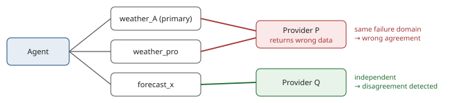
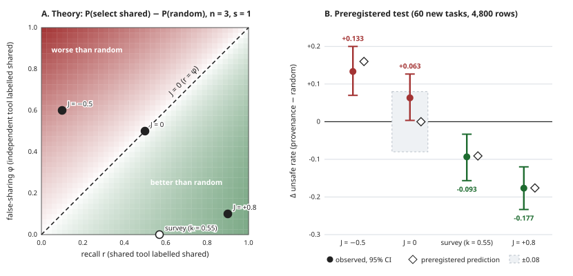
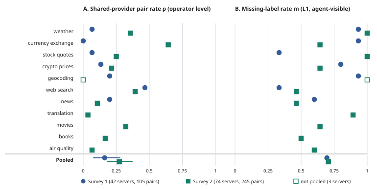

# When Does Failure-Domain Metadata Help Tool-Using AI Agents? A Label-Quality Condition, Two Surveys of MCP Server Metadata, and an LLM Choice Test

**Lương Tuấn Kiệt** · Bản rút gọn, cập nhật 2026-11-08. Bản đầy đủ (technical report) chứa toàn bộ phân tích phụ, chẩn đoán và lịch sử tái lập.

## Abstract

Tool-using AI agent có thể nhận output sai nhưng đúng schema. Khi hai tool khác tên cùng lấy dữ liệu từ một nguồn, cross-verification giữa chúng chỉ tạo ra đồng thuận giả. Công trình trước cho thấy chọn corroborator khác lineage giảm mạnh quyết định sai, nhưng giả định nhãn lineage có sẵn và đúng. Chúng tôi hỏi metadata cần chính xác đến đâu, và metadata thật chính xác đến đâu. **(1)** Trong controlled refund simulation với metadata chính xác, chọn corroborator khác failure domain giảm unsafe decision từ `30/150` xuống `0/150` (95% CI của chênh lệch `[−0.273, −0.127]`); lợi thế không giữ chắc khi 25% nhãn sai. **(2)** Chúng tôi chứng minh, dưới các assumption nêu rõ, rằng chọn theo metadata tốt hơn random khi và chỉ khi `J = r − φ > 0`, và tệ hơn khi `J < 0`; một preregistered test trên 60 task mới xác nhận cả hai chiều (`J = −0.5`: `+0.133` `[+0.070, +0.200]`). **(3)** Hai survey MCP server (42 và 78 server) cho thấy 16% và 27% cặp cùng loại thông tin dùng chung upstream provider. Agent-visible metadata thiếu tên provider ở khoảng 70% cặp, nhưng khi có thì phần lớn đúng (`J = 0.89` ở L2); survey 2 đạt 4/6 prediction ghi trước. Bottleneck thực tế là metadata **missing**, không phải metadata sai. Nhãn survey do AI gán, không có human validation độc lập. **(4)** Trong tác vụ chọn một lần trên 56 bộ ba tool MCP thật (1.008 lời gọi mỗi model), thêm dòng `Upstream provider` vào description làm tỷ lệ hai LLM nhỏ (`gpt-4o-mini`, `gpt-4.1-mini`) chọn tool cùng nguồn với primary giảm từ `0.423` xuống `0.107` và từ `0.339` xuống `0.054` khi prompt yêu cầu nguồn độc lập; nhưng với prompt trung tính, cùng nhãn đó **tăng** tỷ lệ lên khoảng `0.80`. Không có kết quả nào đo live agent trong một vòng agent đầy đủ.

**Keywords:** tool-using AI agents; correlated failures; common-mode failures; failure-domain metadata; provenance; Model Context Protocol; empirical survey.

## 1. Introduction

LLM agent ngày càng được phép gọi API, đọc database và thực hiện hành động có hậu quả thật, ví dụ hoàn tiền hay xóa tài nguyên. Agent coi tool output là bằng chứng về thế giới bên ngoài. Lỗi nguy hiểm nhất là **silent tool failure**: lời gọi thành công, output đúng schema, nhưng nội dung sai hoặc cũ.

Một cách phòng tự nhiên là **cross-verification**: trước khi hành động, agent hỏi thêm một tool thứ hai (corroborator) và chỉ tin khi hai kết quả khớp. Nhưng số tool không đồng nghĩa với số nguồn bằng chứng độc lập. Hai tool khác tên có thể cùng gọi một provider. Khi provider đó sai, cả hai sai giống nhau và agent thấy một sự đồng thuận giả (Figure 1). Đây là dạng **common-mode failure** quen thuộc trong dependable systems [KL86], và cũng đã được quan sát giữa các LLM [CE25].

*Figure 1. Primary `weather_A` và `weather_pro` khác tên nhưng cùng gọi Provider P, tức cùng failure domain. Khi P trả dữ liệu sai, chọn `weather_pro` làm corroborator cho ra đồng thuận sai; `forecast_x` gọi Provider Q độc lập nên phát hiện được bất đồng. Ví dụ minh họa.*

Nếu biết tool nào thuộc failure domain nào, agent có thể chọn corroborator độc lập. VP-Control [VPC26] đã đo điều này với thiết kế mạnh (preregistration, live study): ở regime common stale, tỷ lệ phê duyệt sai là 91,5% khi cùng nguồn, so với 9,8% khi khác nguồn. EFD [EFD26] chứng minh rằng thêm reviewer không khắc phục được upstream chung. Cả hai đều **giả định lineage label có sẵn và đúng**. Bara [BARA26] chỉ ra vì sao giả định này quan trọng: chỉ nhìn vào nội dung báo cáo thì không phân biệt được hai báo cáo độc lập với hai bản sao từ cùng một nguồn bằng chứng, nên thông tin về nguồn phải được cung cấp từ bên ngoài. Trong thực tế, thông tin này đến từ tên, description và tài liệu của tool, và có thể thiếu hoặc sai.

Bài này tập trung vào khoảng trống đó với ba Research Question chính, cộng một thí nghiệm nền (Baseline) cho trường hợp metadata chính xác:

- **Baseline (không phải RQ chính).** *Given accurate failure-domain metadata, under targeted common-mode silent tool-output failures, does independent-domain corroboration reduce unsafe refund authorization decisions relative to random corroboration at a matched two-observation budget?* Phần này lặp lại kết quả của VP-Control trong một miền khác, không phải phát hiện mới.
- **RQ1 (label quality).** *Under class-conditional failure-domain label errors, for which combinations of shared-dependency recall `r` and false-sharing rate `φ` does failure-domain-aware selection beat, match, or lose to random selection?*
- **RQ2 (real metadata).** *Among open-source MCP servers that provide the same information type, how often do two servers share an upstream data provider, and how well does agent-visible metadata reveal that sharing?*
- **RQ3 (LLM behaviour).** *When an LLM agent must choose a corroborating tool from real MCP tool descriptions, does adding the upstream provider to the descriptions reduce how often it chooses a corroborator that shares the primary's provider?*

**Contribution.** (1) Một điều kiện đơn giản, có proof, cho biết khi nào failure-domain metadata giúp, không giúp hay gây hại, kèm preregistered test. (2) Bằng chứng thực nghiệm lặp lại trên hai mẫu về chất lượng metadata của MCP server thật, gồm cả prediction không đạt. (3) Một phép đo hành vi đầu tiên của LLM thật (RQ3), gồm cả chiều ngược lại ở prompt trung tính. (4) Một replication có kiểm soát của Baseline với kết quả robustness âm và phân tích power. Bài không đề xuất thuật toán mới và không claim superiority so với công trình trước.

**Thứ tự thời gian, nói thẳng:** RQ1, RQ2 và RQ3 được đặt ra **sau** khi đã có kết quả Baseline và sau khi phát hiện VP-Control. Mọi bước thu thập và kiểm định sau đó đều có protocol viết và được xác nhận trước; mọi thay đổi được ghi thành amendment có ngày. Đây là protocol nội bộ, không đăng ký trên registry độc lập.

## 2. Problem formulation

**Failure domain.** Tập các component có thể cùng sai vì một phụ thuộc chung, ví dụ cùng một provider API.

**Selector.** Agent có một primary tool và `n` corroborator ứng viên, trong đó `s` cái thật sự cùng failure domain với primary. Metadata gán cho mỗi corroborator nhãn "chung" hoặc "độc lập".
- `random_k` chọn đều trong `n` ứng viên, nên chọn nhầm tool chung với xác suất `s/n`.
- `provenance_k` chọn đều trong các ứng viên gắn nhãn "độc lập"; nếu không có thì chọn đều trong cả `n` (fallback).

**Chất lượng nhãn.** Coi metadata như một bộ phân loại "chung với primary":
- **recall `r`**: xác suất một tool thật sự chung được gắn nhãn "chung";
- **false-sharing `φ`**: xác suất một tool thật sự độc lập bị gắn nhãn "chung";
- **`J = r − φ`**: tương tự Youden index trong chẩn đoán y khoa.

**Đại lượng của survey.** Với mỗi cặp server cùng loại thông tin:
- **ρ**: tỷ lệ cặp thật sự dùng chung provider;
- **m**: tỷ lệ cặp có missing label, tức ít nhất một bên không nêu provider;
- `r`, `φ`, `J`: tính trên các cặp có nhãn.

Metadata được đo ở hai mức: **L1** là thứ agent thấy lúc chạy (tên server, tên và description của tool, input schema); **L2** là L1 cộng README. "Dùng chung" được định nghĩa ở hai mức: **operator level** (tổ chức vận hành hostname API mà tool gọi theo mặc định) và **data-origin level** (nguồn dữ liệu cuối cùng, khi có bằng chứng).

## 3. Related work

**Cross-tool verification và action gating.** RIVA dùng nhiều diagnostic path để tăng reliability khi observability tool trả lỗi [RIVA26]. Deterministic pre-execution gate [RLVM26], postcondition verification [VTC26] và pre-action verification [LBYL26] đều đã có. Hai công trình ProvenanceGuard kiểm tra attribution của claim [PGF26] và grounding của tool call [PGA26]. Các công trình này không báo cáo một so sánh có kiểm soát về việc chọn corroborator theo failure domain khi backend dùng chung bị lỗi; đây là khác biệt về câu hỏi được đo, không phải bằng chứng rằng các phương pháp đó thất bại.

**Tool trust.** TEA-CXA học mức tin cậy của tool theo từng truy vấn [TEA26], và một số công trình hiệu chỉnh uncertainty của tool use [PC24]. Biết một tool thường đúng không cho biết hai tool có ít cùng sai hay không.

**Lineage-aware verification.** VP-Control [VPC26] và EFD [EFD26] là prior art gần nhất, như đã nêu ở §1. Công trình về dependency graph của agent [GRADE26, AF26] phục hồi cấu trúc phụ thuộc từ code, nhưng không phải ground truth cho việc hai backend cùng lỗi lúc chạy.

**Hệ sinh thái MCP.** Các measurement study cho thấy 88,6% trong 116 MCP server chính thức dựa một phần hoặc toàn bộ vào REST API sẵn có [MCPREST25] và có hiện tượng dependency monoculture [MCPMEAS25]. Chúng không đo việc các server cùng loại thông tin dùng chung provider, hay metadata có tiết lộ điều đó không.

## 4. Baseline: controlled replication

**Thiết kế.** Môi trường support-desk deterministic `trajectory-judge` (commit `d0ee54aa`). Primary `check_eligibility` và `check_eligibility_search` cùng `operational_db`; hai corroborator còn lại thuộc hai domain khác. Một actor deterministic đọc primary: nếu eligible thì đề xuất refund, không thì escalation. Mỗi refund proposal bắt buộc qua một corroborator (`K = 2` observation); hai bên khớp thì cho phép, không thì escalation. 30 task × 5 seed × 3 regime (clean, independent fault, targeted common-mode) × 3 policy, tổng 1.350 decision row. Outcome là **unsafe refund decision**, chấm bằng oracle theo code, không dùng LLM-as-a-judge. Inference bằng paired task-cluster bootstrap (10.000 lần). Đây là decision simulation, không thực thi refund và không chạy LLM.

**Kết quả.** Dưới targeted common-mode fault:
- `random_k`: `30/150` unsafe decision;
- `provenance_k`: `0/150`;
- Δ `−0.200`, 95% CI `[−0.273, −0.127]`.

Clean correctness của cả hai là `150/150`. Ở negative control (independent fault) không có lợi thế: Δ `+0.007` `[−0.020, 0.033]`. Kết quả gần như suy ra được từ topology: random chọn đúng tool cùng domain khoảng 1/3 số lần. Đây là **containment**, không phải recovery: dưới targeted fault, cả hai policy đều 0/50 quyết định refund đúng, vì actor không đề xuất refund sau khi primary báo sai.

**Robustness với metadata không hoàn hảo** (30 task mới, 3.750 row):

| Điều kiện                      | Δ unsafe | 95% CI           | Gate     |
| ------------------------------ | -------: | ---------------- | -------- |
| Nhãn đúng, leakage 0.25        |   −0.133 | [−0.220, −0.053] | PASS     |
| Thiếu 25% nhãn, leakage 0.10   |   −0.153 | [−0.227, −0.087] | PASS     |
| **Sai 25% nhãn**, leakage 0.10 |   −0.067 | [−0.133, 0.000]  | **FAIL** |

Gate robustness tổng thể **FAIL**, nên Baseline được giới hạn ở *accurate metadata*. Phân tích post-hoc cho thấy hiệu ứng kỳ vọng ở điều kiện nhãn sai là khoảng `−0.088`, và tiêu chí đã khóa chỉ có khoảng **56% power** ở 30 task (83% ở 60 task). FAIL được giữ nguyên; nó là bằng chứng yếu về việc lợi thế biến mất, không phải bằng chứng lợi thế còn. Câu hỏi "nhãn sai đến mức nào thì hết lợi" dẫn tới RQ1.

## 5. RQ1: điều kiện J

**Định lý.** Giả định: nhãn của primary đúng; nhãn của các corroborator độc lập với nhau và chỉ phụ thuộc vào lớp thật (chung hay độc lập); selector chọn đều, có fallback đều. Gọi `a = 1 − r` là xác suất một tool chung lọt vào nhóm được chọn, `b = 1 − φ` là xác suất một tool độc lập lọt vào, và `K` là số ứng viên khác lọt vào. Khi đó

$$
P(\text{chọn tool chung}) - \frac{s}{n} = -\frac{s(n-s)}{n}\, J\; \mathbb{E}\!\left[\frac{1}{1+K}\right].
$$

Hai thừa số `s(n−s)/n` và `E[1/(1+K)]` luôn dương, nên **dấu của chênh lệch bằng dấu của `−J`**: provenance tốt hơn random khi và chỉ khi `J > 0`, bằng khi `J = 0`, tệ hơn khi `J < 0`. Ý tưởng chứng minh: ghép một tool chung với một tool độc lập; phần còn lại có cùng phân phối với cả hai, nên khi trừ hai xác suất, mọi số hạng triệt tiêu, chỉ còn `(b − a)·E[1/(1+K)]`, mà `b − a = J`. Nếu mỗi nhãn chỉ có với xác suất `k`, thì `a = k(1−r)` và `b = k(1−φ)`, nên `b − a = kJ`: **missing label làm hiệu ứng nhỏ đi nhưng không đổi chiều**. Closed form khớp exact enumeration đến sai số `10⁻¹⁶`; quét số trên 2.205 điểm lưới thuộc 5 topology, kiểm tra bằng Monte Carlo độc lập, không có vi phạm.

**Ví dụ.** Topology main (`n = 3`, `s = 1`), `r = 0`, `φ = 0.5` (`J = −0.5`). Provenance chọn nhầm với xác suất 0.583, so với 0.333 của random; tức metadata tệ còn tệ hơn không có metadata.

**Preregistered test.** Để kiểm tra điều kiện này đi qua cả pipeline (actor, gate, leakage, oracle) chứ không chỉ công thức chọn, chúng tôi viết protocol và hypothesis trước, rồi chạy trên **60 task mới**, 5 seed mới, 4 điều kiện nhãn, 2 policy (4.800 row, leakage 0.10). Một amendment sửa một prediction **trước khi chạy**, sau khi unit test phát hiện prediction dùng sai giả định.

| Điều kiện                         | Provenance | Random |      Δ | Prediction | 95% CI           | Hypothesis        |
| --------------------------------- | ---------: | -----: | -----: | ---------: | ---------------- | ----------------- |
| `J = +0.8` (r 0.9, φ 0.1)         |      0.087 |  0.263 | −0.177 |     −0.176 | [−0.233, −0.120] | H-J2 hỗ trợ       |
| `J = 0` (r 0.5, φ 0.5)            |      0.320 |  0.257 | +0.063 |      0.000 | [+0.003, +0.127] | H-J3 không hỗ trợ |
| `J = −0.5` (r 0.1, φ 0.6)         |      0.423 |  0.290 | +0.133 |     +0.160 | [+0.070, +0.200] | H-J1 hỗ trợ       |
| Theo survey (r 0.57, φ 0, k 0.55) |      0.173 |  0.267 | −0.093 |     −0.091 | [−0.157, −0.033] | H-J4 hỗ trợ       |

Hai hypothesis chính (harm khi `J < 0`, benefit khi `J > 0`) được hỗ trợ, và các chênh lệch nằm sát prediction. H-J3 (tương đương tại `J = 0`, biên ±0.08) **không** được xác nhận: 90% CI `[+0.013, +0.117]` vượt biên. Power của H-J3 (khoảng 59%) không được lập kế hoạch; chúng tôi không diễn giải kết quả này là `J = 0` gây hại, vì protocol không đăng ký giả thuyết đó.

*Figure 2. (A) Closed-form `P(select shared) − s/n` cho topology main trên lưới `(r, φ)`: xanh là tốt hơn random, đỏ là tệ hơn; ranh giới trùng đường chéo `J = 0`. Điểm rỗng (survey) có missing label nên chỉ để tham khảo. (B) Δ unsafe của preregistered test với 95% CI; ◆ là prediction ghi trước; dải xám là biên tương đương ±0.08.*

**Giới hạn của RQ1.** Đây là simulation do chúng tôi thiết kế, nên kết quả gần như suy ra được từ mô hình; giá trị nằm ở kỷ luật kiểm định (prediction ghi trước, task mới), không ở tính mới. Định lý không bao phủ ba trường hợp: nhãn tương quan giữa các tool, nhãn của primary bị sai (đúng là mô hình của robustness gate ở §4), và chọn nhiều corroborator.

## 6. RQ2: metadata của MCP server thật

### 6.1 Phương pháp

Hai survey, mỗi survey có protocol được tác giả xác nhận trước khi tạo sampling frame.

- **Sampling.** Với mỗi loại thông tin, chạy truy vấn GitHub cố định `"<từ khóa> mcp server"`, sắp theo số sao. Danh sách kết quả được lock bằng SHA-256 trước khi đọc code; truy vấn dự phòng được định trước cho nhóm có ít kết quả.
  - Survey 1: 7 loại thông tin (weather, currency exchange, stock, crypto, geocoding, web search, news), 6 server mỗi loại, **42 server, 105 cặp**.
  - Survey 2: mẫu mới, loại mọi repo của survey 1; thêm 5 loại (translation, IP geolocation, movies, books, air quality); 8 server mỗi loại. **78 server**; hai loại có dưới 4 server chỉ báo cáo riêng, nên ước lượng gộp dùng **74 server, 245 cặp**.
- **Screening** theo thứ tự rank, với 5 tiêu chí: repo công khai; triển khai Model Context Protocol thật; có tool trả đúng loại thông tin; gọi API bên ngoài; có upstream mặc định. Lỗi screening phát hiện khi gán nhãn được sửa theo luật thứ tự rank đã định trước (1 lỗi ở survey 1, 4 lỗi ở survey 2).
- **Ground truth.** Đọc tĩnh code tại pinned commit, không chạy code, để xác định provider mà tool gọi theo cấu hình mặc định, kèm bằng chứng `file:dòng`. Hai server là "chung" nếu tập provider mặc định giao nhau.
- **Declared metadata.** Chỉ tính provider được nêu **đích danh** ở L1 hoặc L2.
- **Data-origin level.** Post-hoc ở survey 1; **đăng ký trước** ở survey 2, chỉ dùng bằng chứng trong chính repo. Hai biến thể: "đọc tên theo chữ" (agent chỉ so tên) và "biết ánh xạ" (agent biết, ví dụ, Frankfurter phân phối dữ liệu ECB).
- **Prediction của survey 2.** Sáu prediction P1–P6 rút từ survey 1, mỗi cái có quy tắc đạt/không đạt ghi trước. Ba amendment, đều trước khi tính chỉ số liên quan: A1 làm rõ codebook; A2 ghi năm luật diễn giải phát sinh khi gán nhãn và chi tiết cài đặt phân tích; A3 quy trình phân xử của tác giả.
- **Coding.** Coder A là AI (Claude). Coder thứ hai (một thành viên nhóm) gán độc lập 10 server ở survey 1 và 20 server ở survey 2, chọn bằng hash, nhưng **đã dùng AI (Claude hoặc Codex)**, trái với dự định là coder con người. Vì vậy agreement ở đây là giữa các AI coder.

### 6.2 Kết quả

**Survey 1** (operator level). ρ = 17/105 = **0.16**, server-level bootstrap 95% `[0.075, 0.281]`, cao nhất ở web search (0.47). L1 thiếu nhãn ở **70%** cặp; khi có nhãn: `r = 8/8`, `φ = 0/24`. L2: m = 0.05, `r = 17/17`, `φ = 0/83`. Ở data-origin level (post-hoc), recall đọc tên theo chữ giảm còn 0.61 (17/28), và mọi cặp web search đều chung ít nhất một engine.

**Survey 2** (operator level). ρ = 67/245 = **0.27** `[0.179, 0.374]`. ρ theo loại thông tin rất khác nhau: currency 0.64 (sáu server dùng Frankfurter), web search 0.39, weather 0.36, đến translation 0.04. L1 thiếu nhãn ở **71%** cặp, trong đó weather và stock thiếu ở mọi cặp; khi có nhãn: `r = 23/27`, `φ = 3/45`, `J = 0.79`. L2: m = 0.22, `r = 52/55`, `φ = 7/135`, `J = 0.89`.

| Mức | ρ | r (L2) | φ (L2) | J (L2) |
|---|---:|---|---|---:|
| Operator | 0.27 | 0.95 (52/55) | 0.05 (7/135) | 0.89 |
| Data origin, đọc tên theo chữ | 0.31 | 0.83 (55/66) | 0.03 (4/124) | 0.80 |
| Data origin, biết ánh xạ | 0.31 | 0.97 (64/66) | 0.02 (2/124) | 0.95 |

**Đối chiếu prediction của survey 2:**

| Prediction | Quy tắc | Kết quả |
|---|---|---|
| P1 Có dùng chung nhưng không phổ biến | 0.05 ≤ ρ ≤ 0.30 | 0.27, **đạt** (cận trên CI 0.37) |
| P2 L1 thường thiếu nhãn | m_L1 > 0.50 | 0.71, **đạt** |
| P3 Có nhãn thì hiếm khi sai | φ_L1 ≤ 0.05 | 0.067 (3/45), **không đạt** |
| P4 Tên operator bỏ sót phụ thuộc ở data origin | r_origin < r_operator (L2) | 0.83 < 0.95, **đạt** |
| P5 Có loại thông tin không có nguồn độc lập | ρ_origin ≥ 0.80 ở ít nhất một loại | cao nhất 0.71 (web search), **không đạt** |
| P6 Metadata thật có J > 0 | J_operator,L2 > 0 | 0.89, **đạt** |

Hai finding của survey 1 **không replicate**: "khi có nhãn thì không bao giờ sai" và "web search không có nguồn độc lập". Cả ba cặp gán nhầm ở L1 đều do metadata nêu **nguồn dữ liệu phía sau** thay vì operator. Ví dụ, một server gọi API của Blockchain Academics nhưng description ghi giá lấy "via CoinGecko". Ở data-origin level, hai trong ba nhãn đó lại là đúng. Diễn giải này là post-hoc; kết quả chính của P3 vẫn là không đạt.

*Figure 3. (A) ρ ở operator level và (B) missing-label rate ở L1, theo loại thông tin, cho survey 1 (tròn) và survey 2 (vuông). Hàng Pooled có 95% bootstrap interval cho ρ. ρ của cùng một loại đổi mạnh giữa hai mẫu, trong khi m gộp gần như không đổi (0.70 và 0.71).*

**Phép chiếu lên selector model** (không phải đo agent). Với tỷ lệ nhãn quan sát được ở survey 2, xác suất chọn nhầm corroborator chung là 0.436 khi chọn random, 0.289 với metadata L1 và 0.109 nếu thông tin ở mức README có mặt trong description của tool.

### 6.3 Độ tin cậy của nhãn

**Agreement giữa AI coders.**
- Survey 1: sau chuẩn hóa tên, upstream 0.80 (Cohen's κ 0.78), L1 1.00.
- Survey 2 (Claude và Codex), với bảng chuẩn hóa tên cố định trước: upstream 0.45 (κ 0.43), L1 0.65 (κ 0.57). Phần lớn bất đồng chỉ là khác mức đặt tên của cùng một tổ chức, ví dụ `Google Maps Platform` và `Google`. Sau khi gộp tên ở mức tổ chức (post-hoc): upstream 0.85, L1 0.80.
- Quan trọng nhất: việc L1 có hay thiếu nhãn, tức đại lượng của finding chính, khớp **20/20** (κ 1.00).

**Author adjudication.** Vì không có coder con người, tác giả, theo một quy trình ghi vào protocol trước khi xem các trường hợp, đã làm ba việc:
- chọn 4 luật codebook cho các điểm hai AI hiểu khác nhau, ví dụ "nguồn là nguồn dữ liệu cuối cùng" và "provider không bật mặc định thì không tính";
- phân xử 4 trường hợp có câu trả lời được che tên;
- kiểm tra 10 bằng chứng `file:dòng` chọn ngẫu nhiên: **10/10 đúng**.

Áp các luật này cho cả 78 server làm đổi 7 nhãn. P1, P2, P4, P5, P6 không đổi; P3 từ 3/45 thành 2/45 = 0.044. Tỷ lệ gán nhầm vì vậy nằm **sát ngưỡng 5%** và phụ thuộc định nghĩa. Phân xử này không độc lập: tác giả chọn giống coder A 7/8 lần, coder A cũng là bên giải thích câu hỏi, và tác giả đọc dòng code do coder A trích.

## 7. RQ3: LLM chọn corroborator với metadata thật

**Thiết kế.** Protocol viết ngày 2026-10-18 trước khi trích mô tả tool, tác giả xác nhận 2026-10-20 (nội bộ, không phải registry độc lập). 56 bộ lựa chọn: mỗi bộ có một primary và ba candidate (1 dùng chung provider với primary, 2 độc lập), rút từ nhãn coder A của hai survey. Mô tả mỗi tool trích nguyên văn từ code ở commit ghim (tối đa 400 ký tự). Ba điều kiện: **C0** mô tả gốc, **C1** thêm dòng `Upstream provider: <provider>`, **C2** thay mọi tên provider bằng `[provider]`. Mỗi bộ trình bày theo 3 vòng xoay vị trí. Hai prompt: **prompt chính** yêu cầu chọn tool "not relying on the same underlying data source as the primary"; **prompt trung tính** chỉ yêu cầu chọn tool tốt nhất để kiểm tra lại. Mỗi model chạy 56 × 3 × 3 × 2 = 1.008 lời gọi, temperature 0, seed 0.

**Model.** Protocol gốc dùng hai model 7–8B chạy local. Vì máy duy nhất của tác giả có GPU 4 GB, **Amendment A2 (2026-11-08, trước lời gọi đầu tiên)** đổi sang `gpt-4o-mini-2024-07-18` và `gpt-4.1-mini-2025-04-14` qua OpenAI API. Hai model cùng hãng, đóng.

**Hypothesis ghi trước.** Gọi shared-choice rate là tỷ lệ model chọn candidate dùng chung provider (ngẫu nhiên: `1/3`). H-A1: với prompt chính, tỷ lệ ở C1 thấp hơn C0. H-A2: tỷ lệ ở C1 thấp hơn `1/3`. Từng model riêng; CI bootstrap theo bộ lựa chọn (10.000 lần); Holm trên 4 kiểm định.

**Kết quả** (56 bộ, CI 95%; 0 output không hợp lệ; manipulation check đạt):

| Prompt, điều kiện | `gpt-4o-mini` | `gpt-4.1-mini` |
|---|---|---|
| Chính, C0 (gốc) | 0.423 [0.327, 0.518] | 0.339 [0.238, 0.446] |
| Chính, C1 (thêm provider) | 0.107 [0.048, 0.173] | 0.054 [0.018, 0.095] |
| Chính, C2 (xóa provider) | 0.435 [0.351, 0.524] | 0.387 [0.292, 0.482] |
| Trung tính, C0 | 0.583 | 0.518 |
| Trung tính, C1 | 0.804 | 0.786 |
| Trung tính, C2 | 0.542 | 0.482 |

- **H-A1 đạt ở cả hai model:** `C1 − C0` là `−0.315` (CI `[−0.405, −0.226]`) và `−0.286` (CI `[−0.381, −0.196]`); p Holm `< 0.0001`.
- **H-A2 đạt ở cả hai model:** tỷ lệ ở C1 là `0.107` và `0.054`, cận trên CI đều dưới `0.333`.
- **Mô tả (không kiểm định):** với mô tả gốc, CI của cả hai model chứa `1/3`, tức không tránh được tool cùng nguồn tốt hơn ngẫu nhiên. Xóa tên provider (C2) gần như không đổi so với C0, nên có ít dấu hiệu model tự suy provider. Vị trí C ít được chọn nhất (`0.13–0.14`), được cân bằng bằng vòng xoay.
- **Prompt trung tính cho chiều ngược lại:** thêm nhãn provider **tăng** tỷ lệ chọn tool cùng nguồn từ `0.58` lên `0.80` và từ `0.52` lên `0.79`. Đây không phải hypothesis ghi trước nên không có kiểm định. Các câu `reason` cho thấy model đọc nhãn: khi chọn tool cùng nguồn, `52%` (gpt-4o-mini) và `65%` (gpt-4.1-mini) lý do nhắc provider, nhiều câu dạng "uses the same upstream provider … ensuring consistency" (so với `3%` và `14%` khi chọn tool khác nguồn). Có vẻ model hiểu "kiểm tra lại" là tìm tool nhất quán, không phải độc lập; đây là suy luận (lý do do model tự viết, quy tắc từ khóa đặt sau khi biết kết quả), chưa phải cơ chế đã đo.
- **Theo loại thông tin** (11 loại, 2–10 bộ mỗi loại, chỉ mô tả): ở prompt chính, C1 bằng `0.00` ở cả hai model cho crypto, weather, movies, geocoding, air quality, books; còn cao hơn ở news, web search, translation, stock và currency (`0.05–0.33`). Ở prompt trung tính, C1 không tăng ở web search và translation.

**Giới hạn của RQ3.** Tác vụ chọn một lần, không có vòng agent hay lỗi được inject; prompt chính nói thẳng yêu cầu "độc lập". Nhãn C1 do AI gán và đúng hoàn toàn theo cấu trúc, nên kết quả không nói gì về nhãn thiếu hoặc sai. Chỉ hai model nhỏ cùng hãng; OpenAI không bảo đảm seed cho kết quả xác định hoàn toàn. Phân tích theo loại thông tin chỉ có 2–10 bộ mỗi loại.

## 8. Discussion

**Trả lời các RQ.**
- **Baseline:** khi metadata chính xác, chọn corroborator khác failure domain ngăn được quyết định sai, nhất quán với VP-Control; lợi thế không giữ chắc khi nhãn sai, một phần vì thiếu power.
- **RQ1:** metadata có ích khi và chỉ khi `J > 0`, và gây hại khi `J < 0`; điều này được chứng minh trong mô hình và xác nhận trong simulation trên task mới.
- **RQ2:** ở MCP server thật, dùng chung provider có thật (16–27% cặp) và biến động mạnh theo mẫu; metadata thiếu ở khoảng 70% cặp; khi có thì phần lớn đúng (`J > 0`), nhưng thường chỉ ở operator level.
- **RQ3:** khi prompt yêu cầu nguồn độc lập và nhãn đầy đủ, đúng, hai LLM nhỏ chọn tool cùng nguồn ít hơn hẳn (`0.42 → 0.11` và `0.34 → 0.05`); nhưng với prompt trung tính cùng nhãn làm tỷ lệ này tăng lên khoảng `0.80`. Lợi ích của nhãn phụ thuộc vào việc agent được yêu cầu dùng nó để tìm nguồn khác.

**Ba hàm ý** (INFERENCE, cần kiểm chứng thêm):
1. **Bottleneck là metadata missing, không phải metadata sai.** Vì `J > 0`, metadata thật không gây hại theo định lý; nó chỉ quá hiếm. Đưa tên provider từ README vào description của tool là một thay đổi rẻ, và theo phép chiếu giảm xác suất chọn nhầm từ 0.289 xuống 0.109. Đây là khuyến nghị cụ thể cho người viết MCP server và tool registry. RQ3 kiểm chứng một phần: với nhãn đầy đủ và prompt yêu cầu độc lập, shared-choice rate của hai LLM giảm xuống `0.05–0.11`; nhưng prompt trung tính cho kết quả ngược, nên khuyến nghị này cần đi cùng hướng dẫn rõ ràng cho agent.
2. **Tên operator chưa đủ.** Ở data-origin level, tên provider bỏ sót khoảng 17% (survey 2, đăng ký trước) đến 39% (survey 1, post-hoc) các phụ thuộc. Ví dụ: Frankfurter phân phối dữ liệu ECB; các web search server khác tên cùng gọi Google hay DuckDuckGo. Registry đáng tin cậy nên công bố cả nguồn dữ liệu gốc.
3. **Nguồn độc lập có thể khan hiếm.** Ở web search, mọi server khảo sát đều chung engine với ít nhất một server khác. Khi đó metadata tốt cũng chỉ giúp được một phần; agent cần nhận ra lúc không có nguồn độc lập và chuyển sang escalation, thay vì coi đồng thuận của hai tool là bằng chứng mạnh.

## 9. Threats to validity

- **Thứ tự thời gian.** RQ1 và RQ2 được đặt sau khi có kết quả Baseline; phân tích RQ1 ban đầu là post-hoc. Các protocol sau đó viết trước nhưng là nội bộ.
- **Simulation.** Baseline và preregistered test là decision simulation do project thiết kế; kết quả gần như by-construction và không có live-agent effect estimate. Một chẩn đoán nhỏ trên agent thật (Qwen2.5 7B) không đạt điều kiện để ước lượng hiệu ứng.
- **Corroborator độc lập được coi là báo đúng** (chỉ có leakage). VP-Control cho thấy trên FinQA, verifier nhỏ không đọc đúng bằng chứng, và hiệu ứng nguồn đảo chiều; nguồn độc lập chỉ giúp khi bên kiểm tra đủ năng lực.
- **Phạm vi của định lý.** Không bao phủ nhãn tương quan, primary label sai, hay chọn nhiều corroborator; proof chưa được người độc lập kiểm tra.
- **Nhãn survey.** Do AI gán; coder thứ hai cũng dùng AI. Agreement giữa AI cho biết nhãn tái lập được, không cho biết nhãn đúng. Phần kiểm tra của con người chỉ gồm author adjudication và 10 bằng chứng. Một lần thử để tác giả gán nhãn mù 15 server đã bị dừng vì có AI hỗ trợ tra cứu, và không được báo cáo như human validation. Năm luật diễn giải của survey 2 do coder A đặt sau khi đọc code nhưng trước khi tính chỉ số.
- **Construct "dùng chung".** Operator level là cận dưới của phụ thuộc thật; quy tắc "giao tập khác rỗng" phóng đại phụ thuộc của aggregator nhiều nguồn; data-origin level chỉ dùng bằng chứng trong repo.
- **Mẫu.** Repo MCP phổ biến trên GitHub; các cặp không độc lập vì mỗi server nằm trong nhiều cặp; mẫu số của `r` ở L1 nhỏ (8 và 27). ρ theo loại thông tin khác xa giữa hai mẫu.
- **Phép chiếu không phải đo agent.** Các xác suất ở §6.2 là phép chiếu lên mô hình selector; RQ3 đo hành vi LLM nhưng với nhãn đầy đủ và đúng, nên không so trực tiếp với các phép chiếu đó.
- **RQ3.** Đổi model sau khi khóa protocol v1.0 (Amendment A2, trước lời gọi đầu tiên); hai model cùng hãng, đóng, seed không đảm bảo xác định hoàn toàn; tác vụ chọn một lần với prompt nhắc độc lập; nhãn C1 do AI gán; protocol nội bộ đặt sau khi có kết quả survey; phân tích phụ theo loại thông tin và `reason` chỉ mô tả (quy tắc từ khóa đặt sau khi biết kết quả chính).

## 10. Conclusion

Hai tool khác tên có thể đồng thuận trên cùng một output sai khi chúng chung failure domain. Chọn corroborator theo failure domain chỉ có ích khi metadata phát hiện phụ thuộc chung nhiều hơn số lần báo nhầm (`J > 0`); khi ngược lại, nó còn tệ hơn chọn ngẫu nhiên. Điều kiện này được chứng minh trong mô hình và xác nhận bằng preregistered test. Ở hai mẫu MCP server thật, metadata hiếm khi sai nhưng thường xuyên **thiếu**, và khi có thì chỉ nêu tên bên vận hành API chứ không nêu nguồn dữ liệu gốc. Vì vậy, cải thiện thực tế nhất không phải là phát hiện metadata sai, mà là khiến tool **công bố** provider và nguồn dữ liệu của mình ở nơi agent đọc được. RQ3 cho thấy thêm một điều kiện: nhãn chỉ giúp khi agent được yêu cầu dùng nó để tìm nguồn độc lập. Trong thí nghiệm chọn một lần với hai LLM nhỏ, nhãn giảm việc chọn tool cùng nguồn từ khoảng `0.34–0.42` xuống `0.05–0.11` ở prompt chính, nhưng làm tăng lên khoảng `0.80` ở prompt trung tính.

## References

- [RIVA26] S. Abuzakuk, L. Crijns, A.-M. Kermarrec, R. Pires, M. de Vos. *RIVA: Leveraging LLM Agents for Reliable Configuration Drift Detection*. EuroMLSys ’26. DOI: 10.1145/3805621.3807644.
- [RLVM26] V. Reddy, S. R. Challaram, A. Basu. *Reason Less, Verify More: Deterministic Gates Recover a Silent Policy-Violation Failure Mode in Tool-Using LLM Agents*. arXiv:2607.07405v2, 2026.
- [VTC26] I. K. Mansoor, A. Phadke, P. Rana. *Verified Tool Calls Improve LLM Agent Reliability Under Non-Atomic Failures*. arXiv:2608.02645v1, 2026.
- [LBYL26] A. Althoubi. *Look Before You Leap: Pre-Action Verification for LLM Agents*. arXiv:2609.11957v1, 2026.
- [PGF26] A. Alvarez et al. *ProvenanceGuard: Source-Aware Factuality Verification for MCP-Based LLM Agents*. arXiv:2606.18037v3, 2026.
- [PGA26] Y. She, Y. Liang, E. Kang. *Safeguarding LLM Agents from Misalignment through Provenance Analysis*. ASE ’26. DOI: 10.1145/3832783.3837535.
- [TEA26] Z. Huai, H. Yang, X. Li. *Which Tool Response Should I Trust? Tool-Expertise-Aware Chest X-ray Agent with Multimodal Agentic Learning*. arXiv:2602.21517v1, 2026.
- [PC24] H. Liu, Z.-Y. Dou, Y. Wang, N. Peng, Y. Yue. *Uncertainty Calibration for Tool-Using Language Agents*. Findings of EMNLP 2024. DOI: 10.18653/v1/2024.findings-emnlp.978.
- [GRADE26] Y. Zhao. *GRADE: Graph Representation of LLM Agent Dependency and Execution*. arXiv:2606.22741v2, 2026.
- [AF26] S. Wang, X. Hou, Y. Zhao, X. Cheng, H. Wang. *AgentFlow: Building Agent Dependency Graphs for Static Analysis of Agent Programs*. arXiv:2607.01640v1, 2026.
- [VPC26] Z. Zheng, B. Li, J. Yao, J. Long. *Engineering Reliable Commit Gates for Agentic AI: Cost-Aware Verification Portfolios under Common-Mode Data Failures*. arXiv:2609.10969, 2026.
- [EFD26] J. He, D. Yu. *The Illusion of Independent Quorums: Epistemic Fault Domains and Correlated Cognitive Failures in Agentic Quorums*. arXiv:2609.02925, 2026.
- [MCPREST25] M. Mastouri, E. Ksontini, A. Barrak, W. Kessentini. *From REST to MCP: An Empirical Study of API Wrapping and Automated Server Generation for LLM Agents*. arXiv:2507.16044, 2025.
- [MCPMEAS25] H. Guo, Y. Hao, Y. Zhang, M. Xu, P. Lv, J. Chen, X. Cheng. *A Measurement Study of Model Context Protocol Ecosystem*. arXiv:2509.25292, 2025.
- [BARA26] M. Bara. *Epistemic Sybil Resistance: Multiplying AI Agents Without Multiplying Evidence*. arXiv:2609.01873, 2026.
- [CE25] E. M. Kim, A. Garg, K. Peng, N. Garg. *Correlated Errors in Large Language Models*. ICML 2025, PMLR 267.
- [KL86] J. C. Knight, N. G. Leveson. *An Experimental Evaluation of the Assumption of Independence in Multiversion Programming*. IEEE TSE 12(1), 1986. DOI: 10.1109/TSE.1986.6312924.
