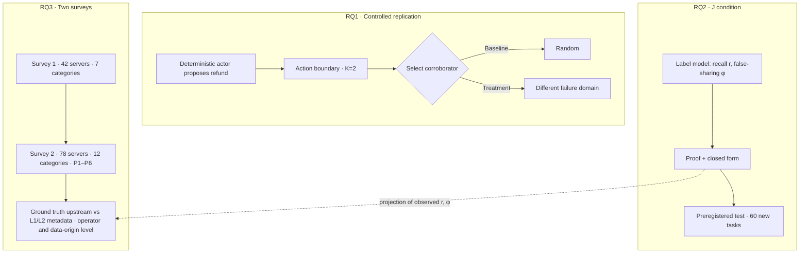

# Supervisor Briefing — Research Question và Methodology (v2.1)

> [!purpose] Mục đích buổi review
> Xin giảng viên đánh giá việc **repositioning** đề tài, ba **Research Question**, **methodology**, mức **contribution**, và khả năng nộp một **workshop**. Không cần kiểm tra từng test case hay từng server trong survey. Thời gian đọc: khoảng 15 phút.

## 0. Thay đổi so với v1.0 (2026-10-10)

| Mục | v1.0 | v2.1 |
|---|---|---|
| Điều kiện `J` (RQ2) | Mới kiểm tra numerically | Có **proof** với closed-form formula (dưới các assumption nêu rõ) và **preregistered test** trên 60 task mới |
| Survey (RQ3) | 1 survey, 42 server, AI-coded | Thêm **survey 2**: sample mới 78 server, 12 category, 6 prediction ghi trước; coder thứ hai (cũng dùng AI) đã code 10 server của survey 1 |
| Kết luận survey | "Label hiếm khi sai"; "web search không có independent source" | Survey 2 **không replicate** hai kết luận này; paper đã sửa |

Bối cảnh repositioning không đổi. Ngày 2026-10-06 em tìm thấy **VP-Control** ([arXiv:2609.10969](https://arxiv.org/abs/2609.10969)), đã đo đúng phần controlled comparison trong RQ ban đầu với thiết kế mạnh hơn, và **EFD** ([arXiv:2609.02925](https://arxiv.org/abs/2609.02925)), chứng minh về mặt cấu trúc rằng thêm reviewer không khắc phục được shared upstream. Cả hai đều **giả định lineage label có sẵn và đúng**. Vì vậy RQ ban đầu được giữ lại dưới dạng replication, còn contribution chính chuyển sang **chất lượng của failure-domain metadata**.

**Cần nói thẳng:** RQ2 và RQ3 được thêm **sau** khi đã có kết quả RQ1. Để bù lại, mọi bước data collection và hypothesis test sau đó đều có **protocol viết và được xác nhận trước**, và mọi thay đổi sau khi lock đều ghi thành **amendment** có ngày. Đây là protocol nội bộ, không đăng ký trên registry độc lập.

## 1. Tóm tắt trong một phút

Tool-using AI agent có thể nhận output sai nhưng vẫn đúng schema. Hai tool khác tên có thể cùng gọi một API, nên **cross-verification** giữa chúng tạo ra sự đồng thuận giả (**common-mode failure**). Chọn **corroborator** thuộc **failure domain** khác giải quyết được vấn đề này, **với điều kiện** biết tool nào dùng chung upstream. Bài hỏi hai câu: metadata cần chính xác đến đâu, và metadata thực tế chính xác đến đâu?

- **RQ1 (replication):** trong controlled refund simulation, chọn corroborator khác failure domain cho `0/150` unsafe decision, so với `30/150` khi chọn random.
- **RQ2 (điều kiện):** metadata có ích **khi và chỉ khi** `J = r − φ > 0`, tức recall của shared dependency cao hơn false-sharing rate; metadata **gây hại** khi `J < 0`. Điều kiện này có proof dưới các assumption nêu rõ. Trong preregistered test, `J = −0.5` làm unsafe rate **tăng** `+0.133` so với random.
- **RQ3 (thực tế):** qua hai survey MCP server (42 và 78 server), 16% và 27% cặp cùng category dùng chung upstream provider. Agent-visible metadata bị **missing** ở khoảng 70% cặp; đây là finding replicate vững nhất. Khi có label thì phần lớn đúng (`J > 0`) nhưng không hoàn hảo. Tên provider ở **operator level** bỏ sót dependency ở **data-origin level**.

**Thông điệp chính:** bottleneck thực tế là metadata **missing**, và khi có thì chỉ ở operator level. Metadata **sai** là vấn đề nhỏ hơn.

## 2. Ba Research Question

### RQ1 — controlled replication

**RQ1. Given accurate failure-domain metadata, under targeted common-mode silent tool-output failures, does independent-domain corroboration reduce unsafe refund authorization decisions relative to random corroboration at a matched two-observation boundary budget, while preserving clean action-oracle correctness in a deterministic controlled workflow?**

Khi biết chính xác tool nào thuộc cùng failure domain, chọn corroborator khác domain có giảm unsafe refund decision so với chọn random không, với cùng budget hai observation cho mỗi refund proposal?

### RQ2 — điều kiện về label quality

**RQ2. Under class-conditional failure-domain label errors, for which combinations of shared-dependency recall `r` and false-sharing rate `φ` does failure-domain-aware corroborator selection reduce, match, or increase the chance of selecting a shared-domain corroborator relative to random selection?**

Khi metadata có thể bỏ sót shared dependency (`r` thấp) hoặc gán nhầm source độc lập là shared (`φ` cao), failure-domain-aware selection khi nào tốt hơn, bằng, hay tệ hơn random selection?

### RQ3 — metadata thực tế

**RQ3. Among open-source MCP servers that provide the same information type, how often do two servers share an upstream data provider, and how well does agent-visible metadata reveal that sharing?**

Trong các MCP server cùng cung cấp một loại thông tin, bao nhiêu cặp dùng chung upstream provider, và agent chỉ đọc tên và description của tool có nhận ra điều đó không?

## 3. Methodology

Sơ đồ là phần tổng hợp thiết kế. ^[inferred]

**RQ1 (không đổi).** 30 frozen task × 3 policy × 3 regime × 5 seed = 1.350 decision rows. Outcome: unsafe refund decision và clean action-oracle correctness. Phân tích bằng paired task-cluster bootstrap. Kèm robustness check (3.750 rows), negative control, và counterfactual always-escalate. Không chạy LLM, không thực thi refund.

**RQ2.**
- **Proof** cho closed-form: `P(select shared) − s/n = −(s(n−s)/n)·J·E[1/(1+K)]`. Hai thừa số kia luôn dương nên dấu do `J` quyết định. Missing label chỉ làm effect **nhỏ đi**, không đảo chiều.
- **Numerical verification:** grid 2.205 điểm, Monte Carlo độc lập; closed-form khớp exact enumeration đến `10⁻¹⁶`.
- **Preregistered test:** 60 task mới, 4.800 rows, 4 label condition, quy tắc pass/fail ghi trước. Một amendment sửa một prediction **trước khi chạy**.
- **Power analysis** cho robustness criterion của RQ1.

**RQ3: hai survey, mỗi survey có protocol viết trước data collection.**
- *Sampling:* GitHub search query cố định, sắp theo star; sampling frame được lock bằng hash trước khi đọc code; screening theo rank với 5 tiêu chí. Survey 2 dùng sample mới, loại mọi repo đã có ở survey 1.
- *Ground truth:* upstream provider mà code gọi theo default configuration, đọc tại pinned commit, có evidence dạng file:line. Chỉ static reading, không chạy code.
- *Metadata:* L1 = server name, tool name và description (agent-visible); L2 = L1 + README.
- *Metric:* shared-pair rate (ρ), missing-label rate (m), `r`, `φ`, `J`, ở operator level và data-origin level; server-level bootstrap; projection lên selector model của RQ2.
- *Survey 2 là confirmatory test cho survey 1:* 6 prediction P1–P6 có quy tắc đánh giá ghi trước; data-origin analysis được **preregistered** (ở survey 1 là post-hoc).
- *Coding:* coder A là AI. Coder thứ hai (một thành viên nhóm) code độc lập 10 server của survey 1 và 20 server của survey 2, nhưng **dùng AI (Claude hoặc Codex)**, nên đây là agreement giữa AI coders, không phải human validation.

## 4. Evidence hiện có

| Evidence | Thiết kế | Kết quả chính | Được phép kết luận |
|---|---|---|---|
| RQ1 main study | 1.350 rows | Unsafe `30/150` vs `0/150`; Δ `−0.200`, 95% CI `[−0.273, −0.127]` | Replication có điều kiện trong simulation; chỉ containment, không recovery |
| Robustness | 3.750 rows | Label sai 25%: CI chạm 0, **FAIL** | Không claim robust; power chỉ khoảng 56% ở 30 task |
| RQ2 proof | Analytical + numerical check | `J > 0` ⇔ tốt hơn random | Theorem **trong phạm vi assumption**; chưa có người kiểm tra độc lập |
| RQ2 preregistered test | 60 task mới, 4.800 rows | `J = −0.5`: `+0.133` [+0.070, +0.200]; `J = +0.8`: `−0.177`; survey-calibrated: `−0.093`; equivalence tại `J = 0`: **không xác nhận** | Simulation do project thiết kế; giá trị là discipline, không phải novelty |
| Survey 1 | 42 server, 105 cặp | ρ 0.16 `[0.075, 0.281]`; m_L1 0.70; `r = 8/8`, `φ = 0/24` | Descriptive; agreement với AI coder thứ hai trên 10 server: upstream 0.80 (κ 0.78), L1 1.00 sau name normalisation |
| Survey 2 | 74 server, 245 cặp | ρ 0.27 `[0.18, 0.37]`; m_L1 0.71; L1 `r = 23/27`, `φ = 3/45`; L2 `J = 0.89`; data-origin recall 0.83 vs 0.95 | **4/6 prediction đạt**; AI-coded; agreement với Codex: có/thiếu nhãn L1 20/20, upstream 0.45 (bảng chuẩn hóa cố định trước) |
| Secondary, live agent | 1.056 rows; 16 live cell | Live `0/4` matched pair | Exploratory; không có live effect estimate |

**Hai prediction không đạt ở survey 2:**
- **P3:** false-sharing rate 0.067, vượt ngưỡng 0.05. Cả ba cặp đều do metadata nêu data origin thay vì operator (diễn giải post-hoc).
- **P5:** không category nào có data-origin shared rate ≥ 0.80; cao nhất là web search với 0.71.

Hai finding tương ứng của survey 1 đã được bỏ khỏi paper.

## 5. Contribution có thể bảo vệ

### Claim được hỗ trợ

1. **Replication** độc lập của effect "independent source tốt hơn shared source" trong refund domain, kèm negative result khi label sai và giải thích bằng power analysis.
2. **Điều kiện `J`:** quy tắc đơn giản, có proof, cho biết khi nào failure-domain metadata giúp, không giúp hay gây hại; được test cả hai chiều trong preregistered simulation.
3. **Descriptive evidence về metadata thực tế, replicate trên hai sample:** shared upstream có thật và biến động mạnh theo category; metadata missing ở khoảng 70% cặp; khi có thì phần lớn đúng; operator-level name không đủ ở data-origin level.
4. **Practical implication:** đưa provider và data origin vào tool description. Theo projection, xác suất chọn nhầm shared corroborator giảm từ 0.289 xuống 0.109.

### Claim không được dùng

- "Chúng tôi là người đầu tiên chứng minh independent source tốt hơn shared source." (VP-Control đã làm.)
- "Metadata thực tế là chính xác" hoặc "khi có label thì không bao giờ sai." (Survey 2: `φ_L1 = 3/45`.)
- "Có category không có independent source." (Survey 2 không replicate.)
- "Quy tắc `J` đúng với mọi label-error model." (Chỉ trong các assumption đã nêu.)
- "Robustness thật ra là PASS." (FAIL giữ nguyên.)
- "Survey đo hành vi của agent." (Đó là projection lên model.)
- "Live agent đã xác nhận phương pháp." (Không có live effect estimate.)

Danh sách đầy đủ: [[projects/reliable-tool-using-ai-agents/paper/claim-evidence-ledger]] (C33–C46).

## 6. Điểm mạnh và điểm yếu

### Điểm mạnh

- Trung thực về prior art: tự phát hiện phần đã bị làm trước và repositioning công khai.
- Từ sau repositioning, quy trình là **protocol trước, data sau**: mỗi survey và hypothesis test có protocol được xác nhận trước, amendment có ngày, analysis script được commit trước khi tính metric.
- Báo cáo đầy đủ các kết quả không đạt: E1 (survey 1), P3 và P5 (survey 2), H-J3 (`J` test), robustness FAIL.
- Các lỗi tự phát hiện đều được sửa công khai: screening error, projection error, một prediction tính sai trước khi chạy, một implementation error ở data-origin analysis.
- Toàn bộ chạy offline, không tốn API cost.

### Điểm yếu

- RQ2 và RQ3 được thêm sau khi biết kết quả RQ1; protocol là nội bộ, không phải independent preregistration.
- Proof của `J` có AI hỗ trợ và chưa được kiểm tra độc lập. Proof chưa bao phủ correlated label, primary label sai, và chọn nhiều corroborator.
- Survey là AI-coded và **không có human validation**: coder thứ hai cũng dùng AI (Claude hoặc Codex).
- Sample là các repo MCP phổ biến trên GitHub. ρ theo category khác xa giữa hai sample (ví dụ currency: 0.00 và 0.64).
- RQ1 là decision simulation, kết quả gần như by-construction, không có live effect estimate.

## 7. Kế hoạch đến hạn nộp (khoảng đầu tháng 11/2026)

| Thời gian | Việc |
|---|---|
| Tùy chọn | Tác giả tự phân xử các bất đồng giữa hai AI coder (author adjudication, khoảng 1 giờ) |
| Sau phản hồi của giảng viên | Chỉnh RQ, focus và contribution theo góp ý; thêm figure cho survey |
| Tuần cuối | Format, proofread, lock snapshot để nộp môn |
| Sau môn học (nếu được đồng ý) | Bản tiếng Anh rút gọn khoảng 4–8 trang cho một workshop |

Tùy chọn, chỉ khi giảng viên thấy cần: một robustness study mới khoảng 60 task với protocol lock trước (chỉ cần CPU, không tốn tiền).

## 8. Năm quyết định cần xin ý kiến giảng viên

### Q1 — Repositioning

Trình bày RQ1 như một replication và chuyển contribution chính sang metadata quality (RQ2, RQ3) có hợp lý không?

- [ ] `APPROVE`
- [ ] `REVISE`
- [ ] `REJECT`
- Lý do/đề xuất:

### Q2 — Thêm RQ sau khi có kết quả

RQ2 và RQ3 được thêm sau RQ1. Các bước sau đó có protocol viết trước và báo cáo đầy đủ kết quả không đạt. Cách làm này có chấp nhận được không, nếu được nêu rõ trong Threats to Validity (§7.7)?

- [ ] Chấp nhận nếu disclosure rõ
- [ ] Cần thu hẹp thành một RQ chính
- [ ] Không chấp nhận
- Lý do/đề xuất:

### Q3 — Độ tin cậy của survey

Hai survey (120 server) là AI-coded; coder thứ hai (10 và 20 server) cũng dùng AI. Có cần thêm kiểm tra của con người không, và ở mức nào?

- [ ] Đủ nếu limitations được nêu đúng
- [ ] Cần human coder thật
- [ ] Cần thêm hình thức kiểm tra khác:
- Lý do/đề xuất:

### Q4 — Focus của paper

Paper nên nhấn mạnh phần nào nhất?

- [ ] Điều kiện `J` (RQ2)
- [ ] Evidence về metadata thực tế (RQ3)
- [ ] Cả hai như hiện tại
- [ ] Khác:

### Q5 — Nộp workshop

Nếu chất lượng đủ, em muốn nộp một workshop làm paper đầu tay. Thầy/cô có đồng ý, có gợi ý venue nào (ví dụ workshop về agent reliability hoặc tool use tại một hội nghị ML hoặc SE), và có muốn đứng tên với vai trò advisor không?

- [ ] Đồng ý, venue gợi ý:
- [ ] Chưa nên, cần thêm:
- [ ] Không
- Ghi chú:

## 9. Tài liệu đọc kèm

1. [[projects/reliable-tool-using-ai-agents/paper/paper-draft]]: paper v1.4; nên đọc §1, §5.8, §5.11, §5.12, §6.4, §7.7.
2. [[projects/reliable-tool-using-ai-agents/paper/proof-j-condition]]: proof của quy tắc `J`, kèm ví dụ tính tay.
3. [[journal/2026-10-14-expanded-tool-survey-results]]: kết quả survey 2 và đối chiếu prediction.
4. [[journal/2026-10-12-label-quality-test-results]]: preregistered test cho `J`.
5. [[journal/2026-10-06-prior-art-refresh-vp-control-and-efd]]: lý do repositioning.
6. [[projects/reliable-tool-using-ai-agents/paper/claim-evidence-ledger]]: ranh giới các claim.

## Trạng thái

**PRELIMINARY.** Paper v1.4. Chưa có phản hồi của giảng viên, chưa có human validation cho survey, chưa có human sign-off cho proof. Mọi review trong hồ sơ là AI-assisted.
