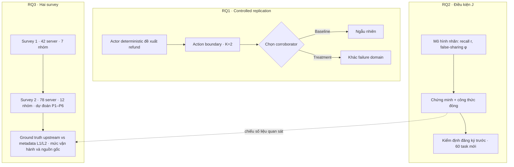

# Supervisor Briefing — RQ và Methodology (v2.0)

> [!purpose] Mục đích buổi review
> Tài liệu này xin giảng viên đánh giá năm điểm:
> - việc định vị lại đề tài;
> - ba **Research Question**;
> - tính hợp lý của **methodology**;
> - **mức contribution**;
> - khả năng nộp một workshop.
>
> Giảng viên không cần kiểm tra từng test case hay từng server trong survey. Đọc trong khoảng 15 phút.

## 0. Thay đổi so với v1.0 (2026-10-10)

| Mục | v1.0 | v2.0 |
|---|---|---|
| Quy tắc `J` (RQ2) | Mới kiểm tra bằng số | **Có chứng minh** với công thức đóng, dưới các giả định nêu rõ; **có kiểm định đăng ký trước** trên 60 task mới |
| Survey (RQ3) | 1 survey, 42 server, AI gán nhãn | Thêm **survey 2**: mẫu mới 78 server, 12 nhóm, 6 dự đoán ghi trước; một người gán nhãn đã kiểm tra 10 server của survey 1 |
| Kết luận survey | "Hiếm khi sai"; "web search không có nguồn độc lập" | Survey 2 **không lặp lại** hai kết luận này. Paper đã sửa lại |

Bối cảnh định vị lại không đổi. Ngày 2026-10-06, tác giả tìm thấy hai công trình liên quan:
- **VP-Control** ([arXiv:2609.10969](https://arxiv.org/abs/2609.10969)) đã đo, với thiết kế mạnh hơn, đúng phần so sánh có kiểm soát trong RQ ban đầu.
- **EFD** ([arXiv:2609.02925](https://arxiv.org/abs/2609.02925)) chứng minh về cấu trúc rằng thêm reviewer không sửa được lỗi khi các reviewer dùng chung một upstream.

Cả hai đều **giả định nhãn lineage có sẵn và đúng**. Vì vậy, RQ ban đầu được giữ lại và trình bày như một replication. Đóng góp chính chuyển sang **chất lượng của failure-domain metadata**.

**Cần nói thẳng:** RQ2 và RQ3 được thêm **sau** khi đã biết kết quả RQ1. Bài bù cho điểm yếu này bằng hai cách:
- mọi bước thu thập và kiểm định sau đó đều có protocol được viết và xác nhận **trước**;
- mọi thay đổi sau khi khóa đều ghi thành amendment có ngày.

Đây vẫn là protocol nội bộ, không đăng ký trên registry độc lập.

## 1. Tóm tắt trong một phút

AI agent dùng tool có thể nhận output sai nhưng vẫn đúng schema. Hai tool khác tên có thể cùng đọc một API. Khi đó, kiểm tra chéo giữa chúng chỉ cho ra một sự đồng thuận giả. Chọn nguồn đối chứng thuộc **failure domain** khác sẽ giải quyết được vấn đề, với điều kiện phải biết tool nào dùng chung nguồn. Bài hỏi: cần biết chính xác đến mức nào, và trong thực tế ta biết được đến mức nào?

- **RQ1 (replication).** Trong mô phỏng refund có kiểm soát, chọn khác failure domain cho `0/150` quyết định refund sai, so với `30/150` khi chọn ngẫu nhiên.
- **RQ2 (điều kiện).** Metadata có ích **khi và chỉ khi** `J = r − φ > 0`, nghĩa là tỷ lệ phát hiện đúng phụ thuộc chung cao hơn tỷ lệ gán nhầm. Khi `J < 0`, metadata **gây hại**. Kết quả này đã được chứng minh dưới các giả định nêu rõ. Trong kiểm định đăng ký trước, `J = −0.5` làm tỷ lệ quyết định sai **tăng** `+0.133` so với chọn ngẫu nhiên.
- **RQ3 (thực tế).** Kết quả qua hai survey MCP server (42 và 78 server):
  - 16% và 27% cặp cùng nhóm dùng chung nhà cung cấp;
  - metadata agent thấy **thiếu** ở khoảng 70% cặp, và đây là phát hiện lặp lại vững nhất;
  - khi có nhãn thì nhãn phần lớn đúng (`J > 0`), nhưng không hoàn hảo;
  - tên bên vận hành bỏ sót phụ thuộc ở mức nguồn dữ liệu gốc.

**Thông điệp:** nút thắt thực tế là metadata **thiếu**, và khi có thì chỉ ở mức bên vận hành. Metadata **sai** là vấn đề nhỏ hơn.

## 2. Ba Research Question

### RQ1 — controlled replication

**RQ1. Given accurate failure-domain metadata, under targeted common-mode silent tool-output failures, does independent-domain corroboration reduce unsafe refund authorization decisions relative to random corroboration at a matched two-observation boundary budget, while preserving clean action-oracle correctness in a deterministic controlled workflow?**

Câu hỏi: khi biết chính xác tool nào dùng chung failure domain, chọn nguồn đối chứng khác domain có giảm quyết định refund sai so với chọn ngẫu nhiên không, với cùng hai observation cho mỗi lần đề xuất refund?

### RQ2 — điều kiện về chất lượng nhãn

**RQ2. Under class-conditional failure-domain label errors, for which combinations of shared-dependency recall `r` and false-sharing rate `φ` does failure-domain-aware corroborator selection reduce, match, or increase the chance of selecting a shared-domain corroborator relative to random selection?**

Câu hỏi: metadata có thể bỏ sót phụ thuộc chung (`r` thấp) hoặc gán nhầm nguồn độc lập thành chung (`φ` cao). Khi nào thì chọn theo failure domain tốt hơn, bằng, hay tệ hơn chọn ngẫu nhiên?

### RQ3 — metadata thực tế

**RQ3. Among open-source MCP servers that provide the same information type, how often do two servers share an upstream data provider, and how well does agent-visible metadata reveal that sharing?**

Câu hỏi: trong các MCP server cùng cung cấp một loại thông tin, bao nhiêu cặp lấy dữ liệu từ cùng nhà cung cấp? Và nếu agent chỉ đọc tên và mô tả của tool, nó có nhận ra điều đó không?

## 3. Methodology

Sơ đồ là phần tổng hợp thiết kế. ^[inferred]

**RQ1 (không đổi).**
- Thiết kế: 30 task đóng băng × 3 policy × 3 regime × 5 seed = 1.350 decision rows.
- Outcome: quyết định refund sai (unsafe refund decision) và tính đúng của quyết định so với oracle (action-oracle correctness).
- Phân tích: paired task-cluster bootstrap.
- Kèm theo: robustness 3.750 rows, negative control, counterfactual always-escalate.
- Không chạy LLM và không thực thi refund.

**RQ2.**
- **Chứng minh** công thức đóng: `P(chọn nhầm) − s/n = −(s(n−s)/n)·J·E[1/(1+K)]`. Hai thừa số kia luôn dương, nên dấu của chênh lệch do `J` quyết định. Hệ quả: thiếu nhãn chỉ làm hiệu ứng **nhỏ đi**, không đảo chiều.
- **Kiểm chứng bằng tính toán:** lưới 2.205 điểm và Monte Carlo độc lập; công thức khớp với liệt kê chính xác đến `10⁻¹⁶`.
- **Kiểm định đăng ký trước:** 60 task mới, 4.800 rows, 4 điều kiện nhãn, quy tắc đạt/không đạt ghi trước. Có một amendment sửa một dự đoán **trước khi chạy**.
- **Power analysis** cho robustness criterion của RQ1.

**RQ3: hai survey, mỗi survey có protocol viết trước khi thu thập.**
- **Mẫu.** Truy vấn GitHub cố định, sắp theo số sao. Danh sách kết quả được khóa bằng hash trước khi đọc code. Sàng lọc theo thứ tự hạng với 5 tiêu chí. Survey 2 dùng mẫu mới, loại mọi repo đã xét ở survey 1.
- **Ground truth.** Nhà cung cấp API mà code gọi theo cấu hình mặc định, đọc tại commit được ghim, kèm bằng chứng file và số dòng. Chỉ đọc tĩnh, không chạy code.
- **Metadata.** L1 gồm tên server, tên và mô tả tool, tức là thứ agent thấy. L2 là L1 cộng README.
- **Đại lượng.**
  - Tỷ lệ cặp dùng chung (ρ) và tỷ lệ thiếu nhãn (m).
  - `r`, `φ`, `J`, đo ở hai mức: bên vận hành và nguồn dữ liệu gốc.
  - Bootstrap theo server.
  - Phép chiếu lên mô hình RQ2.
- **Survey 2 kiểm định survey 1.** Có 6 dự đoán P1–P6, mỗi dự đoán kèm quy tắc đánh giá. Phân tích mức nguồn gốc được đăng ký trước, trong khi ở survey 1 phần này là post-hoc.
- **Gán nhãn.**
  - Coder A là AI.
  - Survey 1: một người gán độc lập 10 server.
  - Survey 2: đã chọn 20 server bằng hash để người gán nhãn, nhưng **chưa có nhãn**.

## 4. Evidence hiện có

| Evidence | Thiết kế | Kết quả chính | Được phép kết luận |
|---|---|---|---|
| RQ1 main study | 1.350 rows | Unsafe `30/150` vs `0/150`; Δ `−0.200`, CI `[−0.273, −0.127]` | Replication có điều kiện trong mô phỏng; chỉ ngăn quyết định sai (containment), không phục hồi được refund bị từ chối sai (recovery) |
| Robustness | 3.750 rows | Nhãn sai 25%: CI chạm 0, **FAIL** | Không claim robust; power chỉ khoảng 56% ở 30 task |
| RQ2 chứng minh | Giải tích + kiểm tra số | `J > 0` ⇔ tốt hơn random | Định lý **trong phạm vi giả định**; chưa có người độc lập kiểm tra |
| RQ2 kiểm định đăng ký trước | 60 task mới, 4.800 rows | `J = −0.5`: `+0.133` [+0.070, +0.200]; `J = +0.8`: `−0.177`; theo survey: `−0.093`; tương đương tại `J = 0`: **không xác nhận** | Mô phỏng do project thiết kế; giá trị nằm ở kỷ luật kiểm định, không ở tính mới |
| Survey 1 | 42 server, 105 cặp | ρ 0.16 `[0.075, 0.281]`; m_L1 0.70; `r = 8/8`, `φ = 0/24` | Mô tả; người kiểm tra 10 server: upstream 0.80 (κ 0.78), L1 1.00 sau chuẩn hóa tên |
| Survey 2 | 74 server, 245 cặp | ρ 0.27 `[0.18, 0.37]`; m_L1 0.71; L1 `r = 23/27`, `φ = 3/45`; L2 `J = 0.89`; nguồn gốc: recall 0.83 so với 0.95 | **4/6 dự đoán đạt**; AI-coded, chưa có người kiểm tra |
| Secondary, live agent | 1.056 rows; 16 live cells | Live `0/4` matched pairs | Exploratory; không có live effect estimate |

**Hai dự đoán không đạt ở survey 2:**
- **P3** đặt ngưỡng tỷ lệ gán nhầm ≤ 0.05; thực tế là 0.067. Cả ba cặp gán nhầm đều do metadata nêu nguồn dữ liệu thay vì bên vận hành. Diễn giải này là post-hoc.
- **P5** dự đoán có nhóm không có nguồn độc lập. Nhóm cao nhất là web search với 0.71, dưới ngưỡng 0.80.

Hai phát hiện này của survey 1 đã được bỏ khỏi paper.

## 5. Contribution có thể bảo vệ

### Claim được hỗ trợ

1. **Replication** độc lập của hiệu ứng nguồn độc lập trong miền refund, kèm kết quả âm khi nhãn sai và giải thích về power.
2. **Điều kiện `J`**: một quy tắc đơn giản, có chứng minh, cho biết khi nào metadata failure-domain giúp, không giúp, hay gây hại. Quy tắc được kiểm định cả hai chiều trong mô phỏng có đăng ký trước.
3. **Bằng chứng mô tả về metadata thật**, lặp lại trên hai mẫu:
   - dùng chung upstream có thật và thay đổi mạnh theo nhóm;
   - metadata agent thấy thiếu ở khoảng 70% cặp;
   - khi có thì phần lớn đúng;
   - tên bên vận hành không đủ ở mức nguồn gốc.
4. **Hàm ý thực hành:** đưa tên nhà cung cấp và nguồn dữ liệu gốc vào mô tả tool. Theo phép chiếu, xác suất chọn nhầm giảm từ 0.289 xuống 0.109.

### Claim không được dùng

- "Chúng tôi là người đầu tiên chứng minh nguồn độc lập tốt hơn nguồn chung." (VP-Control đã làm.)
- "Metadata thực tế là chính xác" hoặc "khi có nhãn thì không bao giờ sai." (Survey 2: `φ_L1 = 3/45`.)
- "Có nhóm tool không có nguồn độc lập." (Survey 2 không lặp lại.)
- "Quy tắc `J` đúng với mọi mô hình lỗi nhãn." (Chỉ đúng dưới các giả định đã nêu.)
- "Robustness thật ra là PASS." (FAIL giữ nguyên.)
- "Kết quả survey đo hành vi agent." (Đó là phép chiếu lên mô hình.)
- "Live agent đã xác nhận phương pháp." (Không có live effect estimate.)

Danh sách đầy đủ: [[projects/reliable-tool-using-ai-agents/paper/claim-evidence-ledger]] (C33–C46).

## 6. Điểm mạnh và điểm yếu

### Điểm mạnh

- Trung thực về prior art: tự phát hiện phần đã bị làm trước và định vị lại công khai.
- Phần sau định vị lại theo quy trình **protocol trước, dữ liệu sau**:
  - mỗi survey và kiểm định đều có protocol được xác nhận trước;
  - có amendment ghi ngày;
  - script được commit trước khi tính chỉ số.
- Báo cáo đầy đủ kết quả không đạt: E1 ở survey 1; P3 và P5 ở survey 2; H-J3 ở kiểm định `J`; robustness FAIL.
- Các lỗi tự phát hiện đều được sửa công khai: lỗi sàng lọc, lỗi phép chiếu, một dự đoán tính sai trước khi chạy, và lỗi cài đặt phân tích mức nguồn gốc.
- Toàn bộ chạy offline, không tốn chi phí API.

### Điểm yếu

- RQ2 và RQ3 được thêm sau khi biết kết quả RQ1. Protocol là nội bộ, không đăng ký trên registry độc lập.
- Chứng minh `J` do AI hỗ trợ và chưa có người độc lập kiểm tra. Chứng minh chưa bao phủ ba trường hợp: nhãn tương quan giữa các tool, nhãn primary sai, chọn nhiều corroborator.
- Survey do AI gán nhãn. Con người mới kiểm tra 10/42 server của survey 1; nhãn người cho survey 2 đang chờ.
- Mẫu là các repo MCP phổ biến trên GitHub. ρ theo từng nhóm khác xa giữa hai mẫu, ví dụ currency 0.00 so với 0.64.
- RQ1 vẫn là mô phỏng quyết định, gần như suy ra được từ cách dựng thí nghiệm, và không có live effect estimate.

## 7. Kế hoạch đến hạn nộp (khoảng đầu tháng 11/2026)

| Thời gian | Việc |
|---|---|
| Khi người gán nhãn gửi lại | Tính agreement cho survey 2, cập nhật §5.12 và ledger |
| Sau phản hồi của giảng viên | Chỉnh RQ, trọng tâm và contribution theo góp ý; thêm hình cho survey |
| Tuần cuối | Định dạng, proofread, khóa snapshot nộp môn |
| Sau môn học, nếu giảng viên đồng ý | Bản tiếng Anh rút gọn khoảng 4–8 trang cho một workshop |

Tùy chọn, chỉ làm nếu giảng viên thấy cần: một robustness study mới khoảng 60 task, với protocol khóa trước. Việc này chỉ cần CPU, không tốn tiền.

## 8. Năm quyết định cần xin giảng viên

### Q1 — Việc định vị lại

Trình bày RQ1 như một replication và chuyển đóng góp chính sang chất lượng metadata (RQ2, RQ3) có hợp lý không?

- [ ] `APPROVE`
- [ ] `REVISE`
- [ ] `REJECT`
- Lý do/đề xuất:

### Q2 — Thêm RQ sau khi có kết quả

RQ2 và RQ3 được thêm sau RQ1. Bù lại, các bước sau đó có protocol viết trước và báo cáo cả kết quả không đạt. Cách làm này có chấp nhận được không, nếu được nói rõ trong Threats to Validity (§7.7)?

- [ ] Chấp nhận nếu disclosure rõ
- [ ] Cần thu hẹp thành một RQ chính
- [ ] Không chấp nhận
- Lý do/đề xuất:

### Q3 — Độ tin cậy của survey

Hai survey (120 server) do AI gán nhãn, với người kiểm tra 10 server ở survey 1 và 20 server ở survey 2 (đang chờ). Như vậy đã đủ chưa?

- [ ] Đủ nếu limitations được nêu đúng
- [ ] Cần thêm người gán nhãn
- [ ] Cần thêm loại kiểm tra khác:
- Lý do/đề xuất:

### Q4 — Trọng tâm paper

Paper nên nhấn mạnh phần nào nhất?

- [ ] Điều kiện `J` (RQ2)
- [ ] Bằng chứng về metadata thật (RQ3)
- [ ] Cả hai như hiện tại
- [ ] Khác:

### Q5 — Nộp workshop

Tác giả muốn, nếu đủ chất lượng, nộp một workshop làm paper đầu tay. Giảng viên có đồng ý không, và có gợi ý venue nào phù hợp không? (Ví dụ: workshop về agent reliability hoặc tool use ở một hội nghị ML hay SE.) Giảng viên có muốn đứng tên với vai trò người hướng dẫn không?

- [ ] Đồng ý, venue gợi ý:
- [ ] Chưa nên, cần thêm:
- [ ] Không
- Ghi chú:

## 9. Tài liệu nên đọc kèm

1. [[projects/reliable-tool-using-ai-agents/paper/paper-draft]]: paper v1.4. Nên đọc §1, §5.8, §5.11, §5.12, §6.4 và §7.7.
2. [[projects/reliable-tool-using-ai-agents/paper/proof-j-condition]]: chứng minh quy tắc `J`, kèm ví dụ tính tay.
3. [[journal/2026-10-14-expanded-tool-survey-results]]: kết quả survey 2 và đối chiếu dự đoán.
4. [[journal/2026-10-12-label-quality-test-results]]: kiểm định đăng ký trước cho `J`.
5. [[journal/2026-10-06-prior-art-refresh-vp-control-and-efd]]: lý do định vị lại.
6. [[projects/reliable-tool-using-ai-agents/paper/claim-evidence-ledger]]: ranh giới các claim.

## Trạng thái

**PRELIMINARY.** Paper đang ở v1.4.
- Chưa có phản hồi của giảng viên.
- Chưa có agreement của survey 2.
- Chưa có human sign-off cho chứng minh.
- Mọi review trong hồ sơ là AI-assisted.
