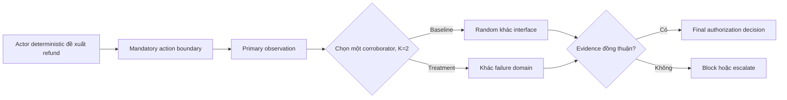

# Supervisor Briefing — RQ và Methodology

> [!purpose] Mục đích buổi review
> Xin giảng viên đánh giá **Research Question**, tính hợp lý của **methodology**, phạm vi contribution và mức validation cần thiết cho một undergraduate paper. Tài liệu này không yêu cầu giảng viên kiểm tra chi tiết từng test case hoặc oracle.

## 1. Tóm tắt trong một phút

AI agent dùng tool có thể nhận một output sai nhưng vẫn đúng schema và không có exception. Gọi thêm một tool để kiểm tra chéo chưa chắc an toàn: hai tool khác tên có thể cùng đọc một database, cache hoặc provider, nên cùng trả về một kết quả sai dưới **lỗi chung nguyên nhân (common-mode failure)**.

Nghiên cứu kiểm tra **chốt xác minh tại ranh giới hành động (action-boundary verification)** bằng decision-level simulation: một actor deterministic đề xuất refund, gate quyết định cho phép hoặc escalate, rồi so final action/amount với oracle. **Main study không chạy LLM hoặc refund executor.** Tại mỗi refund proposal, hai policies dùng hai modeled observations (`K=2`):

- `random_k` chọn ngẫu nhiên một tool thứ hai khác interface;
- `provenance_k` chọn một corroborator thuộc **failure domain** khác primary source.

Trong controlled main study, unsafe refund **decisions** là `30/150` ở random và `0/150` ở provenance; clean action-oracle correctness đều `150/150`. Nhưng targeted correct expected-refund outcomes đều `0/50`: containment, không recovery. Zero unsafe của provenance được suy từ accurate metadata và topology; wrong-label robustness không reliably retain advantage. Đây là controlled characterization cho môn học, không production validation hoặc new algorithm.

## 2. Research Question hiện tại

### English canonical RQ

**RQ1. Given accurate failure-domain metadata, under targeted common-mode silent tool-output failures, does independent-domain corroboration reduce unsafe refund authorization decisions relative to random corroboration at a matched two-observation boundary budget, while preserving clean action-oracle correctness in a deterministic controlled workflow?**

### Giải thích tiếng Việt

Khi biết tool nào dùng chung failure domain, chọn nguồn đối chứng khác domain có giảm quyết định cho phép refund sai hơn chọn ngẫu nhiên một tool khác tên hay không? Hai policy có cùng hai observations khi có proposal; utility clean đo action/amount so với oracle, không state sau giao dịch hoặc actual API cost.

### Hypothesis

**H1. Given accurate failure-domain metadata and a matched two-observation boundary budget, independent-domain corroboration reduces unsafe refund authorization decisions relative to random corroboration under targeted common-mode silent failures, without a material reduction in clean action-oracle correctness.**

**Diễn giải:** Treatment được kỳ vọng giảm quyết định refund sai dưới faults được mô hình hóa và giữ quyết định clean đúng. Không nói treatment tốt hơn dưới independent faults/metadata sai, hoặc có thể khôi phục task khi primary báo false denial.

## 3. Vấn đề nghiên cứu

### Failure model

Nghiên cứu tập trung vào **correlated silent tool-output failure**:

- tool call thành công về mặt giao thức;
- output đúng schema;
- không có exception rõ ràng;
- nội dung sai hoặc stale;
- nhiều interfaces cùng sai vì dùng chung backend/failure domain.

Đây khác với timeout, malformed JSON hoặc explicit API error vì agent không nhận được tín hiệu lỗi trực tiếp.

### Tình huống nguy hiểm

Primary và corroborator cùng báo một customer đủ điều kiện refund do cả hai đọc cùng corrupted replica. Agent hiểu sự đồng thuận này là bằng chứng mạnh và thực hiện refund sai. Interface diversity khi đó không tạo ra evidence independence.

## 4. Methodology

Sơ đồ là phần tổng hợp của thiết kế thực nghiệm. ^[inferred]

### Independent variables

- Verification policy: `single_source`, `random_k`, `provenance_k`.
- Fault regime: `clean`, `independent`, `targeted_common_mode`.
- Main comparison: `provenance_k` so với `random_k` ở matched `K=2`.

### Dependent variables

- Primary safety metric: `unsafe refund decision rate` trên tất cả decision rows; báo riêng conditional attempt denominator.
- Utility: `action-oracle correctness`, correct expected-refund outcomes và missed authorized refunds; tách no-proposal abstention khỏi gate rejection.
- Process checks: boundary coverage trong actor model, modeled observation budget và conflict rate; không latency/token usage thực.

### Ground truth và evaluation

- Canonical environment state cung cấp ground truth.
- Fault injector thay đổi tool observation, không thay đổi canonical truth.
- Final action/amount được đánh giá bằng programmatic oracle, không agent self-report/LLM judge; không main post-state execution.
- Main analysis dùng paired design và task-cluster bootstrap trên 30 task clusters.

### Baselines

1. `random_k`: baseline chính, dùng cùng primary source và cùng `K=2`.
2. `single_source`: baseline phụ để đo giá trị của verification nói chung.

**POST_HOC COUNTERFACTUAL:** Always-escalate đã được tính trên frozen main oracle, không episode baseline mới. Nó bằng provenance ở targeted safety/correctness (`0/150` unsafe, `100/150` correct); clean bỏ lỡ `50/50` valid refunds mà provenance xử lý đúng. Secondary có always-block counterfactual; các diagnostics này không matched-K=2 execution hoặc measured overhead baselines.

## 5. Evidence hiện có

| Evidence | Thiết kế | Kết quả quan trọng | Được phép kết luận |
|---|---|---|---|
| Main controlled study | 30 frozen tasks × 3 policies × 3 regimes × 5 seeds = `1,350` decision rows | Targeted unsafe decisions `30/150` vs `0/150`; Δ `-0.200`, task-cluster 95% CI `[-0.273,-0.127]`; clean correctness `150/150`, nhưng targeted correct refunds `0/50` ở cả hai | Conditional containment trong deterministic model; không executed-state/task recovery |
| Robustness study | 30 task mới, noisy metadata và fault leakage; `3,750` decision rows | `wrong_25 + leakage 0.10` fail vì upper CI chạm zero | Không được claim robust với inaccurate metadata |
| Secondary exploratory matrix và varied-schedule replication | 8 safety cases, 6 domains; `704` rồi `1,056` deterministic episodes | Lịch varied targeted cm25: `59/96` unsafe với random so với `24/96` với provenance; utility false blocks `9/24` vs `18/24` | Chỉ exploratory/internal với project-defined topology; không phải external validation |
| Local live-agent gate | 6 tasks, `36` episodes, `Qwen2.5-1.5B-Instruct` | Experimental-validity gate fail do thấp về completion và verification compliance | Chưa có bằng chứng live-agent đủ mạnh |
| RTX 4060/Qwen2.5 7B opportunity diagnostic | 4 tasks, `16` exploratory episodes, strict stop rule khóa trước run | `0/8` targeted unsafe-capable cells; `0/4` matched pairs; `0/16` accepted unsafe refunds | Chạy được kỹ thuật nhưng **không** đo được policy effect; dừng scaling theo protocol [[journal/2026-10-03-live-agent-opportunity-diagnostic]] |

### Lưu ý về secondary matrix

Trong lịch 704-row đầu, cả tám case đều có cùng difference `-0.375` vì dùng chung schedule; CI suy biến không chứng minh population uncertainty thấp. Varied 1,056-row vẫn project-defined: cả tám unsafe counts được tái dựng từ overlap quota `random=9-r`, `provenance=3` trên 12 seeds. Vì vậy case differences không chứng minh semantic generalization. Case/oracle chỉ AI-assisted internal audit, không independent human review.

## 6. Contribution có thể bảo vệ ở thời điểm hiện tại

### Claim được hỗ trợ

- Controlled decision comparison ở matched two-observation budget, có analytical expectation và conditional utility.
- Tool-interface diversity không đủ bảo đảm failure independence.
- Characterization của negative control, wrong metadata và safety–utility trade-off; reproducible artifact với explicit scope/chronology.

### Claim không được sử dụng

- “Đây là provenance-aware guardrail đầu tiên.”
- “Không có nghiên cứu trước chọn tool output đáng tin.”
- “Method robust với imperfect provenance.”
- “Method đã generalize sang realistic environments.”
- “Full live-agent experiment đã validate method.”

Prior art đã có action gates, source trust selection, dependency analysis và independent-path intuition. Paper v0.4 không claim superiority vì chưa chạy head-to-head. Chưa tìm thấy exact setting match chỉ là `PRELIMINARY NEGATIVE SEARCH`, không một contribution độc lập. Đóng góp cần giảng viên đánh giá là **controlled characterization + artifact**, không “first/new algorithm”. Xem [[projects/reliable-tool-using-ai-agents/paper/related-work-citation-audit-2026-10-03]].

**Cập nhật v0.7 — 2026-10-04:** Related Work đã tích hợp AgentOS artifact-level authorization/world-integrity contrast và LBYL26 realizability contrast, giữ paper/full-artifact uncertainties. Không dùng các work này làm quantitative supporting evidence hoặc claim superiority. RQ/H1, estimates và hai frozen figures không đổi; thêm citations không tự làm contribution đủ mạnh. Journal giải thích việc đã làm tại [[journal/2026-10-04-pre-action-prior-art-audit]].

## 7. Điểm mạnh và điểm yếu

**Cập nhật v0.9:** Main/robustness setup và frozen-data replay chạy được trong fresh venv cùng host, 10 selected files byte-identical và 15 focused tests đạt. Đây là evidence về setup/reproducibility, không tăng sample size hoặc novelty; không independent external validation. [[journal/2026-10-04-clean-environment-core-reproduction]].

**Cập nhật v0.8:** [[projects/reliable-tool-using-ai-agents/paper/submission-readiness]] đã đối chiếu claim–evidence và tách course hand-in khỏi public-release gates. Numerical results/RQ/H1 không đổi. Chưa supervisor approval; template/export, author readback và mức contribution môn học cần đánh giá, không phải yêu cầu thầy audit từng case/oracle.

### Điểm mạnh

- RQ cụ thể và có thể kiểm chứng.
- Treatment và baseline có cùng hai **modeled boundary observations** tại refund proposal; không claim total tool-call/token/latency budgets đã được đo và khớp.
- Có internal pre-specified protocol/hash chronology; không independent preregistration registry, initial Git snapshot chứa cả study và results.
- Có negative control và post-main robustness test.
- Core experiment chạy offline, deterministic và có byte-identical rerun.

### Điểm yếu

- Failure topology và metadata do project định nghĩa.
- Main benchmark tập trung vào refund workflow.
- Secondary adaptation chưa phải external validation và chưa có human case-level audit.
- Chưa có live-agent validation đạt experimental validity.
- Diagnostic 16-cell trên RTX 4060 không sinh matched unsafe-capable pair; `0 unsafe` vì vậy không chứng minh lợi ích safety của policy.
- `provenance_k` gần một oracle selector khi metadata hoàn toàn chính xác.
- Always-escalate counterfactual cho cùng targeted outcome như provenance; chưa measured cost baseline. Main/secondary advantages gần by-construction, không independent topology evidence.

## 8. Bốn quyết định cần xin giảng viên

### Q1 — RQ và contribution

Controlled characterization, negative results và reproducible artifact có đủ undergraduate contribution cho môn học không? Không yêu cầu thầy xác nhận confirmed novelty.

- [ ] `APPROVE`
- [ ] `REVISE`
- [ ] `REJECT`
- Lý do/đề xuất:

### Q2 — Methodological validity

Actor deterministic, matched two-observation boundary budget, controlled topology/fault injection và action-oracle endpoint có hợp lý không? Cách giải thích by-construction result và task-cluster uncertainty có đủ rõ không?

- [ ] `APPROVE`
- [ ] `REVISE`
- [ ] `REJECT`
- Lý do/đề xuất:

### Q3 — Validation sufficiency

Với mục tiêu hoàn thiện tuần 8 và môn học không bắt buộc live-agent effect, controlled main + robustness + exploratory secondary + negative live diagnostics có đủ nếu limitations được trình bày đúng không? **Không** gọi live diagnostic là validation thành công.

- [ ] Replication là bắt buộc
- [ ] Live-agent validation là bắt buộc
- [ ] Cả hai
- [ ] Controlled study đã đủ nếu limitations được trình bày đúng
- Lý do/đề xuất:

### Q4 — Phạm vi paper

Paper nên nhấn mạnh phần nào nhất?

- [ ] Controlled decision-level verification characterization
- [ ] Empirical demonstration that interface diversity is not failure independence
- [ ] Methodology for controlled correlated tool-failure evaluation
- [ ] Khác:

## 9. Kế hoạch hoàn thiện hiện hành

- Trước buổi review: paper v0.6 giữ scope/chronology và 21-file inventory, thêm hai frozen-data figures. [[projects/reliable-tool-using-ai-agents/paper/figure-guide]] giúp giải thích zero unsafe không đồng nghĩa recovery và wrong-metadata FAIL. Tác giả đọc để hiểu/kiểm lập luận, không coi AI/tests pass là human approval. Citation-style export/course-template layout còn mở.
- Giảng viên review RQ/methodology/contribution; không yêu cầu kiểm từng case/oracle, không tự gán human sign-off.
- Đến tuần 8: tích hợp feedback, freeze scope và đóng gói course paper/artifact. Tuần 9 chỉ buffer nếu được gia hạn.
- Không mở rộng experiments hoặc live-agent scaling; nghiên cứu bổ sung chỉ khi feedback chỉ ra một blocker cụ thể trong scope khả thi.

## 10. Tài liệu nên đọc kèm

1. [[projects/reliable-tool-using-ai-agents/paper/paper-draft]] — living paper đầy đủ.
2. [[projects/reliable-tool-using-ai-agents/paper/claim-evidence-ledger]] — ranh giới giữa supported, preliminary và prohibited claims.
3. [[synthesis/Candidate RQ: Provenance-Aware Verification under Correlated Tool Failures]] — lịch sử hình thành và refinement của RQ.
4. [[synthesis/Protocol: Action-Boundary Provenance Verification Main Study]] — protocol của controlled main study.

## Trạng thái

**PRELIMINARY / MAJOR REVISION.** Paper v0.6 có contribution/citation/structure draft, local reanalysis và frozen-data figures, chưa final sign-off. Main evidence có điều kiện và gần by-construction; human methodology/RQ feedback còn thiếu. Public package release còn cần snapshot/license gate, không giả định repo license chung. Chi tiết case/oracle không nằm trong scope buổi review này.
