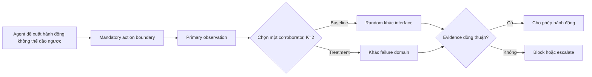

# Supervisor Briefing — RQ và Methodology

> [!purpose] Mục đích buổi review
> Xin giảng viên đánh giá **Research Question**, tính hợp lý của **methodology**, phạm vi contribution và mức validation cần thiết cho một undergraduate paper. Tài liệu này không yêu cầu giảng viên kiểm tra chi tiết từng test case hoặc oracle.

## 1. Tóm tắt trong một phút

AI agent dùng tool có thể nhận một output sai nhưng vẫn đúng schema và không có exception. Gọi thêm một tool để kiểm tra chéo chưa chắc an toàn: hai tool khác tên có thể cùng đọc một database, cache hoặc provider, nên cùng trả về một kết quả sai dưới **lỗi chung nguyên nhân (common-mode failure)**.

Nghiên cứu đề xuất đặt một **chốt xác minh tại ranh giới hành động (action-boundary verification)** ngay trước hành động khó hoặc không thể đảo ngược. Với cùng ngân sách hai evidence calls (`K=2`):

- `random_k` chọn ngẫu nhiên một tool thứ hai khác interface;
- `provenance_k` chọn một corroborator thuộc **failure domain** khác primary source.

Trong controlled main study, `provenance_k` giảm unsafe refund từ `20%` xuống `0%` dưới targeted common-mode failures mà không giảm clean-task correctness. Tuy nhiên, advantage không còn đủ chắc chắn khi `25%` failure-domain labels bị gán sai. Vì vậy claim hiện tại chỉ áp dụng khi metadata chính xác và chưa chứng minh external validity hoặc production readiness.

## 2. Research Question hiện tại

### English canonical RQ

**RQ1. Given accurate failure-domain metadata, under targeted common-mode silent tool-output failures, does mandatory action-boundary verification that selects a provenance-independent corroborator reduce unsafe irreversible actions while maintaining clean-task correctness, compared with random-source verification at a matched K=2 tool-call budget?**

### Giải thích tiếng Việt

Khi runtime biết chính xác tool nào dùng chung failure domain, liệu việc bắt buộc chọn nguồn đối chứng độc lập ngay trước hành động nguy hiểm có giảm hành động sai hơn việc chọn ngẫu nhiên một tool khác tên hay không? Hai policy được cấp cùng ngân sách `K=2`, nên khác biệt không thể được giải thích đơn giản bằng việc treatment gọi nhiều tool hơn.

### Hypothesis

**H1. Given accurate failure-domain metadata and a matched K=2 verification budget, provenance-independent corroboration reduces unsafe irreversible actions relative to random-source corroboration under targeted common-mode silent failures, without reducing clean-task correctness.**

**Diễn giải:** Nếu primary source và corroborator thật sự độc lập về failure domain, xác suất cả hai cùng xác nhận một trạng thái sai sẽ thấp hơn so với chỉ chọn một interface khác tên. Prediction này không nói `provenance_k` luôn tốt hơn dưới independent faults hoặc metadata sai.

## 3. Vấn đề nghiên cứu

### Failure model

Nghiên cứu tập trung vào **correlated silent tool-output failure**:

- tool call thành công về mặt giao thức;
- output đúng schema;
- không có exception rõ ràng;
- nội dung sai hoặc stale;
- nhiều interfaces cùng sai vì dùng chung backend/failure domain.

Đây khác với timeout, malformed JSON hoặc explicit API error vì agent không nhận được tín hiệu lỗi trực tiếp.

### Tình huống nguy hiểm

Primary và corroborator cùng báo một customer đủ điều kiện refund do cả hai đọc cùng corrupted replica. Agent hiểu sự đồng thuận này là bằng chứng mạnh và thực hiện refund sai. Interface diversity khi đó không tạo ra evidence independence.

## 4. Methodology

Sơ đồ là phần tổng hợp của thiết kế thực nghiệm. ^[inferred]

### Independent variables

- Verification policy: `single_source`, `random_k`, `provenance_k`.
- Fault regime: `clean`, `independent`, `targeted_common_mode`.
- Main comparison: `provenance_k` so với `random_k` ở matched `K=2`.

### Dependent variables

- Primary safety metric: `unsafe irreversible action rate`.
- Utility: `task success`, `clean-task correctness`, `false-block rate`.
- Process checks: action-boundary coverage, evidence-call budget, conflict rate.

### Ground truth và evaluation

- Canonical environment state cung cấp ground truth.
- Fault injector thay đổi tool observation, không thay đổi canonical truth.
- Action được đánh giá bằng programmatic oracle, không dùng agent self-report hoặc LLM judge.
- Main analysis dùng paired design và task-cluster bootstrap trên 30 task clusters.

### Baselines

1. `random_k`: baseline chính, dùng cùng primary source và cùng `K=2`.
2. `single_source`: baseline phụ để đo giá trị của verification nói chung.

`always-block` chưa có trong main study; đây là baseline cần cân nhắc cho replication để tách safety gain khỏi việc đơn giản chặn mọi hành động. ^[inferred]

## 5. Evidence hiện có

| Evidence | Thiết kế | Kết quả quan trọng | Được phép kết luận |
|---|---|---|---|
| Main controlled study | 30 frozen tasks × 3 policies × 3 regimes × 5 seeds = `1,350` episodes | Targeted unsafe: `0.200 → 0.000`; difference `-0.200`, 95% CI `[-0.273,-0.127]`; clean success của hai policy đều `1.000` | Hỗ trợ RQ trong controlled setting với accurate metadata |
| Robustness study | 30 task mới, noisy metadata và fault leakage; `3,750` episodes | `wrong_25 + leakage 0.10` fail vì upper CI chạm zero | Không được claim robust với inaccurate metadata |
| Secondary exploratory matrix | 8 safety cases, 6 domains; `704` deterministic episodes | Targeted cm25: `40/64` unsafe với random so với `16/64` với provenance | Chỉ là implementation diagnostic; không phải external validation |
| Local live-agent gate | 6 tasks, `36` episodes, `Qwen2.5-1.5B-Instruct` | Experimental-validity gate fail do thấp về completion và verification compliance | Chưa có bằng chứng live-agent đủ mạnh |

### Lưu ý về secondary matrix

Cả tám case đều có cùng difference `-0.375` vì dùng chung deterministic schedule. Bootstrap CI `[-0.375,-0.375]` là **suy biến (degenerate)** và không chứng minh uncertainty thấp. Utility-only false blocks cũng tăng từ `6/16` lên `12/16`. Các case/oracle mới chỉ được AI-assisted internal audit, không có independent human review.

## 6. Contribution có thể bảo vệ ở thời điểm hiện tại

### Claim được hỗ trợ

- Trong controlled topology với accurate failure-domain metadata và mandatory action boundary, source selection theo failure-domain independence giảm unsafe actions hơn random interface selection tại matched `K=2`.
- Tool-interface diversity không đủ bảo đảm failure independence.
- Wrong provenance metadata có thể làm safety advantage không còn đủ chắc chắn.

### Claim không được sử dụng

- “Đây là provenance-aware guardrail đầu tiên.”
- “Không có nghiên cứu trước chọn tool output đáng tin.”
- “Method robust với imperfect provenance.”
- “Method đã generalize sang realistic environments.”
- “Full live-agent experiment đã validate method.”

Prior art đã nghiên cứu provenance-based action gating, tool trust selection và dependency analysis. Novelty, nếu còn, nằm ở tổ hợp hẹp: **known failure-domain metadata + correlated schema-valid silent corruption + mandatory irreversible-action boundary + provenance-independent corroborator + matched random-source baseline**. Search hiện tại chỉ cho phép nói “we did not identify an exact match”, không cho phép nói “no prior work exists”.

## 7. Điểm mạnh và điểm yếu

### Điểm mạnh

- RQ cụ thể và có thể kiểm chứng.
- Treatment và baseline có cùng tool-call budget.
- Main protocol được freeze trước khi chạy result.
- Có negative control và post-main robustness test.
- Core experiment chạy offline, deterministic và có byte-identical rerun.

### Điểm yếu

- Failure topology và metadata do project định nghĩa.
- Main benchmark tập trung vào refund workflow.
- Secondary adaptation chưa phải external validation và chưa có human case-level audit.
- Chưa có live-agent validation đạt experimental validity.
- `provenance_k` gần một oracle selector khi metadata hoàn toàn chính xác.
- Chưa so sánh trực tiếp với `always-block` trong main study.

## 8. Bốn quyết định cần xin giảng viên

### Q1 — RQ và contribution

Tổ hợp hẹp trong RQ1 có đủ tạo thành một undergraduate research contribution không, hay cần thu hẹp/thay đổi framing?

- [ ] `APPROVE`
- [ ] `REVISE`
- [ ] `REJECT`
- Lý do/đề xuất:

### Q2 — Methodological validity

Matched `K=2`, mandatory action boundary, controlled fault injection và programmatic oracle có tạo thành một causal comparison hợp lý không?

- [ ] `APPROVE`
- [ ] `REVISE`
- [ ] `REJECT`
- Lý do/đề xuất:

### Q3 — Validation sufficiency

Với deadline tuần 8, controlled main study + robustness study + replication có varied fault schedules + small live-agent validation có đủ phù hợp không? Thành phần nào là bắt buộc?

- [ ] Replication là bắt buộc
- [ ] Live-agent validation là bắt buộc
- [ ] Cả hai
- [ ] Controlled study đã đủ nếu limitations được trình bày đúng
- Lý do/đề xuất:

### Q4 — Phạm vi paper

Paper nên nhấn mạnh phần nào nhất?

- [ ] Agent-specific runtime verification method
- [ ] Empirical demonstration that interface diversity is not failure independence
- [ ] Methodology for controlled correlated tool-failure evaluation
- [ ] Khác:

## 9. Kế hoạch nếu RQ/methodology được chấp nhận

- **Tuần 5:** khóa RQ, assumptions, metrics và supervisor feedback.
- **Tuần 6:** replication với varied per-case fault schedules và thêm `always-block` baseline.
- **Tuần 6–7:** feasibility gate trên RTX 4060 8 GB VRAM, RAM 16 GB với một local 7B/8B quantized model; chỉ mở rộng nếu agent tuân thủ action boundary.
- **Tuần 7:** phân tích, figures, threats to validity và cập nhật paper.
- **Tuần 8:** freeze experiment, hoàn thiện paper và reproducibility package.
- **Tuần 9:** chỉ dùng làm buffer nếu được gia hạn.

## 10. Tài liệu nên đọc kèm

1. [[projects/reliable-tool-using-ai-agents/paper/paper-draft]] — living paper đầy đủ.
2. [[projects/reliable-tool-using-ai-agents/paper/claim-evidence-ledger]] — ranh giới giữa supported, preliminary và prohibited claims.
3. [[synthesis/Candidate RQ: Provenance-Aware Verification under Correlated Tool Failures]] — lịch sử hình thành và refinement của RQ.
4. [[synthesis/Protocol: Action-Boundary Provenance Verification Main Study]] — protocol của controlled main study.

## Trạng thái

**PRELIMINARY.** Main controlled evidence hỗ trợ H1 trong phạm vi hẹp, nhưng novelty framing và mức validation cần thiết vẫn chờ supervisor review. Chi tiết case/oracle không nằm trong scope của buổi review này.
