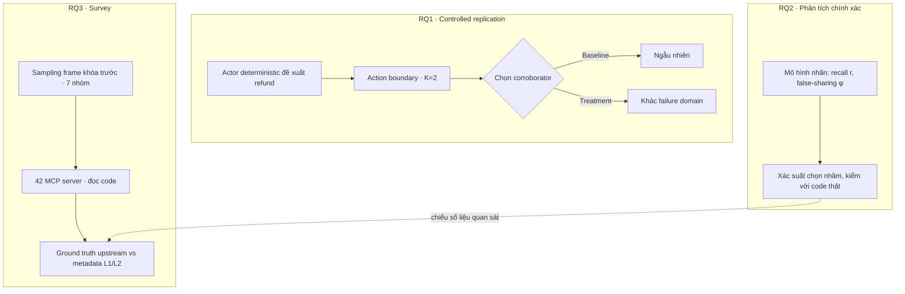

# Supervisor Briefing — RQ và Methodology (v1.0)

> [!purpose] Mục đích buổi review
> Xin giảng viên đánh giá **việc định vị lại đề tài**, ba **Research Question**, tính hợp lý của **methodology** và **mức contribution** cho một undergraduate paper. Tài liệu không yêu cầu kiểm tra từng test case, oracle hay từng server trong survey.

## 0. Điều gì thay đổi so với bản briefing trước

Ngày 2026-10-06, rà soát prior art tìm thấy **VP-Control** ([arXiv:2609.10969](https://arxiv.org/abs/2609.10969), nộp 2026-09-10). Công trình này đã đo, với thiết kế mạnh hơn (preregistration, live study, artifact công khai), đúng phần so sánh có kiểm soát trong RQ cũ: chọn nguồn đối chứng khác lineage giảm mạnh phê duyệt sai dưới lỗi chung nguyên nhân. Một công trình khác, **EFD** ([arXiv:2609.02925](https://arxiv.org/abs/2609.02925)), chứng minh về mặt cấu trúc rằng thêm reviewer không sửa được upstream chung.

Cả hai đều **giả định nhãn lineage có sẵn và đúng**, và tự nêu việc phát hiện lineage là giới hạn. Vì vậy tác giả quyết định:

- giữ nguyên RQ cũ (nay là **RQ1**) và số liệu, nhưng trình bày là **replication**, không phải phát hiện mới;
- chuyển đóng góp chính sang **chất lượng failure-domain metadata**: **RQ2** (điều kiện giải tích) và **RQ3** (survey metadata của tool thật).

**Cần nói thẳng:** RQ2 và RQ3 được thêm **sau** khi biết kết quả RQ1. RQ2 là phân tích post-hoc. RQ3 có protocol viết trước khi thu thập dữ liệu, nhưng sau khi đã biết kết quả của RQ2. Đây là điểm giảng viên nên cân nhắc khi đánh giá (xem Q2 ở §8).

## 1. Tóm tắt trong một phút

AI agent dùng tool có thể nhận output sai nhưng đúng schema. Hai tool khác tên có thể cùng đọc một database hoặc API, nên cùng trả một kết quả sai; kiểm tra chéo giữa chúng khi đó tạo ra sự đồng thuận giả. Chọn nguồn đối chứng thuộc **failure domain** khác giải quyết được vấn đề, **nếu biết** tool nào dùng chung nguồn. Bài hỏi: cần biết chính xác đến đâu, và trong thực tế ta biết được đến đâu?

- **RQ1:** trong mô phỏng refund có kiểm soát, chọn khác failure domain cho `0/150` quyết định refund sai, so với `30/150` khi chọn ngẫu nhiên. Đây là replication, kết quả phần lớn được suy ra từ topology.
- **RQ2:** metadata có ích khi và chỉ khi nó phát hiện phụ thuộc chung tốt hơn mức gán nhầm (`J = r − φ > 0`), và có thể **gây hại** khi `J < 0`. Kết quả này mới được kiểm tra bằng số, chưa có chứng minh.
- **RQ3:** trong 42 MCP server thật, 16% cặp cùng loại dùng chung nhà cung cấp. Metadata agent thấy **thiếu** ở 70% cặp nhưng hiếm khi **sai**. Ở mức nguồn dữ liệu gốc, tên provider bỏ sót khoảng 40% phụ thuộc, và nhóm web search không có nguồn độc lập nào.

## 2. Ba Research Question

### RQ1 — controlled replication

**RQ1. Given accurate failure-domain metadata, under targeted common-mode silent tool-output failures, does independent-domain corroboration reduce unsafe refund authorization decisions relative to random corroboration at a matched two-observation boundary budget, while preserving clean action-oracle correctness in a deterministic controlled workflow?**

Khi biết chính xác tool nào dùng chung failure domain, chọn nguồn đối chứng khác domain có giảm quyết định cho phép refund sai hơn chọn ngẫu nhiên không, với cùng hai observation mỗi lần đề xuất refund? Không đổi so với bản trước.

### RQ2 — điều kiện về chất lượng nhãn (post-hoc)

**RQ2. Under class-conditional failure-domain label errors, for which combinations of shared-dependency recall `r` and false-sharing rate `φ` does failure-domain-aware corroborator selection reduce, match, or increase the chance of selecting a shared-domain corroborator relative to random selection?**

Khi metadata có thể bỏ sót phụ thuộc chung (`r` thấp) hoặc gán nhầm nguồn độc lập là chung (`φ` cao), chọn theo failure domain khi nào tốt hơn, bằng, hay tệ hơn chọn ngẫu nhiên?

### RQ3 — metadata thực tế (survey)

**RQ3. Among open-source MCP servers that provide the same information type, how often do two servers share an upstream data provider, and how well does agent-visible metadata reveal that sharing?**

Trong các MCP server cùng cung cấp một loại thông tin, bao nhiêu cặp lấy dữ liệu từ cùng nhà cung cấp, và agent chỉ đọc tên cùng mô tả của tool có nhận ra điều đó không?

## 3. Methodology

Sơ đồ là phần tổng hợp của thiết kế. ^[inferred]

**RQ1 (không đổi).** 30 task đóng băng × 3 policy × 3 regime × 5 seed = 1.350 decision rows; outcome là unsafe refund decision và action-oracle correctness; paired task-cluster bootstrap. Kèm robustness 3.750 rows, negative control, counterfactual always-escalate, secondary exploratory và live-agent diagnostics. Không chạy LLM hay thực thi refund trong main study.

**RQ2 (post-hoc).** Hai mô hình nhãn:
- *nhiễu độc lập* (như robustness gate), liệt kê chính xác mọi trạng thái nhãn, kiểm tra với selector thật;
- *lỗi có hệ thống* (`r`, `φ`), tính chính xác và quét 2.205 điểm lưới trên 5 topology, kiểm tra bằng Monte Carlo độc lập.

Kèm **power analysis**: mô phỏng 300 study mỗi cỡ mẫu bằng chính code episode thật để biết robustness criterion có đủ power không.

**RQ3 (survey, protocol viết trước khi thu thập).**
- *Mẫu:* 7 nhóm thông tin; truy vấn GitHub cố định; danh sách 30 kết quả đầu được khóa bằng hash trước khi đọc code. Amendment A1 (trước khi đọc code) bổ sung một truy vấn cho hai nhóm quá ít kết quả. Sàng lọc theo thứ tự hạng, lấy 6 server đầu tiên đạt tiêu chí mỗi nhóm: 54 repo được xét, 42 được chọn.
- *Ground truth:* nhà cung cấp API mà code gọi theo cấu hình mặc định, ghim theo commit, có bằng chứng file và số dòng.
- *Metadata:* L1 là tên server, tên và mô tả tool (thứ agent thấy); L2 là L1 cộng README.
- *Đại lượng:* tỷ lệ cặp dùng chung (ρ), tỷ lệ thiếu nhãn (m), `r`, `φ`, `J` trên 105 cặp cùng nhóm, kèm bootstrap theo server.
- *Gán nhãn:* coder A là AI; coder B (thành viên nhóm, con người) gán độc lập 10 server để đo agreement. **Coder B chưa nộp.**
- *Độ nhạy post-hoc:* đo lại ở mức nguồn dữ liệu gốc, chỉ dùng liên kết có bằng chứng trong repo.

## 4. Evidence hiện có

| Evidence | Thiết kế | Kết quả chính | Được phép kết luận |
|---|---|---|---|
| RQ1 main study | 1.350 decision rows | Unsafe `30/150` vs `0/150`; Δ `−0.200`, CI `[−0.273, −0.127]`; correct refunds dưới fault `0/50` ở cả hai | Replication có điều kiện trong mô phỏng; containment, không recovery |
| Robustness | 3.750 decision rows | Nhãn sai 25%: CI chạm 0, **FAIL** | Không claim robust với metadata sai |
| Power (post-hoc) | 300 study mô phỏng mỗi cỡ | Power 56% ở 30 task, 83% ở 60 task | FAIL là bằng chứng yếu về việc lợi ích biến mất; FAIL giữ nguyên |
| RQ2 (post-hoc) | Phân tích chính xác, 2.205 điểm lưới | `J > 0` ⇔ tốt hơn random; `J < 0` ⇔ tệ hơn | Kiểm tra số, chưa chứng minh |
| RQ3 survey | 42 server, 105 cặp | ρ 0.16 `[0.075, 0.281]`; L1 thiếu nhãn 0.70; `r = 8/8`, `φ = 0/24`; **E1 không đạt** | Mô tả, AI-coded, chờ kiểm tra của người |
| RQ3 độ nhạy (post-hoc) | Mức nguồn gốc dữ liệu | `r` ≈ 0.61; web search không có cặp độc lập | Cận dưới/cận trên theo hai chiều sai lệch |
| Secondary, live agent | 1.056 rows; 16 live cells | Secondary tái dựng được từ schedule; live `0/4` matched pairs | Exploratory; không có live effect estimate |

## 5. Contribution có thể bảo vệ

### Claim được hỗ trợ

1. **Replication** độc lập của hiệu ứng nguồn độc lập trong miền refund, kèm utility, negative control và kết quả âm với nhãn sai.
2. **Điều kiện `J`** cho biết khi nào metadata failure-domain giúp hay hại, cùng giải thích power cho robustness FAIL.
3. **Bằng chứng mô tả về metadata thật:** dùng chung upstream có thật; metadata agent thấy chủ yếu thiếu hơn là sai; tên bên vận hành không đủ ở mức nguồn gốc; có nhóm không có nguồn độc lập.
4. **Hàm ý thực hành:** đưa tên nhà cung cấp và nguồn dữ liệu gốc vào mô tả tool; agent cần nhận ra khi không có nguồn độc lập.

### Claim không được dùng

- "Chúng tôi là người đầu tiên chứng minh nguồn độc lập tốt hơn nguồn chung." (VP-Control đã làm.)
- "Metadata thực tế là chính xác." (Chỉ ở mức bên vận hành, mẫu AI-coded; ở mức nguồn gốc `r ≈ 0.6`.)
- "Robustness thật ra là PASS." (FAIL giữ nguyên.)
- "Quy tắc `J` là định lý." (Chưa chứng minh.)
- "16% mọi cặp tool dùng chung backend." (Chỉ trong mẫu 42 MCP server.)
- "Live agent đã xác nhận phương pháp." (Không có live effect estimate.)

Danh sách đầy đủ: [[projects/reliable-tool-using-ai-agents/paper/claim-evidence-ledger]].

## 6. Điểm mạnh và điểm yếu

### Điểm mạnh

- Trung thực về prior art: tự phát hiện bị làm trước, định vị lại công khai, không giấu.
- Mỗi kết quả giải tích được kiểm tra với code thật bằng một phương pháp độc lập.
- Survey có sampling frame khóa bằng hash, amendment ghi trước khi đọc code, bằng chứng truy được tới file và dòng, và hai lỗi trong quá trình đã được sửa công khai.
- Kết quả trái kỳ vọng (E1) được báo là không đạt.
- Toàn bộ chạy offline, không tốn chi phí API.

### Điểm yếu

- **RQ2 và RQ3 được thêm sau khi biết kết quả RQ1**; RQ2 và độ nhạy theo nguồn gốc là post-hoc.
- Quy tắc `J` chưa có chứng minh hình thức.
- Survey do AI gán nhãn; agreement với người chưa có.
- Mẫu nhỏ: 42 server phổ biến trên GitHub, chỉ hệ sinh thái MCP; mẫu số của `r` ở L1 chỉ 8 cặp.
- Kết quả về selector trong survey là **phép chiếu** lên mô hình, không đo hành vi agent.
- RQ1 vẫn là mô phỏng quyết định, gần by-construction, không có live effect estimate.

## 7. Kế hoạch đến hạn nộp

| Thời gian | Việc |
|---|---|
| Khi coder B nộp | Tính agreement/kappa, cập nhật §5.10 và ledger |
| Tuần này | Tác giả đọc lại §1, §5.10, §6.4 của paper v1.0; tự đọc toàn văn VP-Control và EFD |
| Sau phản hồi của giảng viên | Chỉnh RQ, contribution và methodology theo góp ý; thêm hình cho survey |
| Tuần cuối | Định dạng theo template môn học, proofread, khóa snapshot nộp bài |

Tùy chọn, chỉ khi giảng viên thấy cần: một robustness study mới khoảng 60 task với protocol khóa trước (chỉ cần CPU, không tốn tiền). Không mở rộng live-agent experiment.

## 8. Bốn quyết định cần xin giảng viên

### Q1 — Việc định vị lại

Trình bày RQ1 là replication và chuyển đóng góp chính sang chất lượng metadata (RQ2, RQ3) có hợp lý cho môn học không?

- [ ] `APPROVE`
- [ ] `REVISE`
- [ ] `REJECT`
- Lý do/đề xuất:

### Q2 — Tính hợp lệ khi thêm RQ sau khi có kết quả

Việc thêm RQ2 và RQ3 sau khi biết kết quả RQ1, với nhãn post-hoc và protocol công khai cho survey, có chấp nhận được không, nếu được nói rõ trong Threats to Validity (§7.7)?

- [ ] Chấp nhận nếu disclosure rõ
- [ ] Cần thu hẹp thành một RQ chính
- [ ] Không chấp nhận
- Lý do/đề xuất:

### Q3 — Survey

Survey 42 server do AI gán nhãn, kèm một người gán độc lập 10 server, có đủ cho môn học không? Có cần mở rộng mẫu hoặc thêm người gán không?

- [ ] Đủ nếu limitations được nêu đúng
- [ ] Cần thêm người gán nhãn
- [ ] Cần mở rộng mẫu
- Lý do/đề xuất:

### Q4 — Trọng tâm paper

Paper nên nhấn mạnh phần nào nhất?

- [ ] Điều kiện `J` (RQ2)
- [ ] Bằng chứng về metadata thật (RQ3)
- [ ] Cả hai như hiện tại
- [ ] Khác:

## 9. Tài liệu nên đọc kèm

1. [[projects/reliable-tool-using-ai-agents/paper/paper-draft]] — paper v1.0; nên đọc §1, §5.8–5.10, §6.4, §7.7.
2. [[journal/2026-10-06-prior-art-refresh-vp-control-and-efd]] — lý do định vị lại và các phân tích RQ2.
3. [[journal/2026-10-09-real-tool-metadata-survey-results]] — kết quả survey.
4. [[synthesis/Protocol: Real-Tool Failure-Domain Metadata Survey]] — protocol và nhật ký khóa của survey.
5. [[projects/reliable-tool-using-ai-agents/paper/claim-evidence-ledger]] — ranh giới các claim.

## Trạng thái

**PRELIMINARY / MAJOR REVISION.** Paper v1.0 đã định vị lại sau prior art mới. Chưa có phản hồi của giảng viên, chưa có agreement của coder B, chưa có human sign-off. Mọi review trong hồ sơ là AI-assisted.
